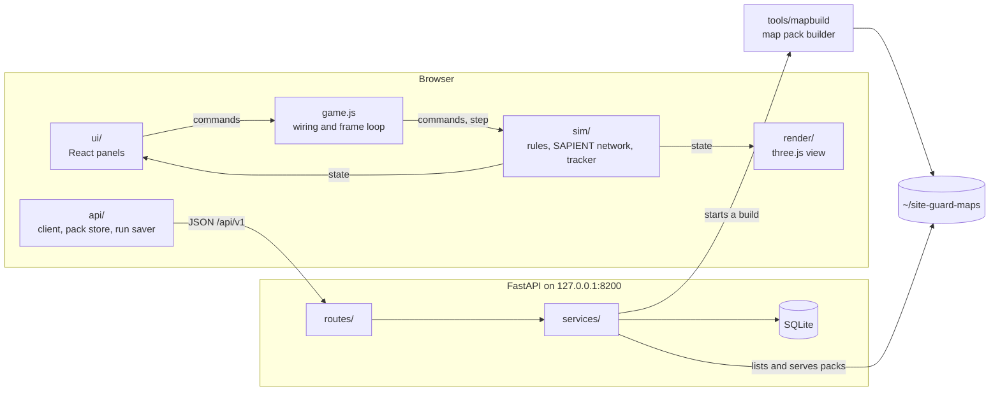

# Bombadil

Bombadil is a fork of Site Guard ([ShabalalaWATP/DroneGame](https://github.com/ShabalalaWATP/DroneGame)), with its own name and version (see `PRODUCT` in `frontend/src/sim/config/world.js`). It keeps Site Guard's rules version, so laydowns and runs saved in either replay the same.

A counter-drone defence game and command-and-control simulator. You place and network real sensors and weapons around a site you choose, then watch a fusion node detect, track and engage inbound drones using [SAPIENT](docs/SAPIENT.md) (BSI Flex 335 v2.0) messages.


## Contents

- [About this app](#about-this-app)
- [How this app works](#how-this-app-works)
- [Architecture and tech stack](#architecture-and-tech-stack)
- [How to run this app locally](#how-to-run-this-app-locally)
- [Documentation](#documentation)

## About this app

Bombadil puts you in charge of defending a site against small drones: first-person-view (FPV) strike drones, fibre-optic drones that emit no radio, fixed-wing strike drones, and the spotters that guide them. You have one fixed budget. Every radar, RF detector, camera, acoustic sensor, jammer, interceptor, missile, gun and laser costs money, and so does every shot. No single system handles every drone.

The heart of it is the gap between where drones really are and where your system believes they are. The fusion node is never told which drone a detection came from. It builds tracks from noisy, delayed and sometimes missing reports, so it can lag, merge two drones, or chase a ghost. A truth overlay shows both at once.

It is built for three uses:

- **Learning:** what each kind of counter-drone system does well and badly, and how a SAPIENT network passes detections, tasks and alerts.
- **Planning exercises:** trying a laydown on generated ground or on real British and Estonian terrain, with lidar heights for woods and buildings, against a chosen mix of generic and real drones.
- **Questioning the numbers:** every figure carries its source and confidence, and can be edited.

The figures come from public sources, mostly vendor claims and press reports, and many are labelled assumptions. This is a game and a teaching tool, not a model to base real decisions on.

## How this app works

A run goes like this. The [user guide](docs/USER_GUIDE.md) covers each step in full.

1. **Choose a world.** Generated ground from a seed, or a real map of Great Britain or Estonia built from open data ([maps](docs/MAPS.md)).
2. **Mark what you defend.** A power station by default, or any area you draw, or a foot patrol on a route ([patrol mode](docs/PATROL_MODE.md)).
3. **Build a laydown.** Place generic or real systems from the toolbar, or deploy a unit's kit from a deployment pack. Each system's range ring follows the real ground around it ([sensors](docs/SENSORS.md), [effectors](docs/EFFECTORS.md), [vehicles](docs/VEHICLES.md)).
4. **Network it.** Every system is a SAPIENT node, linked to the fusion node by Starlink or cellular. Links depend on the sky, the terrain, cell towers and your own jammers ([SAPIENT](docs/SAPIENT.md)).
5. **Check and rehearse.** Coverage maps show what the laydown sees of each drone, and the sandbox launches any attack without risk.
6. **Fight the waves.** The laydown locks. Drones fly in on routes and in formations; the fusion node associates detections into tracks, cues cameras, assigns weapons and asks for your approval if you set it to ([drones](docs/DRONES.md), [fusion and targeting](docs/FUSION_AND_TARGETING.md)).
7. **Review.** Pause and scrub back through the run, read every SAPIENT message with plain-English notes, count casualties among simulated people ([people](docs/PEOPLE.md)), and compare what you spent with what the attack cost.

Underneath, a deterministic simulation moves in fixed steps of 0.05 game seconds. Detection, propagation, jamming, hit chance and blast are physical models with published or labelled figures ([physics and propagation](docs/PHYSICS_AND_PROPAGATION.md)). The same seeds and laydown always give the same run, which is what makes replays and saved runs exact.

| | |
|---|---|
|  |  |
|  |  |

## Architecture and tech stack

The simulation runs in the browser, and the backend only stores and serves: it takes no part in live play, so a game keeps playing if the backend stops ([ADR 0001](docs/adr/0001-simulation-runs-in-the-browser.md)). Signing in is the exception ([ADR 0004](docs/adr/0004-local-accounts-with-recovery-codes.md)). Real map packs are built by a separate Python tool that the backend starts on request.



Three rules hold it together: the simulation has no DOM and no rendering, so a whole game runs in Node for tests; the view and panels only read simulation state, and every change goes through logged commands; and the simulation moves in fixed steps, so results never depend on frame rate. The full picture is in [ARCHITECTURE.md](docs/ARCHITECTURE.md), and the HTTP API in [API.md](docs/API.md).

| Layer | Technology | What it does here |
|---|---|---|
| Simulation | JavaScript (ES modules), no runtime dependencies | Rules, sensor and propagation models, Kalman filter tracking, SAPIENT messages. Runs in the browser or in Node |
| 3D view | [three.js](https://threejs.org) 0.186 | Terrain, systems, drones, tracks and range rings |
| Interface | [React](https://react.dev) 19, [Leaflet](https://leafletjs.com) 1.9 | Panels, the SAPIENT dock and the start screen's map |
| Build | [Vite](https://vite.dev) 8 | Development server and production bundle |
| Backend | Python 3.12+, [FastAPI](https://fastapi.tiangolo.com), Pydantic, Uvicorn | Accounts, saved data, map pack listing and builds, and serving the built game |
| Database | SQLite through Python's `sqlite3` | One local file with JSON columns ([ADR 0002](docs/adr/0002-sqlite-with-json-columns.md)) |
| Map builder | Python 3.12+, NumPy, rasterio, pyproj, Shapely, pyogrio | Turns open height, lidar, map and satellite data into `.sgmap` packs |
| Tests | [Vitest](https://vitest.dev), Testing Library, jsdom, pytest, pytest-cov | Simulation, UI, API and builder tests, plus reference runs that pin down behaviour |
| Tooling | npm, [uv](https://docs.astral.sh/uv/) | Pinned dependencies with lockfiles |

## How to run this app locally

You need [Node.js](https://nodejs.org) 22.12 or later and [uv](https://docs.astral.sh/uv/), which installs a suitable Python by itself. From the project folder:

```bash
npm --prefix frontend ci
```

```bash
npm --prefix frontend run build
```

```bash
uv --directory backend run --no-dev python -m app
```

Then open <http://localhost:8200> and press **Create account**. The first two commands are only needed once, or again after changing the frontend. The app runs entirely on your machine and is reachable only from this computer. It works offline, apart from the live map styles, which you can turn off.

To work on the code, run the backend as above and the Vite development server in a second terminal; the game is then at <http://localhost:5199> and reloads as you edit:

```bash
npm --prefix frontend run dev
```

Real maps are optional. Packs you build are kept in `~/site-guard-maps`, and packs you import are kept in the browser. Building one downloads open data, often several GB the first time in an area, so check the sizes in [MAPS.md](docs/MAPS.md) first. Saved data lives in `backend/data/siteguard.db`. Tests, reference runs and conventions are in [DEVELOPING.md](docs/DEVELOPING.md).

## Documentation

**Using it**

| Document | What it covers |
|---|---|
| [User guide](docs/USER_GUIDE.md) | Every step of a run, deployment packs, people, patrols and keys |
| [Maps](docs/MAPS.md) | Map types, real maps and generated ground, building and installing packs, grids, data sources, privacy |
| [Patrol mode](docs/PATROL_MODE.md) | Defending soldiers on the move instead of a site |
| [Glossary](docs/GLOSSARY.md) | Terms and abbreviations |

**The models and the inventory**

| Document | What it covers |
|---|---|
| [Physics and propagation](docs/PHYSICS_AND_PROPAGATION.md) | Radar, RF, optical and acoustic detection, terrain and line of sight, jamming, weather, flight, hit chance, blast |
| [Drones](docs/DRONES.md) | Every threat drone, its figures, behaviour, waves and sources |
| [Sensors](docs/SENSORS.md) | Every sensor, generic and real, with figures and sources |
| [Effectors](docs/EFFECTORS.md) | Jammers, interceptors, missiles, guns and lasers, with magazines and costs |
| [Vehicles](docs/VEHICLES.md) | Vehicles, mounts, masts, crews and mobility |
| [People](docs/PEOPLE.md) | Simulated people, crews, protection and casualties |
| [Paint sources](docs/PAINT_SOURCES.md) | Where each 3D model's colours come from |

**The network and the fusion engine**

| Document | What it covers |
|---|---|
| [SAPIENT](docs/SAPIENT.md) | The BSI Flex 335 messages, nodes, tasking and how closely the game follows the standard |
| [Fusion and targeting](docs/FUSION_AND_TARGETING.md) | Tracking, classification, threat evaluation, automatic weapon assignment, and measured results |

**Engineering**

| Document | What it covers |
|---|---|
| [Architecture](docs/ARCHITECTURE.md) | Layers, the frame loop, determinism, replay, persistence, the backend and the builder |
| [API](docs/API.md) | Every backend route, its limits and errors |
| [Developing](docs/DEVELOPING.md) | Setup, the three test suites, reference digests, conventions, adding systems and drones |
| [Decision records](docs/adr/) | Why the simulation runs in the browser, SQLite with JSON, the terrain path model, local accounts |

**Assurance**

| Document | What it covers |
|---|---|
| [Secure by Design](docs/SECURE_BY_DESIGN.md) | How the app follows Secure by Design principles, with evidence and gaps |
| [Security notes](docs/SECURITY_NOTES.md) | The detailed register of security decisions and accepted risks |
| [Accessibility](docs/ACCESSIBILITY.md) | Where the app stands against WCAG 2.2 AA, and what is missing |

**Project history**

| Document | What it covers |
|---|---|
| [Development story](docs/DEVELOPMENT_STORY.md) | How the app was built, in order |
| [Implementation plan](docs/MASTER_IMPLEMENTATION_PLAN.md) | The plan and its progress |
| [Real mapping plan](docs/REAL_MAPPING_PLAN.md) | How real maps were planned and measured |
| [To do](docs/TODO.md) | Known work still open |
