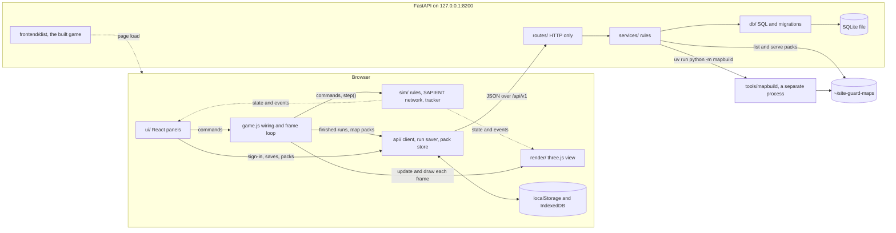
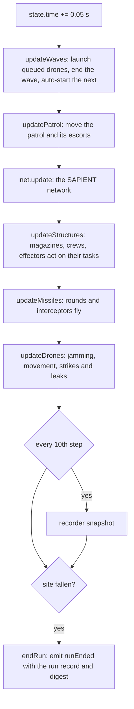

# Architecture

How Site Guard is put together: the layers and the rules between them, the frame loop and the fixed simulation step, why a run replays exactly, how the interface reads state, how a world is built, what is stored where, the backend and the separate map builder. It is for developers changing the code, and for anyone who wants to know how far a saved result can be trusted.

## Contents

- [The layers](#the-layers)
- [Rules between the layers](#rules-between-the-layers)
- [Start-up](#start-up)
- [The frame loop and the fixed step](#the-frame-loop-and-the-fixed-step)
- [Inside one step](#inside-one-step)
- [Determinism](#determinism)
- [Reference digests](#reference-digests)
- [Recording and replay](#recording-and-replay)
- [How the interface reads state](#how-the-interface-reads-state)
- [How a world is chosen and built](#how-a-world-is-chosen-and-built)
- [Persistence](#persistence)
- [The backend](#the-backend)
- [The map builder](#the-map-builder)
- [Decision records](#decision-records)
- [Limits and simplifications](#limits-and-simplifications)
- [Where this lives in the code](#where-this-lives-in-the-code)

## The layers

The game runs in the browser. The backend stores and serves, and takes no part in live play ([ADR 0001](adr/0001-simulation-runs-in-the-browser.md)), except that signing in needs it ([ADR 0004](adr/0004-local-accounts-with-recovery-codes.md)).

| Layer | Folder | What it does |
|---|---|---|
| Simulation | [`frontend/src/sim/`](../frontend/src/sim/) | The rules: terrain, sensors, drones, effectors, the [SAPIENT](SAPIENT.md) network and the tracker. No DOM and no rendering, so a whole game runs in Node for tests and balance work |
| Game wiring | [`game.js`](../frontend/src/game.js), [`tools.js`](../frontend/src/tools.js), [`zone.js`](../frontend/src/zone.js), [`patrol-draw.js`](../frontend/src/patrol-draw.js), [`drag.js`](../frontend/src/drag.js) | Joins the simulation to the view and runs the frame loop. Holds view-only state: the picked tool, the next placement's settings, the area being drawn |
| Rendering | [`frontend/src/render/`](../frontend/src/render/) | The three.js scene. Reads simulation state each frame and draws it |
| Interface | [`frontend/src/ui/`](../frontend/src/ui/) | React panels, the login page and profile, the wizard and the dock. Canvas diagrams inside the dock |
| API client | [`frontend/src/api/`](../frontend/src/api/) | Talks to the backend, keeps finished runs safe while it is down, and reads, checks and keeps map packs |
| Backend | [`backend/app/`](../backend/app/) | FastAPI and SQLite. Accounts, deployment packs, laydowns, runs, figure sets, map pack files and pack builds. Serves the built game |
| Map builder | [`tools/mapbuild/`](../tools/mapbuild/) | A separate Python program that builds real-world map packs from open data. The backend starts it as its own process |

## Rules between the layers

**The simulation imports only itself, and only `Vector3` from three.js.** It never touches the DOM, the view, the interface or the API client. [`boundary.test.js:14`](../frontend/tests/boundary.test.js#L14) fails if any file under `sim/` names `document`, `window`, `requestAnimationFrame`, `innerWidth` or `localStorage`, imports from a path matching `render`, `/ui/` or `react`, or imports anything from three.js but `{ Vector3 }`. The test does not list `api/`, so I checked by search on 2026-11-09: every import under `sim/` is a relative path inside `sim/`, apart from four `import { Vector3 } from 'three'` lines ([`drones.js:3`](../frontend/src/sim/drones.js#L3), [`effectors.js:3`](../frontend/src/sim/effectors.js#L3), [`jamming.js:10`](../frontend/src/sim/jamming.js#L10), [`laydown.js:4`](../frontend/src/sim/laydown.js#L4)).

**The simulation has three surfaces** ([`simulation.js:1`](../frontend/src/sim/simulation.js#L1)): `commands`, which change the game and are logged by step; `state` and the collections (drones, structures, missiles, people, tracks), which the view and panels read; and `on(event, fn)`, for moments such as `toast`, `siteHit`, `gameOver`, `reset`, `terrain` and `runEnded`.

**Rendering does not import the interface** ([`boundary.test.js:30`](../frontend/tests/boundary.test.js#L30)). It reads the simulation and never changes it ([`game-view.js:1`](../frontend/src/render/game-view.js#L1)). That second rule is a convention: no test enforces it.

**The interface changes the game only through `game.commands`.** It reads simulation state directly while rendering. It may read and set view state in [`render/view.js`](../frontend/src/render/view.js#L6) (truth overlay, labels, selection, the map style, the player's position), which changes the picture but never a run. No file under `ui/` may build HTML from strings ([`boundary.test.js:39`](../frontend/tests/boundary.test.js#L39)).

**Hand-written source files stay within 350 lines.** [`boundary.test.js:47`](../frontend/tests/boundary.test.js#L47) checks every `.js` and `.jsx` file under `frontend/src`. See [DEVELOPING.md](DEVELOPING.md#conventions) for what it does not cover.

## Start-up

1. [`main.jsx:10`](../frontend/src/main.jsx#L10) reads `?seed=` and `?terrain=` from the address, cleans them to at most 64 characters with no control characters ([`game.js:27`](../frontend/src/game.js#L27)), and calls `createGame`. If `terrain` holds a real-world id, the page starts on generated ground with terrain seed `1` instead ([`main.jsx:12`](../frontend/src/main.jsx#L12)): the pack is not loaded yet, and a site does not belong in an address.
2. `createGame` ([`game.js:32`](../frontend/src/game.js#L32)) makes the simulation, the run saver, the pack store and the tool state.
3. [`Root.jsx`](../frontend/src/ui/account/Root.jsx#L32) shows the login page until `GET /api/v1/auth/me` succeeds, then the profile hub, then the game. The game mounts once and stays mounted behind the profile screen.
4. [`App.jsx:22`](../frontend/src/ui/App.jsx#L22) puts the canvas in the page and calls `game.attach`, which builds the three.js scene and starts the frame loop ([`game.js:270`](../frontend/src/game.js#L270)).
5. `pagehide` calls `game.pageClosing` ([`main.jsx:14`](../frontend/src/main.jsx#L14)), which ends a run still going and keeps it in the browser to save later.

## The frame loop and the fixed step

The simulation moves in fixed steps of 0.05 game seconds (`SIM_STEP`, [`simulation.js:29`](../frontend/src/sim/simulation.js#L29)). The frame loop ([`game.js:251`](../frontend/src/game.js#L251)) runs on every animation frame:

1. It takes the real time since the last frame, capped at 0.05 s ([`game.js:252`](../frontend/src/game.js#L252)).
2. If a run is under way and not paused, it adds real time x `WORLD.timeScale` (5 game seconds per real second, [`world.js:19`](../frontend/src/sim/config/world.js#L19)) x the chosen speed to an accumulator, then runs whole steps until the accumulator is under one step, at most 400 in a frame ([`game.js:256`](../frontend/src/game.js#L256)). At 1x that is 100 steps per real second. The fastest speed offered is 10x ([`SpeedControl.jsx:8`](../frontend/src/ui/SpeedControl.jsx#L8)), so a capped frame asks for at most 50 steps and the 400 guard does not bite in normal play.
3. It updates the scene, the replay view and the placement preview, then draws, unless the profile screen covers the game ([`game.js:264`](../frontend/src/game.js#L264)).
4. It refreshes the panels at most every 100 ms, and only if steps ran, the player moved the mouse or pressed a key, or a replay is playing ([`game.js:266`](../frontend/src/game.js#L266)).

Because the step is fixed, a slow machine or a high speed changes how fast the game runs, not what happens in it. A frame longer than 0.05 s counts as 0.05 s, so on a slow machine game time falls behind the wall clock rather than taking larger steps.

The clock stops by itself when the fusion node asks the operator to approve an engagement ([`game.js:215`](../frontend/src/game.js#L215)), and while the player rewinds (`reviewClock`, [`game.js:223`](../frontend/src/game.js#L223)).

## Inside one step

`step()` ([`simulation.js:83`](../frontend/src/sim/simulation.js#L83)) always runs in this order:

The SAPIENT network runs third, before any weapon acts. `net.update` ([`network/index.js:35`](../frontend/src/sim/network/index.js#L35)) delivers messages whose delay has passed, lets each sensor scan on its own interval, sends status reports every `FUSION.statusInterval` (5 s), keeps the tracks, expires unanswered approval requests, confirms kills, raises alerts, sends fused reports to the operator, and re-runs tasking every `FUSION.taskInterval` (1 s) ([`world.js:85`](../frontend/src/sim/config/world.js#L85)). Effectors only act on a task once its message has arrived. Every message goes through the bus in [`sapient.js`](../frontend/src/sim/sapient.js#L131), which keeps at most the newest 5,000 for the dock. The messages, registration and tasking are described in [SAPIENT.md](SAPIENT.md); tracking, threat evaluation and weapon assignment in [FUSION_AND_TARGETING.md](FUSION_AND_TARGETING.md).

## Determinism

The same scenario seed, world and laydown, with the same commands at the same steps, give the same run to the last message. This holds because:

- **No unseeded randomness.** Everything that affects the simulation draws from seeded generators in [`rng.js`](../frontend/src/sim/rng.js#L1): Mulberry32 seeded by an FNV-1a hash of a text key. Cosmetic effects in `render/` use `Math.random`, which cannot reach the rules.

  | Stream | Seeded from | Used for |
  |---|---|---|
  | `sim` | `<seed>:sim` ([`rng.js:29`](../frontend/src/sim/rng.js#L29)) | Sensor noise, hit rolls and other chance during play |
  | `ids` | `<seed>:ids` | SAPIENT message and node ids |
  | Wave | `<seed>:wave:<n>` ([`rng.js:35`](../frontend/src/sim/rng.js#L35)) | Each wave's contents, rolled when it starts, so they do not depend on when that is |
  | Terrain | `<terrain seed>:terrain` ([`terrain.js:61`](../frontend/src/sim/terrain.js#L61)) | Generated ground |
  | Masts | `<world>:masts` ([`world-pack.js:112`](../frontend/src/sim/world-pack.js#L112)) | Cell towers on a real map, which open data does not list |
  | People | `people:<x>:<z>` and `<seed>:blast:<drone>` ([`people.js:41`](../frontend/src/sim/people.js#L41), [`people.js:133`](../frontend/src/sim/people.js#L133)) | Where people stand and who a blast hurts, so people never shift the other streams |

- **A fixed step and a fixed epoch.** Steps are always 0.05 s, and message timestamps count from 2026-01-01 00:00 UTC ([`rng.js:47`](../frontend/src/sim/rng.js#L47)), not the wall clock.
- **Every input is a logged command.** The `logged` wrapper ([`simulation.js:186`](../frontend/src/sim/simulation.js#L186)) records each command as `{ step, name, args }`, with any placed system replaced by `{ node: <its SAPIENT node id> }`. Figure edits from the Sources tab, the engagement authority, approvals and jammer bands are all commands. Speed, pausing, selection, camera and map style are not, and cannot change a run.
- **The first wave starts from a clean rebuild.** `beginRun` ([`simulation.js:119`](../frontend/src/sim/simulation.js#L119)) resets the run, re-seeds every stream and rebuilds the laydown, so time spent building cannot affect it. It then logs the authority, auto-start and deployment pack at step 0 so the log alone can reproduce the run. Time between later waves is an operator input: it changes the noise, and the log captures it ([`simulation.js:117`](../frontend/src/sim/simulation.js#L117)).
- **Reset re-seeds too** ([`simulation.js:111`](../frontend/src/sim/simulation.js#L111)), and so does choosing a new seed or a real world before deploying ([`simulation.js:170`](../frontend/src/sim/simulation.js#L170)).

## Reference digests

`digest()` ([`simulation.js:241`](../frontend/src/sim/simulation.js#L241)) is a 32-bit FNV-1a hash, in hex, over every SAPIENT message still kept on the bus plus the headline numbers: kills, health, budget, leaks, game time, the message count and the ledger. Some ledger fields added later are left out on purpose so that older digests still match. People's casualties and the patrol's state are added only when there are people or a patrol, so runs without them hash as before.

Five scripted runs in [`scenarios.js:11`](../frontend/tests/support/scenarios.js#L11) play fixed laydowns for four to eight waves on seeds 1, 7 and 42. Their digests and results are pinned in [`reference-digests.json`](../frontend/tests/support/reference-digests.json), and [`reference.test.js:7`](../frontend/tests/reference.test.js#L7) fails on any difference. A second test ([`reference.test.js:13`](../frontend/tests/reference.test.js#L13)) checks that idle time before the first wave and the order systems were placed in do not change a digest. How to print, compare and re-record them is in [DEVELOPING.md](DEVELOPING.md#reference-digests).

## Recording and replay

There are two kinds of replay.

**Rewinding in the game.** The recorder ([`recorder.js`](../frontend/src/sim/recorder.js#L1)) takes a snapshot every 10 steps (0.5 game seconds) of every drone, track, missile and system, and keeps the last 7,200 (one hour of game time). A system doing the same as at the last snapshot shares that entry, so memory grows with changes, not frames. It also keeps a list of events (launches, kills, leaks, confirmations) for the timeline markers. The replay view ([`replay-view.js`](../frontend/src/render/replay-view.js#L1)) hides the live objects and draws a snapshot instead. Rewinding is for looking: the simulation is not rolled back, and "Live" returns to where the run had got to.

**Reproducing a saved run.** When a run ends, however it ends, the simulation emits one run record ([`run-record.js:10`](../frontend/src/sim/run-record.js#L10)): the scenario seed, the world, the laydown and figures it started with, the command log with a final `endRun` marking where it stopped, `GAME_VERSION`, the digest and the headline results. [`replay.js:9`](../frontend/tests/support/replay.js#L9) puts a record back through a fresh simulation (figures, step-0 settings, laydown, then each command at its step) and the tests check that it reaches the same digest ([`saving.test.js:117`](../frontend/tests/saving.test.js#L117)). The game itself does not offer this: the Runs tab lists and deletes saved runs.

## How the interface reads state

React never owns game state ([`game.js:1`](../frontend/src/game.js#L1)). The game keeps a tick counter and a set of subscribers ([`game.js:37`](../frontend/src/game.js#L37)). A "bump" adds one to the tick and calls them.

- Components call `useTick()` ([`hooks.js:12`](../frontend/src/ui/hooks.js#L12)), which uses React's `useSyncExternalStore` on the tick, then read `game.sim.state` and the collections directly as they render. A hidden component passes `false` and stops refreshing.
- Every command the interface sends bumps at once ([`game.js:44`](../frontend/src/game.js#L44)), so a control never lags a click.
- The frame loop bumps at most every 100 ms while something can change, as above. Paused or idle, nothing re-renders.
- The `gameOver`, `sandbox` and `reset` events bump too.
- Canvas diagrams in the dock (network, plan, spectrum) draw on animation frames through `useAnimation` ([`hooks.js:18`](../frontend/src/ui/hooks.js#L18)) while their tab is open, some no more often than every 200 or 300 ms.
- The three.js scene is not React at all: [`game-view.js:228`](../frontend/src/render/game-view.js#L228) syncs it from the simulation every frame.

## How a world is chosen and built

A world is named by one string, saved with laydowns and runs.

- **Generated ground.** Any terrain seed, such as `3`. `generateTerrain` ([`terrain.js:54`](../frontend/src/sim/terrain.js#L54)) builds a square 54 km across (`WORLD.radius` 27,000 m, [`world.js:13`](../frontend/src/sim/config/world.js#L13)) on a 20 m grid (`TERRAIN.cell`, [`world.js:44`](../frontend/src/sim/config/world.js#L44)): heights, tree canopy, buildings, cover, power lines and cell towers. It keeps the last world it made, because a restart asks for the same ground and making it takes seconds.
- **A real map.** An id of the form `pack:<32 hex>:<easting>:<northing>:real` ([`world-pack.js:9`](../frontend/src/sim/world-pack.js#L9)): the first 32 hex digits of the pack's grid fingerprint and the site on the national grid. The pack must be loaded first. The pack store ([`pack-store.js:126`](../frontend/src/api/pack-store.js#L126)) lists packs on the server and packs imported into this browser, fetches one, and checks the whole file before use ([`decodePack`](../frontend/src/api/pack-store.js#L48), then [`parsePack`](../frontend/src/sim/world-pack.js#L31)). `game.loadPack` registers it with the simulation ([`game.js:65`](../frontend/src/game.js#L65)). `cutWorld` ([`world-pack.js:88`](../frontend/src/sim/world-pack.js#L88)) then cuts a 54 km square around the site, snapped to a 20 m post, with heights relative to the site and features moved to match. A site too near the pack's edge or on water is refused ([`world-pack.js:70`](../frontend/src/sim/world-pack.js#L70)).

Both kinds go through [`makeWorld`](../frontend/src/sim/world.js#L42), which wraps the grids with the questions the rules ask: ground height, line of sight, canopy, buildings and slope. The start card calls `commands.deploy(seed, world)` ([`simulation.js:170`](../frontend/src/sim/simulation.js#L170)), which swaps the world, re-seeds and restarts the network when a real map is involved, and emits `terrain`, on which the view rebuilds the ground mesh and its picture ([`game-view.js:214`](../frontend/src/render/game-view.js#L214)). A saved laydown loads on its own world, after `game.ensureWorld` has found and loaded its pack ([`game.js:72`](../frontend/src/game.js#L72)). Map types, pack contents and how they are built are in [MAPS.md](MAPS.md).

## Persistence

| What | Where | Lifetime |
|---|---|---|
| Accounts, sessions, deployment packs | SQLite tables `users`, `sessions`, `units` ([`0002_accounts.sql`](../backend/app/db/migrations/0002_accounts.sql)) | Until deleted. Packs belong to one account |
| Laydowns, runs, figure sets | SQLite tables `laydowns`, `runs`, `figure_sets` ([`0001_initial.sql`](../backend/app/db/migrations/0001_initial.sql)) | Until deleted. Shared by every account on the computer |
| The database file | `backend/data/siteguard.db`, or `SITE_GUARD_DB` ([`main.py:27`](../backend/app/main.py#L27)) | Git ignores it |
| Finished runs not yet saved | `localStorage` key `site-guard.unsaved-runs`, at most 50 ([`run-saver.js:6`](../frontend/src/api/run-saver.js#L6)) | Until the server accepts or refuses each one |
| The deployed pack | `localStorage` key `site-guard.deployed-pack`, `{ username, id }` ([`Root.jsx:15`](../frontend/src/ui/account/Root.jsx#L15)) | Restored on reload for the same user only |
| The start screen's map style | `localStorage` key `site-guard-start-map` ([`site-map.js:20`](../frontend/src/ui/site-map.js#L20)) | A convenience |
| Imported map packs | IndexedDB database `site-guard-packs`, store `packs`, keyed by fingerprint ([`pack-store.js:11`](../frontend/src/api/pack-store.js#L11)) | Kept in this browser, with persistent storage requested |
| Map packs and the data they are built from | `~/site-guard-maps`, or `SITE_GUARD_MAPS`: `packs/`, `os/`, `estonia/` ([`services/packs.py:45`](../backend/app/services/packs.py#L45)) | Files on disk. `*.sgmap` is git-ignored |
| The built game | `frontend/dist` ([`main.py:28`](../backend/app/main.py#L28)) | Rebuilt by `npm run build` |
| Snapshots, the message bus, figure edits not saved as a set | Memory only | Lost on reload |

Every browser storage call is wrapped, so blocked or full storage never stops the game. Where it would lose something that matters, a run that cannot be kept or a pack that cannot be imported, the game says so. The game also offers files to download: a figure set as JSON (Sources tab), the kept messages as newline-delimited JSON (Messages tab), and a map pack as `.sgmap` (start screen).

The run saver ([`run-saver.js`](../frontend/src/api/run-saver.js#L1)) copies every finished run to `localStorage` before sending it, removes the copy once the server answers, and keeps it if the server is down or the player is signed out. Kept runs are sent again when a save succeeds or someone signs in. A run can be saved twice if the page closes after the server stored it but before the answer arrived; that is a known `shortcut:` ([`run-saver.js:4`](../frontend/src/api/run-saver.js#L4)), chosen because a duplicate can be deleted and a lost run cannot be recovered.

## The backend

FastAPI on `127.0.0.1:8200` ([`__main__.py:9`](../backend/app/__main__.py#L9)), in layers:

| Layer | Files | Responsibility |
|---|---|---|
| Assembly | [`main.py`](../backend/app/main.py#L31) | Builds the app, includes the routers, maps service exceptions to status codes, mounts the built game, adds the middleware |
| Middleware | [`security.py`](../backend/app/security.py#L1) | Host check, JSON-only writes, a 1 MiB body cap and security headers |
| Routes | [`routes/`](../backend/app/routes/) | HTTP only: parse, call a service, return. `auth.py` also holds `signed_in`, the session check |
| Schemas | [`schemas.py`](../backend/app/schemas.py#L1), [`account_schemas.py`](../backend/app/account_schemas.py#L1) | The trust boundary. Pydantic models that refuse unknown fields, non-finite numbers and anything over its limits |
| Services | [`services/`](../backend/app/services/) | The rules: records are immutable runs or replaceable laydowns, account hashing, sessions and lockout, the pack limit per account, pack listing and the build job |
| Stores | [`db/stores.py`](../backend/app/db/stores.py#L1), [`db/account_stores.py`](../backend/app/db/account_stores.py#L1) | All the SQL, with bound parameters only |
| Migrations | [`db/connection.py`](../backend/app/db/connection.py#L28), [`db/migrations/`](../backend/app/db/migrations/) | Numbered SQL files, tracked with `PRAGMA user_version`, each applied whole or not at all |

The record services in [`records.py`](../backend/app/services/records.py#L30) depend on small `Protocol` store interfaces. The account and unit services take the SQLite store classes directly. Each request opens its own SQLite connection and closes it afterwards ([`routes/api.py:21`](../backend/app/routes/api.py#L21)). The schema checks shapes and coarse bounds; the game clamps values to each system's own limits when it loads a laydown. Every route and its rules are in [API.md](API.md); the security reasoning is in [SECURITY_NOTES.md](SECURITY_NOTES.md) and [SECURE_BY_DESIGN.md](SECURE_BY_DESIGN.md).

## The map builder

The map builder is its own uv project with its own dependencies (numpy, pyogrio, pyproj, rasterio, shapely, [`pyproject.toml`](../tools/mapbuild/pyproject.toml)), so none of them are loaded into the backend. It can be run by hand, or started by `POST /api/v1/packs/build`: `PackBuilder` ([`services/packs.py:146`](../backend/app/services/packs.py#L146)) runs `uv run --quiet --frozen --directory tools/mapbuild python -m mapbuild` with fixed arguments built from two validated integers ([`services/packs.py:170`](../backend/app/services/packs.py#L170)), one build at a time within daily, disk and time limits ([API.md](API.md#map-packs-and-builds)), and reports the last line it printed as the build's status. The finished `.sgmap` file lands in the maps folder's `packs/`, where the backend lists and serves it and the browser checks it before use. The builder, its inputs and its outputs are described in [MAPS.md](MAPS.md).

Some values must match across the game, the backend and the builder, which cannot import each other. Tests read the other programs' source to catch drift; see [DEVELOPING.md](DEVELOPING.md#values-copied-between-programs).

## Decision records

| ADR | Decision | Why, in brief |
|---|---|---|
| [0001](adr/0001-simulation-runs-in-the-browser.md) | The simulation stays in JavaScript in the browser; FastAPI only stores and serves | A server rewrite would have cost about 2,000 lines and the reference runs, added lag for one player, and made replay harder. Consequence: results are not proof of a score. Revisit for multiplayer, real SAPIENT hardware or tamper-proof scores |
| [0002](adr/0002-sqlite-with-json-columns.md) | One SQLite file through the standard library, game data in JSON columns, numbered SQL migrations | Parameters change without a migration, there is no server to run, and few dependencies. Pydantic validates the JSON. Revisit if several users need to write at once |
| [0003](adr/0003-range-from-a-terrain-path-model.md) | One terrain path model ([`propagation.js`](../frontend/src/sim/propagation.js#L1)) for radar, RF detection and jamming, used by both the range prediction and live detection | A prediction cannot disagree with play. Ray tracers and ITM were too heavy for the browser. See [PHYSICS_AND_PROPAGATION.md](PHYSICS_AND_PROPAGATION.md) |
| [0004](adr/0004-local-accounts-with-recovery-codes.md) | Local accounts with scrypt hashes, an `HttpOnly`, `SameSite=Strict` session cookie storing only a SHA-256 of the token, and a recovery code instead of email | Works offline with no new dependency. Only deployment packs belong to an account; saves stay shared. The cookie is not `Secure` because the game is served over plain http on localhost |

ADR 0002 says all SQL is in `db/stores.py` and that there are three tables. Since accounts were added there are six tables, and the account SQL is in `db/account_stores.py`.

## Limits and simplifications

- **One simulation at a time.** The message bus, its clock, the terrain and the random streams are module-level singletons ([`simulation.js:31`](../frontend/src/sim/simulation.js#L31)). Two simulations in one page or Node process would share them.
- **Results come from the browser.** The backend stores whatever digest and results it is sent and never replays a run, so a saved score is not proof ([ADR 0001](adr/0001-simulation-runs-in-the-browser.md)).
- **Exact replay assumes the same JavaScript engine.** ECMAScript leaves functions such as `Math.sin` and `Math.log` implementation-approximated, so a run is only guaranteed to replay bit for bit on the same engine. The reference digests are produced in Node. Replay across different browsers has not been tested.
- **The digest is a 32-bit hash** over the messages still kept (the newest 5,000 at most) and the headline numbers. It is a fingerprint for spotting change, not a proof.
- **The boundary test reads single-line static imports** at the start of a line. A multi-line import statement or a dynamic `import()` would pass it unchecked. Rendering's read-only rule is not tested at all.
- **Rewind covers the last hour of game time** and does not roll back the simulation. Reproducing a saved run from its log exists only in the tests.
- **A saved record carries `GAME_VERSION`.** A laydown from another version still loads, with a warning that it may not play the same. Old runs are not migrated.
- **No automated browser test.** `render/` is outside the coverage measure ([`vitest.config.js:10`](../frontend/vitest.config.js#L10)) and is checked by hand in a browser.

## Where this lives in the code

- [`frontend/src/main.jsx`](../frontend/src/main.jsx): reads the address, creates the game, mounts the login gate.
- [`frontend/src/game.js`](../frontend/src/game.js): wiring, the frame loop, ticks and bumps, run saving and pack loading.
- [`frontend/src/sim/simulation.js`](../frontend/src/sim/simulation.js): the step, commands and their log, reset, deploy and the digest.
- [`frontend/src/sim/rng.js`](../frontend/src/sim/rng.js): seeded random streams and the fixed epoch.
- [`frontend/src/sim/recorder.js`](../frontend/src/sim/recorder.js) and [`run-record.js`](../frontend/src/sim/run-record.js): snapshots, events and the saved run record.
- [`frontend/src/sim/world.js`](../frontend/src/sim/world.js), [`terrain.js`](../frontend/src/sim/terrain.js) and [`world-pack.js`](../frontend/src/sim/world-pack.js): the world, generated ground and real maps.
- [`frontend/src/sim/network/index.js`](../frontend/src/sim/network/index.js): the SAPIENT network's update within a step.
- [`frontend/src/render/game-view.js`](../frontend/src/render/game-view.js) and [`view.js`](../frontend/src/render/view.js): the scene and the shared view state.
- [`frontend/src/ui/hooks.js`](../frontend/src/ui/hooks.js) and [`App.jsx`](../frontend/src/ui/App.jsx): how React reaches the game.
- [`frontend/src/api/`](../frontend/src/api/): the backend client, run saver and pack store.
- [`backend/app/`](../backend/app/): the backend, by layer as above.
- [`tools/mapbuild/mapbuild/__main__.py`](../tools/mapbuild/mapbuild/__main__.py): the map builder's entry point.
- [`frontend/tests/boundary.test.js`](../frontend/tests/boundary.test.js), [`reference.test.js`](../frontend/tests/reference.test.js) and [`support/`](../frontend/tests/support/): the structure and determinism checks.
