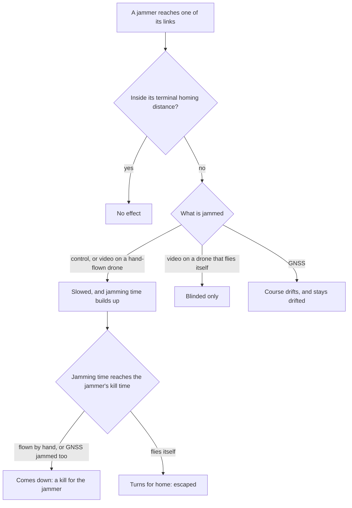

# Drones: the threat inventory

This document lists every drone Site Guard can send against you: the four generic types the waves are built from, and the 31 real drones from public sources that can take their place. It gives each drone's figures, how it flies, what it goes for, how it reacts to jamming and fire, how the waves grow, and where each figure comes from. It is written for a defence reader who wants to know what the numbers mean and how far to trust them, and for a developer who wants to change them.

## Contents

- [How to read the figures](#how-to-read-the-figures)
- [The four generic types](#the-four-generic-types)
- [How a drone flies](#how-a-drone-flies)
- [What a strike goes for](#what-a-strike-goes-for)
- [Arrival and damage](#arrival-and-damage)
- [Jamming](#jamming)
- [Being shot at](#being-shot-at)
- [How the enemy adapts](#how-the-enemy-adapts)
- [Waves](#waves)
- [Real drones](#real-drones)
- [Classification: the threat library](#classification-the-threat-library)
- [Limits and simplifications](#limits-and-simplifications)
- [Where this lives in the code](#where-this-lives-in-the-code)

## How to read the figures

- **Units.** Distances in metres, speeds in m/s, times in seconds of game time ([`world.js:1`](../frontend/src/sim/config/world.js#L1)). Heights are above the ground under the drone.
- **Money.** The config stores prices in US dollars, as the sources quote them. The game shows pounds at 0.75 to the dollar ([`economy.js:26`](../frontend/src/sim/economy.js#L26)), and so does this document.
- **Basis.** Each drone figure carries a basis in the Sources tab ([`figures.js:42`](../frontend/src/sim/config/figures.js#L42) to [`figures.js:51`](../frontend/src/sim/config/figures.js#L51)). Speed, health, evasion and jam resistance are game rules. Radar cross-section, size, RF link power and loudness are assumptions. Warhead mass and terminal homing distance come from research. Cost is a price estimate with its own confidence label. The research figures are mostly press, analyst and maker claims, not test data.
- **Editable.** Cost, speed, health, radar cross-section, size, RF link power, loudness, evasion, jam resistance, warhead and terminal homing distance can all be changed in the Sources tab ([`figures.js:12`](../frontend/src/sim/config/figures.js#L12)). An edit takes effect at once and is logged with the run.
- **Plays as.** Every real drone names one generic type (`variantOf`) and starts as a copy of it, overriding only what is public or what would be plainly wrong ([`drones.js:81`](../frontend/src/sim/config/drones.js#L81)). Anything it does not override, it inherits.
- **What is not here.** The configs hold published flight performance and reported warhead mass only. Nothing about building or arming a drone belongs in them ([SECURITY_NOTES.md](SECURITY_NOTES.md)).

## The four generic types

These are the types the waves are built from and the planning wizard reasons about ([`drones.js:87`](../frontend/src/sim/config/drones.js#L87)): a fixed-wing spotter, a fibre-optic strike drone, a first-person-view (FPV) strike drone flown over a radio link, and a fixed-wing one-way attack drone of the Shahed class. Config: [`spotter`](../frontend/src/sim/config/drones.js#L20), [`fo`](../frontend/src/sim/config/drones.js#L35), [`fpv`](../frontend/src/sim/config/drones.js#L50), [`fw`](../frontend/src/sim/config/drones.js#L64).

| Figure | Fixed-wing spotter drone | Fibre-optic strike drone | First-person-view strike drone | Fixed-wing strike drone |
|---|---|---|---|---|
| Id in config | `spotter` | `fo` | `fpv` | `fw` |
| Map label | Fixed-wing spotter | Fibre-optic | First-person-view | Fixed-wing strike |
| Airframe (camera class) | Fixed wing | Multirotor | Multirotor | Fixed wing |
| Speed, m/s (km/h) | 30 (108) | 18 (65) | 30 (108) | 45 (162) |
| Spawn height above ground, m | 400 to 500 | 10 to 25 | 30 to 90 | 150 to 300 |
| Lowest height until 400 m out, m | none | 8 | 15 | 30 |
| Size (span), m | 3 | 0.35 | 0.35 | 2.5 |
| Radar cross-section, m² | 0.15 | 0.01 | 0.01 | 0.2 |
| RF link power (x FPV) | 2.5 | 1 | 1 | 1 |
| Loudness (x FPV) | 3 | 1 | 1 | 5 |
| Radiates on | 868/915 MHz, 5.8 GHz | nothing | 2.4 GHz, 5.8 GHz | nothing |
| Links a jammer can attack | control 868/915 MHz, video 5.8 GHz, GNSS | none | control 2.4 GHz, video 5.8 GHz | GNSS |
| Link family (RF library) | tactical | none | hobby | none |
| Fibre-optic | no | yes | no | no |
| On a lost control link | home | crash | crash | crash |
| Jam resistance at wave 1 (0 to 1) | 0.75 | 1 | 0 | 0.5 |
| Evasion at wave 1 (1 = none) | 0.9 | 0.8 | 0.6 | 0.8 |
| Adaptation rate | 0.5 | 0 | 1 | 0.7 |
| Health, hp | 50 | 20 | 20 | 60 |
| Warhead, kg | none | 2 | 2 | 30 |
| Damage on arrival | 0 | 12 | 12 | 30 |
| Goes for emitters | no | yes, within 3000 m | yes, within 3000 m | no |
| Launch band | long: 12000 to 26000 m | short: 12000 to 15000 m | short: 12000 to 15000 m | map edge |
| Cost to the enemy | £75,000 | £750 | £300 | £26,250 |
| Cost basis | Wartime press estimates, not procurement prices | Contract reporting; currency converted by approximation | Press and manufacturer figures | Analyst estimates; wide spread |

The spotter also has an orbit radius of 2,500 m (`loiterDist`), 60 s on station (`loiterTime`), a strike bonus of 0.5 (`spotBonus`) and a 0.35 radian bank while orbiting, drawn only ([`drones.js:24`](../frontend/src/sim/config/drones.js#L24) to [`drones.js:27`](../frontend/src/sim/config/drones.js#L27)).

What the less obvious rows mean:

- **Damage on arrival** is a game rule, not a stored figure. It is worked out from the warhead every time it is read: `damage = round(9.5 × ∛warhead kg)` ([`real-drones.js:9`](../frontend/src/sim/config/real-drones.js#L9), getter at [`drones.js:84`](../frontend/src/sim/config/drones.js#L84)). The 9.5 is chosen so 2 kg gives 12 and 30 kg gives 30. A warhead edit in the Sources tab changes damage straight away. The blast model itself is in [PHYSICS_AND_PROPAGATION.md](PHYSICS_AND_PROPAGATION.md).
- **Radar cross-section, size, RF link power and loudness** scale how far each kind of sensor reaches against the drone, relative to a small quadcopter of 0.01 m² and 0.35 m: radar reach × (RCS / 0.01)^0.25, camera reach × size / 0.35, RF detector reach × √(RF power) and by the band its link is on, acoustic reach × loudness ([`site-range.js:38`](../frontend/src/sim/site-range.js#L38) to [`site-range.js:41`](../frontend/src/sim/site-range.js#L41)). Size and loudness also set how far a crew sees and hears it ([`crew.js:19`](../frontend/src/sim/crew.js#L19), [PEOPLE.md](PEOPLE.md#crews)). See [SENSORS.md](SENSORS.md).
- **Radiates on** is what an RF detector can hear: the bands of its control and video links, if it is an RF emitter ([`rf-model.js:33`](../frontend/src/sim/rf-model.js#L33)). A drone that radiates on a band no source gives is taken to use 2.4 GHz ([`rf-model.js:9`](../frontend/src/sim/rf-model.js#L9)). The bands are 860 to 930 MHz, 2.400 to 2.4835 GHz, 5.650 to 5.925 GHz, and GNSS L1/L2 ([`comms.js:7`](../frontend/src/sim/config/comms.js#L7) to [`comms.js:10`](../frontend/src/sim/config/comms.js#L10)).
- **Links a jammer can attack** are what it depends on. A drone only receives GNSS, so GNSS can be jammed but never heard.
- **Link family** is the protocol family an RF detector's classifier library may know: commercial, hobby or tactical ([`rf-model.js:14`](../frontend/src/sim/rf-model.js#L14)).
- **Evasion** is agility: 1 means no manoeuvre, and lower is harder to hit and slower for a laser to burn through. **Jam resistance** runs from 0 (fully jammable) to 1 (immune), standing for anti-jam antennas and autonomy. Both improve each wave at the **adaptation rate** ([How the enemy adapts](#how-the-enemy-adapts)).

## How a drone flies

### Launch

A drone appears at full height at a launch point, already flying ([`drones.js:23`](../frontend/src/sim/drones.js#L23)). The world is a square 54 km across ([`world.js:13`](../frontend/src/sim/config/world.js#L13)).

- **How far out.** Each kind starts somewhere in a launch band, measured from what is being defended ([`world.js:18`](../frontend/src/sim/config/world.js#L18), [`attack-area.js:26`](../frontend/src/sim/attack-area.js#L26)). A multirotor uses the short band, 12,000 to 15,000 m, standing for the range of its radio or fibre. A fixed-wing drone uses the long band, 12,000 to 26,000 m. A drone can name its own band (`launch`): the Shahed class and its kin fly in from off the map, so they appear at the map edge. A roll from the wave's seeded stream picks the share of the band.
- **Where on the map.** The drone starts along its bearing from the centre of what is defended, at most 200 m inside the map edge. If that bearing has less than 2,000 m of room, it comes from the opposite bearing, and failing that from the direction of the map's middle ([`attack-area.js:15`](../frontend/src/sim/attack-area.js#L15) to [`attack-area.js:41`](../frontend/src/sim/attack-area.js#L41)).
- **How high.** A roll picks one of its height bands, if it has more than one (`altModes`), then a height inside it ([`drones.js:38`](../frontend/src/sim/drones.js#L38)). The Geran-2, for example, flies either at 50 to 300 m or at 2,000 to 4,000 m.

### Strike drones

A strike drone flies straight at its target every step, re-choosing the target as it goes ([`drones.js:164`](../frontend/src/sim/drones.js#L164)).

- **Height profile** ([`drones.js:179`](../frontend/src/sim/drones.js#L179) to [`drones.js:184`](../frontend/src/sim/drones.js#L184)). A fixed-wing drone holds its launch height until a 45° dive to 20 m over the target is lower, then follows that dive line down ([`world.js:34`](../frontend/src/sim/config/world.js#L34), [`world.js:35`](../frontend/src/sim/config/world.js#L35); the 45° is an assumption). A multirotor eases down in a straight line from its launch height to 20 m over its whole run, as an operator brings it in low. Neither goes below its `minAgl` floor until it is within 400 m, where the floor shrinks to nothing.
- **Terrain.** It follows the ground, taking the higher of the ground under it and 150 m ahead. It climbs at most 0.8 times and descends at most 1.2 times its horizontal distance each step, and never goes lower than 3 m.
- **Leaving.** A drone that goes off the map is gone for good and counts as escaped. So is one whose navigation has drifted and that ends up more than 27 km from what is defended ([`drones.js:166`](../frontend/src/sim/drones.js#L166)).

### Spotters

A spotter never strikes ([`drones.js:131`](../frontend/src/sim/drones.js#L131)).

1. **Approach.** It flies straight towards the centre of what is defended until it is at its orbit radius (2,500 m for the generic spotter, 1,000 m for the Mini 4 Pro). It holds at least 30 m above the ground ([`drones.js:16`](../frontend/src/sim/drones.js#L16)).
2. **On station.** It circles at that radius at its own speed for its time on station (60 s), then turns away. While circling with working video, each spotter adds its `spotBonus` (0.5) to the damage of every strike ([`drones.js:86`](../frontend/src/sim/drones.js#L86)). Two spotters on station double what each strike does.
3. **Egress.** It flies straight away until it is more than 26 km out or off the map, and counts as escaped ([`drones.js:121`](../frontend/src/sim/drones.js#L121)). When a wave's last strike drone has gone, every spotter still flying turns away too ([`waves.js:42`](../frontend/src/sim/waves.js#L42) to [`waves.js:43`](../frontend/src/sim/waves.js#L43)).

Against a patrol a spotter must first find it: it sweeps the route end to end until its camera sees the patrol, then circles the last fix it took ([`hunt.js:32`](../frontend/src/sim/hunt.js#L32)). See [PATROL_MODE.md](PATROL_MODE.md).

## What a strike goes for

The choice is made in [`targeting.js`](../frontend/src/sim/targeting.js).

- **Emitter seekers.** Drones with `seeksEmitters` (the FPV and fibre-optic types and their variants, the Lancet-3 and the ASN-301) look for the loudest of your systems within their seeker range, 3,000 m unless they name another ([`targeting.js:74`](../frontend/src/sim/targeting.js#L74) to [`targeting.js:90`](../frontend/src/sim/targeting.js#L90)). A system scores its signature plus its network terminal's signature, a jammer counting a tenth unless it is jamming ([`targeting.js:55`](../frontend/src/sim/targeting.js#L55)), divided by (1 + distance / 1,500 m). The best score above 0.3 wins, and the drone keeps that target until the system is gone. With nothing loud enough in reach, it flies at its plain aim.
- **Anti-radar.** The ASN-301 hears only what radiates: a radar's signature, or a jammer that is on, scaled by how many bands it is jamming against the number it jams as standard ([`targeting.js:72`](../frontend/src/sim/targeting.js#L72)). It goes for the strongest above 0.3 within 8,000 m, whatever the distance.
- **Plain aim** ([`targeting.js:64`](../frontend/src/sim/targeting.js#L64)). With a patrol, the patrol ([`hunt.js:53`](../frontend/src/sim/hunt.js#L53)). With a drawn area, the aim it was given at launch. Otherwise the middle of the station.
- **Aim in a drawn area** ([`targeting.js:40`](../frontend/src/sim/targeting.js#L40)). At launch, each strike drone picks a kind of target among those the area holds, by a fixed share: a system 0.45, people 0.30, a building 0.25 ([`targeting.js:17`](../frontend/src/sim/targeting.js#L17), an assumption). Then it picks one of that kind at random. Only if the area holds none of them does it aim at a random spot inside ([`attack-area.js:73`](../frontend/src/sim/attack-area.js#L73)). If its system is destroyed before it arrives, it strikes where the system stood.

## Arrival and damage

A strike arrives when it is within 30 m of a system, of its aim in a drawn area or of the patrol, or within 150 m of the station's centre ([`drones.js:172`](../frontend/src/sim/drones.js#L172), [`world.js:33`](../frontend/src/sim/config/world.js#L33)).

| It reaches | What happens | Code |
|---|---|---|
| The station, an aim point in a drawn area, or the patrol | Integrity falls by damage × (1 + spotter bonus), from 100. The run is lost at 0. | [`drones.js:89`](../frontend/src/sim/drones.js#L89) to [`drones.js:109`](../frontend/src/sim/drones.js#L109) |
| One of your systems | The system's health falls by damage × (1 + spotter bonus) ÷ armour. Armour is 1 unless the system or its patrol vehicle has more (the Patria has 2). At 0 the system is destroyed and its value counts as lost. | [`targeting.js:95`](../frontend/src/sim/targeting.js#L95) to [`targeting.js:113`](../frontend/src/sim/targeting.js#L113) |
| The patrol's last fix, with no soldier within 30 m | A miss: no integrity is lost. | [`drones.js:91`](../frontend/src/sim/drones.js#L91) |

Every arrival is also a blast that can hurt simulated people near it ([PEOPLE.md](PEOPLE.md)). In the sandbox nothing of yours is damaged. A spotter's damage is 0, but it multiplies every strike's.

## Jamming

Each step, every jammer that is switched on works out which of a drone's links it reaches ([`jamming.js:81`](../frontend/src/sim/jamming.js#L81)). What that does depends on what the drone relies on and how it is flown ([`drones.js:188`](../frontend/src/sim/drones.js#L188) to [`drones.js:240`](../frontend/src/sim/drones.js#L240)). Reach, antenna arcs and the operator distance rule are in [PHYSICS_AND_PROPAGATION.md](PHYSICS_AND_PROPAGATION.md) and [EFFECTORS.md](EFFECTORS.md).

- **Effectiveness.** Everything below is scaled by `eff = 1 − jam resistance`. A drone at 0.75 suffers a quarter of what one at 0 does.
- **Control link jammed.** Speed falls to 1 − (1 − the jammer's slow factor) × eff. Jamming time builds at eff per second, and decays at 0.5 per second once the jamming stops. When it reaches the quickest jammer's kill time, the link is lost. Each jammer sets its own slow factor and kill time ([EFFECTORS.md](EFFECTORS.md)).
- **Lost link** (`lostLink`, [`drones.js:11`](../frontend/src/sim/config/drones.js#L11)). A drone flown by hand (`crash`, the default) comes down, and the kill goes to the jammer. A drone that flies itself (`home`: the spotters and the commercial DJI and Autel drones) turns for home, counted as turned and then escaped. With its GNSS jammed as well it cannot find home and comes down. Jamming does nothing more to a drone already heading home or egressing.
- **Video only.** A drone flown by hand is flying blind: speed falls to 1 − 0.3 × eff and jamming time builds at half the rate, so it comes down more slowly. A drone that flies itself is only blinded: a blinded spotter gives no strike bonus and cannot see a patrol.
- **GNSS.** The drone's course drifts by a random walk of 0.08 × eff × √dt radians a step, and the drift stays. This is all that jamming can do to the generic fixed-wing strike drone and the Shahed family, which have no control or video link.
- **Spoofing.** A spoofer drags the course round by up to 2.1 radians (120°) at 0.15 × eff radians a second, so the drone spirals away ([`drones.js:18`](../frontend/src/sim/drones.js#L18), assumptions).
- **Takeover.** A jammer that takes drones over can land a drone with a commercial link its library knows. It takes the jammer's kill time divided by eff. It counts as a kill, with no blast ([`drones.js:213`](../frontend/src/sim/drones.js#L213) to [`drones.js:216`](../frontend/src/sim/drones.js#L216), [`jamming.js:70`](../frontend/src/sim/jamming.js#L70)).
- **Reactive jammers** break a link twice as fast ([`jamming.js:40`](../frontend/src/sim/jamming.js#L40)), but only on a link family their library knows, and never on a drone that hops frequency (`hops`, the Molniya-2). They never jam GNSS.
- **Terminal homing.** Within `terminal` metres of its target a drone with a homing module flies itself, and jamming no longer touches it ([`drones.js:198`](../frontend/src/sim/drones.js#L198)). Only the last-mile FPV has one, at 500 m.
- **Fibre-optic** drones have no radio link at all, so no jammer touches them.

For example, a generic FPV at wave 1 under a jammer with a slow factor of 0.5 and a kill time of 5 s flies at half speed and comes down after 5 s. By wave 10 its jam resistance is 0.45, so it keeps 72.5% of its speed and lasts about 9 s.

## Being shot at

Drones do not dodge or change course when engaged. Evasion is a fixed property of each drone that lowers every shot's chance and slows a laser:

- A shot's chance is multiplied by 0.5 + 0.5 × evasion ([`hit-chance.js:29`](../frontend/src/sim/hit-chance.js#L29)). Against a round much faster than the drone the loss shrinks ([`hit-chance.js:31`](../frontend/src/sim/hit-chance.js#L31)).
- A laser needs health ÷ (damage rate × (0.5 + 0.5 × evasion) × range factor) seconds ([`hit-chance.js:52`](../frontend/src/sim/hit-chance.js#L52)).
- Each hit takes the weapon's damage off the drone's health. At 0 it is destroyed where it is, counted as a kill for that weapon, and its warhead goes off in the air ([`drones.js:75`](../frontend/src/sim/drones.js#L75)).

Weapon figures are in [EFFECTORS.md](EFFECTORS.md) and the hit-chance model in [PHYSICS_AND_PROPAGATION.md](PHYSICS_AND_PROPAGATION.md).

## How the enemy adapts

Each wave after the first, new drones spawn harder to hit and harder to jam ([`drones.js:27`](../frontend/src/sim/drones.js#L27) to [`drones.js:29`](../frontend/src/sim/drones.js#L29), [`world.js:126`](../frontend/src/sim/config/world.js#L126)). With `k = (wave − 1) × adaptation rate`:

- evasion = max(min(0.25, base), base × (1 − 0.07 k))
- jam resistance = max(base, min(0.95, base + 0.05 k))

In the sandbox the level chosen there stands in for the wave number ([`drones.js:21`](../frontend/src/sim/drones.js#L21)). The per-wave steps (0.07 and 0.05) can be changed in the Tuning panel ([`Panels.jsx:20`](../frontend/src/ui/Panels.jsx#L20)) and travel with exported figure sets. Evasion / jam resistance for the generic types:

| Wave | Fixed-wing spotter | Fibre-optic | First-person-view | Fixed-wing strike |
|---|---|---|---|---|
| 1 | 0.90 / 0.75 | 0.80 / 1.00 | 0.60 / 0.00 | 0.80 / 0.50 |
| 2 | 0.87 / 0.78 | 0.80 / 1.00 | 0.56 / 0.05 | 0.76 / 0.54 |
| 3 | 0.84 / 0.80 | 0.80 / 1.00 | 0.52 / 0.10 | 0.72 / 0.57 |
| 5 | 0.77 / 0.85 | 0.80 / 1.00 | 0.43 / 0.20 | 0.64 / 0.64 |
| 8 | 0.68 / 0.93 | 0.80 / 1.00 | 0.31 / 0.35 | 0.53 / 0.74 |
| 10 | 0.62 / 0.95 | 0.80 / 1.00 | 0.25 / 0.45 | 0.45 / 0.81 |
| 15 | 0.46 / 0.95 | 0.80 / 1.00 | 0.25 / 0.70 | 0.25 / 0.95 |
| 20 | 0.30 / 0.95 | 0.80 / 1.00 | 0.25 / 0.95 | 0.25 / 0.95 |

The fibre-optic drone has an adaptation rate of 0, so it never changes. A real drone adapts at its type's rate.

## Waves

### Size and timing

A wave is planned when it starts, from its own seeded random stream, so a wave is the same however it is reached ([`waves.js:58`](../frontend/src/sim/waves.js#L58)). There are four slots, one per generic type:

- **FPV slot:** 3 + 2 × wave drones, one every 20 s (`WAVES.fpvGap`, [`world.js:107`](../frontend/src/sim/config/world.js#L107), editable), each from its own random bearing and distance ([`waves.js:72`](../frontend/src/sim/waves.js#L72)).
- **Fixed-wing strike slot:** from wave 2, ⌈(wave − 1) / 2⌉ drones, launched between 4 s and 18 s in.
- **Fibre-optic slot:** from wave 3, ⌊(wave − 1) / 2⌋ drones, launched between 2 s and 12 s in.
- **Spotter slot:** from wave 3, one spotter, and two from wave 8, launched in the first second.

The fixed-wing, fibre-optic and spotter drones come from shared launch areas: one at waves 1 and 2, two from wave 3 and three from wave 6 ([`waves.js:62`](../frontend/src/sim/waves.js#L62)). Each drone in an area gets up to ±0.15 radians (about ±8.6°) of bearing jitter.

Counts from `makeWave` with the default mix (a script imported `waves.js` and counted each slot; the counts do not depend on the seed):

| Wave | FPV slot | Fixed-wing strike | Fibre-optic | Spotter | Total | Launch areas | Last launch (s) |
|---|---|---|---|---|---|---|---|
| 1 | 5 | 0 | 0 | 0 | 5 | 1 | 80 |
| 2 | 7 | 1 | 0 | 0 | 8 | 1 | 120 |
| 3 | 9 | 1 | 1 | 1 | 12 | 2 | 160 |
| 4 | 11 | 2 | 1 | 1 | 15 | 2 | 200 |
| 5 | 13 | 2 | 2 | 1 | 18 | 2 | 240 |
| 6 | 15 | 3 | 2 | 1 | 21 | 3 | 280 |
| 7 | 17 | 3 | 3 | 1 | 24 | 3 | 320 |
| 8 | 19 | 4 | 3 | 2 | 28 | 3 | 360 |
| 9 | 21 | 4 | 4 | 2 | 31 | 3 | 400 |
| 10 | 23 | 5 | 4 | 2 | 34 | 3 | 440 |
| 12 | 27 | 6 | 5 | 2 | 40 | 3 | 520 |
| 15 | 33 | 7 | 7 | 2 | 49 | 3 | 640 |
| 20 | 43 | 10 | 9 | 2 | 64 | 3 | 840 |

What each wave costs the enemy with the default mix:

| Wave | Drones | Enemy cost |
|---|---|---|
| 1 | 5 | £1,500 |
| 2 | 8 | £28,350 |
| 3 | 12 | £104,700 |
| 5 | 18 | £132,900 |
| 8 | 28 | £262,950 |
| 10 | 34 | £291,150 |
| 15 | 49 | £348,900 |
| 20 | 64 | £432,150 |

A wave ends when its queue is empty and no strike drone is left; the spotters then withdraw ([`waves.js:42`](../frontend/src/sim/waves.js#L42)). With auto-start on, the next wave begins 6 s later. Start times are spawn times: an FPV starting 12 to 15 km out at 30 m/s takes about 400 to 500 s to arrive.

### Attack mix

**Attack** (top right) chooses which drones the waves send ([`attack-mix.js`](../frontend/src/sim/attack-mix.js), [`AttackMix.jsx`](../frontend/src/ui/AttackMix.jsx)). The default is the four generic types, which keeps the original waves exactly.

- Each slot sends the ticked drones whose type matches it, taking turns, starting at a different one each wave so every one is seen ([`attack-mix.js:22`](../frontend/src/sim/attack-mix.js#L22), [`waves.js:59`](../frontend/src/sim/waves.js#L59)). The Molniya-2 plays as an FPV, so it takes FPV places even though it has wings.
- A strike slot with none of its type ticked is filled by all the ticked strike drones in turn. The spotter slot is filled only if a spotter is ticked.
- A mix must hold at least one strike drone ([`laydown.js:154`](../frontend/src/sim/laydown.js#L154)). A saved mix is cleaned to known drones, once each, in catalogue order ([`attack-mix.js:15`](../frontend/src/sim/attack-mix.js#L15)). It is saved with the laydown and locked when the first wave starts.
- The mix is also what the fusion node expects to see ([Classification](#classification-the-threat-library)).

### The attack area

Without a drawn area, the attack is centred on the station. A drawn area becomes the site: drones launch around its centre (the mean of its corners) and strike drones aim inside it ([`laydown.js:175`](../frontend/src/sim/laydown.js#L175), [`attack-area.js`](../frontend/src/sim/attack-area.js)). With a patrol, the centre is the lead soldier, wherever the patrol has walked to ([`patrol.js:46`](../frontend/src/sim/patrol.js#L46)). An area and a patrol cannot both be set.

### Conditions

The light and weather ([`conditions.js:11`](../frontend/src/sim/conditions.js#L11)) do not change how drones fly. They change how far sensors reach, how well a laser works, and how far a crew sees and hears a drone. See [PHYSICS_AND_PROPAGATION.md](PHYSICS_AND_PROPAGATION.md).

### Sandbox

Before the first wave, the sandbox can launch any wave's attack at a chosen adaptation level, with the current mix, or a custom attack of any drones: a count of each, a compass bearing or random bearings, and seconds between launches ([`sandbox.js:21`](../frontend/src/sim/sandbox.js#L21) to [`sandbox.js:37`](../frontend/src/sim/sandbox.js#L37)). Shots are free and nothing of yours is damaged. Leaving resets the run and keeps the laydown.

## Real drones

### How they relate to the game types

The 31 real drones are in three files, split only for file size: [`real-drones.js`](../frontend/src/sim/config/real-drones.js) (Russia, Iran, China), [`real-drones-extra.js`](../frontend/src/sim/config/real-drones-extra.js) (a jet strike drone, an anti-radar munition and a large reconnaissance drone) and [`real-drones-cots.js`](../frontend/src/sim/config/real-drones-cots.js) (commercial and hobby drones reported in Russia-Ukraine).

- **They fly.** They are not only for classification. Tick them in the attack mix and the waves send them in the places of their type; launch them in the sandbox; or plan against them in the Plan tab. They behave as their type does, with their own figures.
- **They inherit.** A real drone is its type with its own fields on top. What the sources do not give stays its type's value, labelled as such in its `assumed` text in the Sources tab. Health comes from the type for every real drone except the Mini 4 Pro, which sets 20.
- **Evasion is set by rule**, as nothing publishes it ([`real-drones.js:11`](../frontend/src/sim/config/real-drones.js#L11)): 0.6 for a radio strike quad an operator flies, 0.7 for a fibre-optic one, 0.75 for an operator-guided small fixed-wing drone, 0.85 for a camera quad, 0.9 for a drone on a set route or a reconnaissance aircraft, and 0.95 for a heavy farm drone.
- **Prices.** Where no price was found, the drone uses its type's price, and its cost basis says "Not public" ([`real-drones.js:14`](../frontend/src/sim/config/real-drones.js#L14)). Treat cost sums that include those as rough.
- **Commercial drones** share one radio set-up: control on 2.4 GHz, video on 5.8 GHz, GNSS, the commercial link family, and return to home on a lost link ([`real-drones-cots.js:8`](../frontend/src/sim/config/real-drones-cots.js#L8)). The 10-inch and 13-inch quads use 868/915 MHz control and 5.8 GHz video ([`real-drones-cots.js:9`](../frontend/src/sim/config/real-drones-cots.js#L9)).
- **Classification.** A camera that resolves a drone well enough names its model by its map label; an RF detector whose library knows commercial links names the model of a drone that uses one ([`sensors.js:98`](../frontend/src/sim/network/sensors.js#L98) to [`sensors.js:106`](../frontend/src/sim/network/sensors.js#L106)). A named model brings its own figures into the threat library.

Each drone's `published` text (what sources say) and `assumed` text (what was set by rule) is shown in the Sources tab and is not repeated here. The tables below are printed from the config by a script. "Plays as" is the generic type it starts from.

### Russia (7)

| Drone | Plays as | Airframe | Speed, m/s (km/h) | Height, m | Size, m | RCS, m² | Warhead, kg | Damage | Health | Evasion | Jam resistance | Cost |
|---|---|---|---|---|---|---|---|---|---|---|---|---|
| [Geran-2 (fixed-wing strike)](../frontend/src/sim/config/real-drones.js#L18) | Fixed-wing strike | Fixed wing | 50 (180) | 50 to 300 or 2000 to 4000 | 2.5 | 0.2 | 50 | 35 | 60 | 0.9 | 0.5 | £36,600 |
| [Lancet-3 (loitering munition)](../frontend/src/sim/config/real-drones.js#L38) | Fixed-wing strike | Fixed wing | 26 (94) | 500 to 800 | 1 | 0.05 | 4 | 15 | 60 | 0.75 | 0.5 | £26,250 |
| [Orlan-10 (reconnaissance)](../frontend/src/sim/config/real-drones.js#L54) | Spotter | Fixed wing | 33 (119) | 1000 to 3000 | 3.1 | 0.15 | none | 0 | 50 | 0.9 | 0.75 | £75,000 |
| [Molniya-2 (first-person-view fixed wing)](../frontend/src/sim/config/real-drones.js#L71) | FPV | Fixed wing | 29 (104) | 30 to 150 | 1.5 | 0.05 | 4.5 | 16 | 20 | 0.75 | 0 | £1,200 |
| [KVN (fibre-optic, Knyaz Vandal Novgorodsky)](../frontend/src/sim/config/real-drones.js#L88) | Fibre-optic | Multirotor | 18 (65) | 10 to 25 | 0.35 | 0.01 | 4.5 | 16 | 20 | 0.7 | 1 | £12,750 |
| [Gerbera (decoy, some armed)](../frontend/src/sim/config/real-drones.js#L105) | Fixed-wing strike | Fixed wing | 44 (158) | 20 to 300 or 2000 to 3000 | 2.5 | 0.2 | 6 | 17 | 60 | 0.9 | 0.5 | £7,500 |
| [Geran-3 / Shahed-238 (jet strike)](../frontend/src/sim/config/real-drones-extra.js#L8) | Fixed-wing strike | Fixed wing | 90 (324) | 50 to 300 or 2000 to 4000 | 2.5 | 0.2 | 50 | 35 | 60 | 0.9 | 0.7 | £225,000 |

| Drone | Radio | Behaviour |
|---|---|---|
| Geran-2 | silent; jammable: GNSS | launch: map edge |
| Lancet-3 | radiates 868/915 MHz (tactical); jammable: control 868/915 MHz, GNSS | seeks emitters within 3000 m; launch: long |
| Orlan-10 | radiates 868/915 MHz (tactical); jammable: control 868/915 MHz, GNSS | turns for home on lost link; launch: long |
| Molniya-2 | radiates 2.4 GHz, 5.8 GHz (hobby); jammable: control 2.4 GHz, video 5.8 GHz | hops frequency; seeks emitters within 3000 m; launch: long |
| KVN | Fibre, silent; nothing to jam | seeks emitters within 3000 m; launch: short |
| Gerbera | radiates 2.4 GHz (no family); jammable: GNSS | launch: map edge |
| Geran-3 | silent; jammable: GNSS | launch: map edge |

### Iran (4)

| Drone | Plays as | Airframe | Speed, m/s (km/h) | Height, m | Size, m | RCS, m² | Warhead, kg | Damage | Health | Evasion | Jam resistance | Cost |
|---|---|---|---|---|---|---|---|---|---|---|---|---|
| [Shahed-136 (fixed-wing strike)](../frontend/src/sim/config/real-drones.js#L122) | Fixed-wing strike | Fixed wing | 50 (180) | 50 to 300 or 2000 to 4000 | 2.5 | 0.2 | 35 | 31 | 60 | 0.9 | 0.5 | £26,250 |
| [Shahed-131 (fixed-wing strike)](../frontend/src/sim/config/real-drones.js#L141) | Fixed-wing strike | Fixed wing | 50 (180) | 50 to 300 or 2000 to 4000 | 2.2 | 0.2 | 15 | 23 | 60 | 0.9 | 0.5 | £15,000 |
| [Mohajer-6 (reconnaissance and strike)](../frontend/src/sim/config/real-drones.js#L157) | Spotter | Fixed wing | 36 (130) | 4876 to 5486 | 10 | 1 | none | 0 | 50 | 0.9 | 0.75 | £75,000 |
| [Ababil-2 (reconnaissance)](../frontend/src/sim/config/real-drones.js#L173) | Spotter | Fixed wing | 77 (277) | 1000 to 3000 | 3.25 | 0.15 | none | 0 | 50 | 0.9 | 0.75 | £75,000 |

| Drone | Radio | Behaviour |
|---|---|---|
| Shahed-136 | silent; jammable: GNSS | launch: map edge |
| Shahed-131 | silent; jammable: GNSS | launch: map edge |
| Mohajer-6 | radiates 868/915 MHz, 5.8 GHz (tactical); jammable: control 868/915 MHz, video 5.8 GHz, GNSS | turns for home on lost link; launch: long |
| Ababil-2 | radiates 868/915 MHz, 5.8 GHz (tactical); jammable: control 868/915 MHz, video 5.8 GHz, GNSS | turns for home on lost link; launch: long |

### China (7)

| Drone | Plays as | Airframe | Speed, m/s (km/h) | Height, m | Size, m | RCS, m² | Warhead, kg | Damage | Health | Evasion | Jam resistance | Cost |
|---|---|---|---|---|---|---|---|---|---|---|---|---|
| [CH-901 (loitering munition)](../frontend/src/sim/config/real-drones.js#L190) | Fixed-wing strike | Fixed wing | 39 (140) | 100 to 150 | 1 | 0.05 | 3 | 14 | 60 | 0.75 | 0.5 | £26,250 |
| [Feilong-300D (fixed-wing strike)](../frontend/src/sim/config/real-drones.js#L206) | Fixed-wing strike | Fixed wing | 45 (162) | 50 to 300 | 2.5 | 0.2 | 45 | 34 | 60 | 0.9 | 0.5 | £7,500 |
| [Sunflower-200 (fixed-wing strike)](../frontend/src/sim/config/real-drones.js#L222) | Fixed-wing strike | Fixed wing | 53 (191) | 150 to 300 | 2.5 | 0.2 | 40 | 32 | 60 | 0.9 | 0.5 | £26,250 |
| [ASN-209 (reconnaissance)](../frontend/src/sim/config/real-drones.js#L238) | Spotter | Fixed wing | 39 (140) | 1000 to 4000 | 7.5 | 0.5 | none | 0 | 50 | 0.9 | 0.75 | £75,000 |
| [Skywalker (fibre-optic fixed wing, commercial)](../frontend/src/sim/config/real-drones.js#L253) | Fibre-optic | Fixed wing | 53 (191) | 10 to 25 | 0.35 | 0.01 | 2 | 12 | 20 | 0.8 | 1 | £750 |
| [ASN-301 (anti-radar loitering munition)](../frontend/src/sim/config/real-drones-extra.js#L24) | Fixed-wing strike | Fixed wing | 61 (220) | 150 to 300 | 2.2 | 0.2 | 30 | 30 | 60 | 0.9 | 0.5 | £37,500 |
| [Wing Loong II (reconnaissance and strike)](../frontend/src/sim/config/real-drones-extra.js#L39) | Spotter | Fixed wing | 56 (202) | 4000 to 6000 | 20 | 2 | none | 0 | 50 | 0.9 | 0.75 | £1,500,000 |

| Drone | Radio | Behaviour |
|---|---|---|
| CH-901 | silent; jammable: GNSS | launch: short |
| Feilong-300D | silent; jammable: GNSS | launch: map edge |
| Sunflower-200 | silent; jammable: GNSS | launch: map edge |
| ASN-209 | radiates 868/915 MHz, 5.8 GHz (tactical); jammable: control 868/915 MHz, video 5.8 GHz, GNSS | turns for home on lost link; launch: long |
| Skywalker | Fibre, silent; nothing to jam | seeks emitters within 3000 m; launch: long |
| ASN-301 | silent; jammable: GNSS | hunts radars and jammers within 8000 m; launch: map edge |
| Wing Loong II | radiates 868/915 MHz, 5.8 GHz (tactical); jammable: control 868/915 MHz, video 5.8 GHz, GNSS | turns for home on lost link; launch: long |

### Commercial off the shelf (13)

| Drone | Plays as | Airframe | Speed, m/s (km/h) | Height, m | Size, m | RCS, m² | Warhead, kg | Damage | Health | Evasion | Jam resistance | Cost |
|---|---|---|---|---|---|---|---|---|---|---|---|---|
| [DJI Mavic 3 with a small munition](../frontend/src/sim/config/real-drones-cots.js#L19) | FPV | Multirotor | 15 (54) | 60 to 200 | 0.38 | 0.01 | 0.3 | 6 | 20 | 0.85 | 0 | £1,649 |
| [DJI Matrice 30T with a munition](../frontend/src/sim/config/real-drones-cots.js#L36) | FPV | Multirotor | 23 (83) | 60 to 200 | 0.67 | 0.01 | 1 | 10 | 20 | 0.85 | 0 | £5,100 |
| [DJI Matrice 300 RTK with a munition](../frontend/src/sim/config/real-drones-cots.js#L51) | FPV | Multirotor | 17 (61) | 60 to 200 | 0.9 | 0.02 | 2 | 12 | 20 | 0.85 | 0 | £5,100 |
| [DJI Agras T30 as a heavy bomber](../frontend/src/sim/config/real-drones-cots.js#L67) | FPV | Multirotor | 10 (36) | 30 to 90 | 2.1 | 0.1 | 20 | 26 | 20 | 0.95 | 0 | £17,250 |
| [Autel EVO Max 4T with a small munition](../frontend/src/sim/config/real-drones-cots.js#L83) | FPV | Multirotor | 23 (83) | 60 to 200 | 0.46 | 0.01 | 0.5 | 8 | 20 | 0.85 | 0 | £4,050 |
| [Typical 7-inch first-person-view quadcopter (not one product)](../frontend/src/sim/config/real-drones-cots.js#L99) | FPV | Multirotor | 31 (112) | 30 to 90 | 0.33 | 0.01 | 1.75 | 11 | 20 | 0.6 | 0 | £525 |
| [First-person-view quadcopter with a last-mile homing module (not one product)](../frontend/src/sim/config/real-drones-cots.js#L114) | FPV | Multirotor | 31 (112) | 30 to 90 | 0.33 | 0.01 | 1.75 | 11 | 20 | 0.6 | 0 | £525 |
| [DJI Mini 4 Pro (reconnaissance)](../frontend/src/sim/config/real-drones-cots.js#L130) | Spotter | Multirotor | 12 (43) | 60 to 200 | 0.37 | 0.01 | none | 0 | 20 | 0.85 | 0 | £569 |
| [DJI Mavic 3T with a small munition](../frontend/src/sim/config/real-drones-cots.js#L147) | FPV | Multirotor | 15 (54) | 60 to 200 | 0.38 | 0.01 | 0.3 | 6 | 20 | 0.85 | 0 | £3,749 |
| [DJI Mavic 3 Pro with a small munition](../frontend/src/sim/config/real-drones-cots.js#L163) | FPV | Multirotor | 15 (54) | 60 to 200 | 0.38 | 0.01 | 0.3 | 6 | 20 | 0.85 | 0 | £1,649 |
| [Autel EVO II Dual 640T with a small munition](../frontend/src/sim/config/real-drones-cots.js#L179) | FPV | Multirotor | 15 (54) | 60 to 200 | 0.36 | 0.01 | 0.3 | 6 | 20 | 0.85 | 0 | £4,499 |
| [Typical 10-inch first-person-view quadcopter (not one product)](../frontend/src/sim/config/real-drones-cots.js#L195) | FPV | Multirotor | 22 (79) | 30 to 90 | 0.43 | 0.01 | 3 | 14 | 20 | 0.6 | 0 | £338 |
| [Typical 13-inch first-person-view quadcopter (not one product)](../frontend/src/sim/config/real-drones-cots.js#L211) | FPV | Multirotor | 22 (79) | 30 to 90 | 0.52 | 0.02 | 6 | 17 | 20 | 0.65 | 0 | £675 |

| Drone | Radio | Behaviour |
|---|---|---|
| Mavic 3 | radiates 2.4 GHz, 5.8 GHz (commercial); jammable: control 2.4 GHz, video 5.8 GHz, GNSS | turns for home on lost link; seeks emitters within 3000 m; launch: short |
| Matrice 30T | radiates 2.4 GHz, 5.8 GHz (commercial); jammable: control 2.4 GHz, video 5.8 GHz, GNSS | turns for home on lost link; seeks emitters within 3000 m; launch: short |
| Matrice 300 | radiates 2.4 GHz, 5.8 GHz (commercial); jammable: control 2.4 GHz, video 5.8 GHz, GNSS | turns for home on lost link; seeks emitters within 3000 m; launch: short |
| Agras T30 | radiates 2.4 GHz, 5.8 GHz (commercial); jammable: control 2.4 GHz, video 5.8 GHz, GNSS | turns for home on lost link; seeks emitters within 3000 m; launch: short |
| EVO Max 4T | radiates 2.4 GHz, 5.8 GHz (commercial); jammable: control 2.4 GHz, video 5.8 GHz, GNSS | turns for home on lost link; seeks emitters within 3000 m; launch: short |
| 7-inch quad | radiates 2.4 GHz, 5.8 GHz (hobby); jammable: control 2.4 GHz, video 5.8 GHz | seeks emitters within 3000 m; launch: short |
| Last-mile FPV | radiates 2.4 GHz, 5.8 GHz (hobby); jammable: control 2.4 GHz, video 5.8 GHz | homes by itself over the last 500 m; seeks emitters within 3000 m; launch: short |
| Mini 4 Pro | radiates 2.4 GHz, 5.8 GHz (commercial); jammable: control 2.4 GHz, video 5.8 GHz, GNSS | turns for home on lost link; launch: short |
| Mavic 3T | radiates 2.4 GHz, 5.8 GHz (commercial); jammable: control 2.4 GHz, video 5.8 GHz, GNSS | turns for home on lost link; seeks emitters within 3000 m; launch: short |
| Mavic 3 Pro | radiates 2.4 GHz, 5.8 GHz (commercial); jammable: control 2.4 GHz, video 5.8 GHz, GNSS | turns for home on lost link; seeks emitters within 3000 m; launch: short |
| EVO II 640T | radiates 2.4 GHz, 5.8 GHz (commercial); jammable: control 2.4 GHz, video 5.8 GHz, GNSS | turns for home on lost link; seeks emitters within 3000 m; launch: short |
| 10-inch quad | radiates 868/915 MHz, 5.8 GHz (hobby); jammable: control 868/915 MHz, video 5.8 GHz | seeks emitters within 3000 m; launch: short |
| 13-inch quad | radiates 868/915 MHz, 5.8 GHz (hobby); jammable: control 868/915 MHz, video 5.8 GHz | seeks emitters within 3000 m; launch: short |

### Sources

Each drone's source links, as listed in its config entry (`costRef.sources`), with the confidence label given for its price. The drone name links to its config entry.

#### Generic

- [**Fixed-wing spotter**](../frontend/src/sim/config/drones.js#L20) (Wartime press estimates, not procurement prices): [UNIAN: Orlan-10](https://www.unian.info/war/amp-2138624-russia-loses-another-uav-in-donbas-photos.html)
- [**Fibre-optic**](../frontend/src/sim/config/drones.js#L35) (Contract reporting; currency converted by approximation): [Mezha: fibre-optic FPV contract prices](https://mezha.net/eng/news/5bb1a299_dot_allows_contract/), [Gagadget: fibre-optic drone prices](https://gagadget.com/en/562965-the-latest-fibre-optic-drones-have-started-to-fall-in-price-due-to-increased-production-volumes/)
- [**First-person-view**](../frontend/src/sim/config/drones.js#L50) (Press and manufacturer figures): [Defence Blog: What Ukraine’s drones really cost](https://defence-blog.com/?p=83162), [TechRadar: $400 FPV](https://www.techradar.com/pro/ukraine-claims-usd400-fpv-drone-destroyed-russias-usd19-million-apache-rival-attack-helicopter)
- [**Fixed-wing strike**](../frontend/src/sim/config/drones.js#L64) (Analyst estimates; wide spread): [Phenomenal World: Shahed costs](https://phenomenalworld.org/?p=29408), [ThePricer: Shahed cost](https://www.thepricer.org/how-much-does-a-shahed-drone-cost/)

#### Russia

- [**Geran-2**](../frontend/src/sim/config/real-drones.js#L18) (Analyst estimates; wide spread): [Kyiv Independent: launched above 2 km, then diving](https://kyivindependent.com/russia-has-changed-drone-attack-tactics-against-ukraine-to-bypass-air-defense-ukraines-air-force-says), [Ukrinform: from 3 to 4 km down to 250 m](https://www.ukrinform.net/rubric-ato/4077268-enemy-reduces-launch-altitude-of-shahed-drones-over-zaporizhzhia-to-250-meters-fedorov.html), [RBC-Ukraine: as low as 10 to 20 m](https://newsukraine.rbc.ua/news/russian-shahed-drones-fly-as-low-as-10-meters-1780394143.html), [CSIS: Shahed to Geran](https://www.csis.org/analysis/shahed-geran-how-russia-continues-reinvent-one-way-attack-drone), [Wikipedia: HESA Shahed 136](https://en.wikipedia.org/wiki/HESA_Shahed_136), [LB.ua: jet Shaheds](https://en.lb.ua/news/2025/08/01/36522_reactive_shaheds_when.html), [Forces News: Shahed heights](https://www.forcesnews.com/russia/ukraine-urged-change-tactics-russias-shahed-drones-become-more-deadly)
- [**Lancet-3**](../frontend/src/sim/config/real-drones.js#L38) (Analyst estimate): [Army Recognition: Lancet-3](https://armyrecognition.com/military-products/army/unmanned-systems/unmanned-aerial-vehicles/lancet-3-loitering-munition-kamikaze-drone-russia-data-fact-sheet), [Wikipedia: ZALA Lancet](https://en.wikipedia.org/wiki/ZALA_Lancet)
- [**Orlan-10**](../frontend/src/sim/config/real-drones.js#L54) (Press report): [UNN: an Orlan-10 shot down at 3,620 m](https://unn.ua/en/news/ukrainian-military-shoots-down-an-orlan-10-for-the-first-time-at-an-altitude-of-over-3600-meters), [War & Sanctions (HUR): Orlan-10](https://war-sanctions.gur.gov.ua/en/uav/207), [Army Recognition: Orlan-10](https://www.armyrecognition.com/archives/archives-land-defense/land-defense-2018/more-orlan-10-drones-for-russian-army-in-may), [Wikipedia: Orlan-10](https://en.wikipedia.org/wiki/Orlan-10)
- [**Molniya-2**](../frontend/src/sim/config/real-drones.js#L71) (Press reports; wide spread): [Euromaidan Press: Molniya flies too low for radar](https://euromaidanpress.com/2026/04/25/ukraines-prominent-drone-expert-flash-russias-cheap-molniya-drones-fly-too-low-for-radar-and-hop-frequencies-too-fast-for-standard-jamming/), [Mezha: Molniya drones](https://oboronka.mezha.ua/en/udarni-droni-molniya-harateristiki-chim-nebezpechni-307515/), [United24: Molniya family](https://united24media.com/war-in-ukraine/russia-expands-molniya-drone-family-with-new-lightning-13-variant-20008), [Wikipedia: Molniya](https://en.wikipedia.org/wiki/Molniya_(drone))
- [**KVN**](../frontend/src/sim/config/real-drones.js#L88) (Press report of blogger claims): [War&Sanctions: KVN](https://war-sanctions.gur.gov.ua/en/uav/486), [TASS: KVN](https://tass.com/defense/2110647), [www1.ru: KVN range versions](https://www1.ru/en/news/2026/08/15/428247-optovolokonnyi-dron-kniaz-vandal-polucil-versii-s-dalnostiu-do-42-km-lineika-modifikacii-rassiriaetsia.html), [Kyiv Post: KVN price](https://www.kyivpost.com/post/38831)
- [**Gerbera**](../frontend/src/sim/config/real-drones.js#L105) (Official, adversary estimate): [Wikipedia: Gerbera](https://en.wikipedia.org/wiki/Gerbera_(drone)), [ISIS: Russian decoy drones](https://isis-online.org/isis-reports/russian-decoy-drones-that-depend-on-western-parts-pose-a-great-challenge/)
- [**Geran-3**](../frontend/src/sim/config/real-drones-extra.js#L8) (ASSUMPTION: no reliable price): [United24: Geran-3 production](https://united24media.com/latest-news/russia-begins-production-of-jet-powered-geran-3-drone-a-faster-deadlier-shahed-238-clone-6001), [Espreso: Geran-3 cost and speed](https://global.espreso.tv/russia-ukraine-war-geran-3-too-costly-for-russia-just-target-for-ukraine-aviation-expert), [Army Recognition: Shahed-238](https://armyrecognition.com/focus-analysis-conflicts/army/conflicts-in-the-world/russia-ukraine-war-2022/russias-jet-powered-shahed-238-drones-introduce-new-challenges-to-ukraines-air-defenses)

#### Iran

- [**Shahed-136**](../frontend/src/sim/config/real-drones.js#L122) (Analyst estimates; wide spread): [Kyiv Independent: launched above 2 km, then diving](https://kyivindependent.com/russia-has-changed-drone-attack-tactics-against-ukraine-to-bypass-air-defense-ukraines-air-force-says), [Ukrinform: from 3 to 4 km down to 250 m](https://www.ukrinform.net/rubric-ato/4077268-enemy-reduces-launch-altitude-of-shahed-drones-over-zaporizhzhia-to-250-meters-fedorov.html), [RBC-Ukraine: as low as 10 to 20 m](https://newsukraine.rbc.ua/news/russian-shahed-drones-fly-as-low-as-10-meters-1780394143.html), [CSIS Missile Threat: Shahed 131 and 136](https://missilethreat.csis.org/missile/shahed-131-and-136/), [CSIS: cost of Russia’s drone strikes](https://www.csis.org/analysis/calculating-cost-effectiveness-russias-drone-strikes), [Army Recognition: Shahed-136](https://armyrecognition.com/military-products/army/unmanned-systems/unmanned-aerial-vehicles/shahed-136-loitering-munition-kamikaze-suicide-drone-technical-data)
- [**Shahed-131**](../frontend/src/sim/config/real-drones.js#L141) (Analyst estimate for the series): [War & Sanctions (HUR): Shahed-131](https://war-sanctions.gur.gov.ua/en/uav/338), [CSIS Missile Threat: Shahed 131 and 136](https://missilethreat.csis.org/missile/shahed-131-and-136/), [Wikipedia: Shahed 131](https://en.wikipedia.org/wiki/Shahed_131)
- [**Mohajer-6**](../frontend/src/sim/config/real-drones.js#L157) (Not public): [TWZ: Mohajer-6](https://www.twz.com/news-features/iranian-mohajer-6-drones-now-operating-in-venezuela), [Army Recognition: Mohajer-6](https://www.armyrecognition.com/focus-analysis-conflicts/army/conflicts-in-the-world/russia-ukraine-war-2022/first-armed-iranian-made-mohajer-6-uav-used-by-russia-in-ukraine-crashes-near-kursk), [Wikipedia: Qods Mohajer-6](https://en.wikipedia.org/wiki/Qods_Mohajer-6)
- [**Ababil-2**](../frontend/src/sim/config/real-drones.js#L173) (Not public): [Wikipedia: HESA Ababil](https://en.wikipedia.org/wiki/HESA_Ababil), [FAS: Hezbollah’s use of drones](https://fas.org/publication/hezbollah-use-drones-weapon-terrorism/)

#### China

- [**CH-901**](../frontend/src/sim/config/real-drones.js#L190) (Not public): [Bard CSD: Loitering Munitions](https://dronecenter.bard.edu/files/2017/02/CSD-Loitering-Munitions.pdf), [Army Recognition: CH-901](https://www.armyrecognition.com/archives/archives-land-defense/land-defense-2018/china-defense-industry-presents-ch-901-suicide-drone-at-sofex-2018), [Wikipedia: CASC CH-901](https://en.wikipedia.org/wiki/CASC_CH-901)
- [**Feilong-300D**](../frontend/src/sim/config/real-drones.js#L206) (Marketing figure): [Army Recognition: FL-300D](https://armyrecognition.com/news/army-news/2026/chinas-10k-truck-launched-fl-300d-drone-to-overwhelm-air-defenses-with-mass-saturation-strikes), [The Defense Post: Feilong-300D](https://thedefensepost.com/2025/11/07/china-feilong-300d-drone), [Interesting Engineering: Feilong](https://interestingengineering.com/military/china-feilong-drone-long-range-strike)
- [**Sunflower-200**](../frontend/src/sim/config/real-drones.js#L222) (Not public): [Defense Express: Sunflower-200](https://en.defence-ua.com/news/china_shows_a_shahed_136_copy_called_sunflower_200_and_its_serious_threat-7648.html), [Army Recognition: Sunflower-200](https://www.armyrecognition.com/archives/archives-land-defense/land-defense-2023/china-could-provide-large-scale-sunflower-200-kamikaze-drones-to-russia), [Asia Times: Sunflower](https://asiatimes.com/2023/09/killer-sunflower-chinas-kamikaze-drone-has-arrived/)
- [**ASN-209**](../frontend/src/sim/config/real-drones.js#L238) (Not public): [Wikipedia: Aisheng ASN-209](https://en.wikipedia.org/wiki/Aisheng_ASN-209), [StrategyPage: ASN-209](https://www.strategypage.com/htmw/htairfo/20120524.aspx)
- [**Skywalker**](../frontend/src/sim/config/real-drones.js#L253) (Not public): [Militarnyi: Chinese fibre-optic drone](https://militarnyi.com/en/news/chinese-drone-maker-introduces-uav-controlled-by-fiber-optics/), [Militarnyi: PLA fibre-optic training](https://militarnyi.com/en/news/china-s-military-is-training-with-fiber-optic-drones-and-homing-systems/), [The Star: PLA low-cost drones](https://thestar.com.my/tech/tech-news/2025/04/29/chinas-military-rapidly-expands-use-of-low-cost-ai-powered-drones-in-phased-leap)
- [**ASN-301**](../frontend/src/sim/config/real-drones-extra.js#L24) (ASSUMPTION: no price found): [Army Recognition: ASN-301 test](https://armyrecognition.com/news/army-news/2025/china-tests-asn-301-anti-radar-drone-raising-new-threats-for-u-s-and-allied-forces), [SCMP: ASN-301](https://www.scmp.com/news/china/military/article/3347494/why-chinas-asn-301-suicide-drone-more-deadly-its-iranian-counterpart)
- [**Wing Loong II**](../frontend/src/sim/config/real-drones-extra.js#L39) (ASSUMPTION: no published price): [Armed Forces: Wing Loong II](https://armedforces.eu/air_forces/drone/CAIG_Wing_Loong_II), [Defense News: Wing Loong II](https://development.defensenews.com/?p=38166)

#### Commercial off the shelf

- [**Mavic 3**](../frontend/src/sim/config/real-drones-cots.js#L19) (Press report of a retail price): [UNITED24: Russian drone manual, about 300 g](https://united24media.com/latest-news/russian-drone-operators-use-homemade-chemical-munitions-in-combat-leaked-manual-reveals-7266), [DJI: Mavic 3](https://www.dji.com/ph/support/product/mavic-3), [DroneDJ: Mavic 3 specs](https://dronedj.com/2021/11/04/dji-mavic-3-vs-mavic-2-pro-spec-sheet), [CT Public (NPR): hobby drones in the war](https://www.ctpublic.org/2023-03-21/a-chinese-drone-for-hobbyists-plays-a-crucial-role-in-the-russia-ukraine-war)
- [**Matrice 30T**](../frontend/src/sim/config/real-drones-cots.js#L36) (Contract reporting; currency converted by approximation): [DJI: Matrice 30 specs](https://enterprise.dji.com/matrice-30/specs), [Borg Expert: Matrice 30T contract](https://borgexpert.com/ru/news/ahentstvo-oboronnykh-zakupok-zakazalo-samye-deshevye-drony-matrice-30t)
- [**Matrice 300**](../frontend/src/sim/config/real-drones-cots.js#L51) (Not public): [Drone Spec: Matrice 300](https://dronespec.dronedesk.io/dji-matrice-300), [Clifton Cameras: Matrice 300 RTK specs](https://www.cliftoncameras.co.uk/uploads/specifications/DJI%20Matrice%20300%20RTK.pdf), [DroneXL: Matrice 300 in Ukraine](https://dronexl.co/2022/07/10/dji-matrice-300-ukrainian-forces-mortars)
- [**Agras T30**](../frontend/src/sim/config/real-drones-cots.js#L67) (Retail listing; currency uncertain): [DJI: Agras T30 specs](https://www.dji.com/t30/specs), [Ferntech: Agras T30](https://www.ferntech.co.nz/dji-agras-t30), [Army Recognition: armed farm drone](https://www.armyrecognition.com/focus-analysis-conflicts/army/conflicts-in-the-world/russia-ukraine-war-2022/ukrainian-farm-drone-now-armed-with-pkm-7-62-mm-machine-gun-and-bullspike-at-grenade-launcher), [Kyiv Post: Baba Yaga](https://www.kyivpost.com/amp/post/31150)
- [**EVO Max 4T**](../frontend/src/sim/config/real-drones-cots.js#L83) (Contract reporting; currency converted by approximation): [Autel: EVO Max 4T brochure](https://cdn.shopify.com/s/files/1/0047/0247/0190/files/EVOMax4TBrochure.pdf), [Economic Pravda: procurement](https://epravda.com.ua/rus/oborona/kakie-drony-zakazalo-agentstvo-oboronnyh-zakupok-806296/), [Euromaidan Press: Autel and Bloomberg](https://euromaidanpress.com/2025/07/08/china-helped-build-the-drones-now-hitting-ukraine-bloomberg-traces-the-parts/)
- [**7-inch quad**](../frontend/src/sim/config/real-drones-cots.js#L99) (Hobby and press figures): [Grepow: 7-inch first-person-view drones](https://www.grepow.com/blog/what-is-a-7-inch-fpv-drone.html), [RobotShop: iFlight 7-inch](https://uk.robotshop.com/products/iflight-sh-cinelr-7-o4-6s-hd), [Militarnyi: first-person-view drones](https://militarnyi.com/en/articles/fpv-drones-weapons-that-changed-the-modern-war)
- [**Last-mile FPV**](../frontend/src/sim/config/real-drones-cots.js#L114) (Not public): [Kyiv Post: FPV drones with autonomous terminal guidance](https://www.kyivpost.com/post/60152), [Defence Connect: The Fourth Law final approach module](https://www.defenceconnect.com.au/industry/16455-fourth-law-announces-successful-results-with-fpv-drone-final-approach-autonomy-module), [Euromaidan Press: terminal guidance past jamming](https://euromaidanpress.com/2025/05/29/new-footage-shows-ukraines-fpv-drone-bypasses-jamming-in-autonomous-strike/)
- [**Mini 4 Pro**](../frontend/src/sim/config/real-drones-cots.js#L130) (Press report of a retail price): [DJI: Mini 4 Pro specs](https://www.dji.com/mini-4-pro/specs), [The Shortcut: Mini 4 Pro prices](https://www.theshortcut.com/p/dji-mini-4-pro-news-announcement), [CNA: Russian uncrewed systems](https://www.cna.org/reports/2023/03/Russian-Uncrewed-Systems-Ukraine.pdf)
- [**Mavic 3T**](../frontend/src/sim/config/real-drones-cots.js#L147) (Press reports of retail and state purchase prices): [DJI: Mavic 3 Enterprise specs](https://enterprise.dji.com/mavic-3-enterprise/specs), [Drone Girl: Mavic 3 Enterprise](https://www.thedronegirl.com/2022/10/03/dji-mavic-3-enterprise/), [Human Rights Watch: drones in Kherson](https://www.hrw.org/report/2025/06/03/hunted-from-above/russias-use-of-drones-to-attack-civilians-in-kherson-ukraine), [UNITED24: Russian drone manual, about 300 g](https://united24media.com/latest-news/russian-drone-operators-use-homemade-chemical-munitions-in-combat-leaked-manual-reveals-7266), [Kyiv Post: Mavic 3T at about 150 m](https://www.kyivpost.com/post/28820)
- [**Mavic 3 Pro**](../frontend/src/sim/config/real-drones-cots.js#L163) (Press report of a retail price): [DJI: Mavic 3 Pro specs](https://www.dji.com/mavic-3-pro/specs), [Wccftech: Mavic 3 Pro prices](https://wccftech.com/dji-mavic-3-pro-and-mavic-3-pro-cine-announced/), [Human Rights Watch: drones in Kherson](https://www.hrw.org/report/2025/06/03/hunted-from-above/russias-use-of-drones-to-attack-civilians-in-kherson-ukraine), [UNITED24: Russian drone manual, about 300 g](https://united24media.com/latest-news/russian-drone-operators-use-homemade-chemical-munitions-in-combat-leaked-manual-reveals-7266)
- [**EVO II 640T**](../frontend/src/sim/config/real-drones-cots.js#L179) (Dealer listing): [Autel: EVO II Dual 640T V3 brochure](https://cdn.shopify.com/s/files/1/0047/0247/0190/files/EVO_II_Dual_640T_V3_Brochure-EN.pdf), [Autelpilot: 640T V3 price](https://www.autelpilot.com/blogs/news/autel-640t-v3-8k-thermal-imaging-long-range-drone), [Human Rights Watch: drones in Kherson](https://www.hrw.org/report/2025/06/03/hunted-from-above/russias-use-of-drones-to-attack-civilians-in-kherson-ukraine), [CNA: Russian uncrewed systems](https://www.cna.org/reports/2023/03/Russian-Uncrewed-Systems-Ukraine.pdf), [UNITED24: Russian drone manual, about 300 g](https://united24media.com/latest-news/russian-drone-operators-use-homemade-chemical-munitions-in-combat-leaked-manual-reveals-7266)
- [**10-inch quad**](../frontend/src/sim/config/real-drones-cots.js#L195) (Maker and press figures): [BlueBird: Zhakh 10](https://www.blue-bird.tech/en/products/fpv-drone-horror-10-by-bluebird/), [War&Sanctions: Veter-10](https://war-sanctions.gur.gov.ua/en/uav/455), [Militarnyi: Boomerang-10 frequencies](https://militarnyi.com/en/news/russian-boomerang-fpv-drones-shifted-to-frequencies-unavailable-to-most-detectors/)
- [**13-inch quad**](../frontend/src/sim/config/real-drones-cots.js#L211) (Maker figures): [BlueBird: Zhakh 13](https://www.blue-bird.tech/en/products/fpv-drone-horror-13-by-bluebird/), [War&Sanctions: Veter-13](https://war-sanctions.gur.gov.ua/en/uav/456), [www1.ru (TASS): Piranha-13, up to 8 kg](https://www1.ru/news/2024/04/12/eshhe-bolse-vzryvcatki-dlia-porazeniia-protivnika-fpv-dron-pirania-13-smozet-nesti-do-8-kilogrammov.html)

## Classification: the threat library

The fusion node never looks at the real drone. It judges a track from what its sensors have named, and from the drones the enemy is known to send, which is the attack mix ([`threats.js:15`](../frontend/src/sim/network/threats.js#L15), fed from [`simulation.js:63`](../frontend/src/sim/simulation.js#L63)). Adding a drone to the catalogue changes nothing unless it is in the mix.

- **A named model** brings its own figures ([`threats.js:29`](../frontend/src/sim/network/threats.js#L29)).
- **A named airframe** (multirotor or fixed wing) is judged as the average of every expected drone of that airframe ([`threats.js:32`](../frontend/src/sim/network/threats.js#L32)).
- **An unnamed track** is judged as the average of every expected drone.

For each, the library gives ([`threats.js:21`](../frontend/src/sim/network/threats.js#L21) to [`threats.js:26`](../frontend/src/sim/network/threats.js#L26)):

- **harm:** the damage it would do on arrival, averaged. A spotter's harm is its strike bonus times the average strike damage ([`threats.js:20`](../frontend/src/sim/network/threats.js#L20)).
- **jammable:** whether any of the possibilities has a link a jammer could touch.
- **breakable:** whether every possibility has a control link and jam resistance below 1, so jamming is sure to have something to break ([`threats.js:9`](../frontend/src/sim/network/threats.js#L9)).
- **bands:** every band the possibilities rely on, which decides which jammers are switched on for it.

Harm sets how urgent a track is ([`tasking.js:36`](../frontend/src/sim/network/tasking.js#L36)). How tracks are built, named and engaged is in [FUSION_AND_TARGETING.md](FUSION_AND_TARGETING.md).

## Limits and simplifications

- **Straight lines.** Drones fly straight at their target at a set speed. There are no waypoints, no route planning round your sensors, no use of terrain to hide, and no coordination between drones beyond sharing launch areas and launch times.
- **No reaction to fire.** Drones do not dodge, climb or turn away when engaged. Evasion is a fixed number that lowers hit chances.
- **Health is per type.** A 20 m Wing Loong II has the 50 health points of the generic spotter, and a 2.1 m Agras T30 the 20 of an FPV.
- **Armed reconnaissance drones only spot.** The Mohajer-6 and Wing Loong II can carry weapons but in the game never strike.
- **Damage is a game rule.** The cube-root rule and the site's integrity of 100 are scoring devices, not a weapons-effects or vulnerability model.
- **Inherited radio links.** Large reconnaissance drones inherit the generic spotter's 868/915 MHz control and 5.8 GHz video links. The game has no satellite-link band, and no bands outside the four it models, so a drone on another band (a mesh modem, the Boomerang-10's higher video bands, the Mini 4 Pro's 5.1 GHz) is simplified.
- **Signatures are assumptions.** Radar cross-section, size, RF power and loudness are rough values chosen per class. The only published radar cross-section found for the Shahed-136 traced to a social media post and is not used.
- **Adaptation is linear** and the same for every drone of a type. Real adversaries change tactics, not just agility.
- **The operator** is assumed to stand at the launch point, for jamming. Drones appear in the air at full height, with no take-off.
- **Prices vary widely in confidence**, from launch prices of commercial drones to labelled guesses (the Geran-3, ASN-301 and Wing Loong II).

## Where this lives in the code

- [`frontend/src/sim/config/drones.js`](../frontend/src/sim/config/drones.js): the four generic types, the merge of real drones into them, the damage getter and the picker groups.
- [`frontend/src/sim/config/real-drones.js`](../frontend/src/sim/config/real-drones.js), [`real-drones-extra.js`](../frontend/src/sim/config/real-drones-extra.js), [`real-drones-cots.js`](../frontend/src/sim/config/real-drones-cots.js): the real drones and the `blast()` damage rule.
- [`frontend/src/sim/drones.js`](../frontend/src/sim/drones.js): launch, flight, jamming reactions, arrival, kills and escapes.
- [`frontend/src/sim/targeting.js`](../frontend/src/sim/targeting.js): what a strike goes for, and strikes on systems.
- [`frontend/src/sim/hunt.js`](../frontend/src/sim/hunt.js): how spotters and strikes find a patrol.
- [`frontend/src/sim/waves.js`](../frontend/src/sim/waves.js): wave size and timing. [`attack-mix.js`](../frontend/src/sim/attack-mix.js): which drones fill each slot.
- [`frontend/src/sim/attack-area.js`](../frontend/src/sim/attack-area.js): launch points and the drawn area.
- [`frontend/src/sim/jamming.js`](../frontend/src/sim/jamming.js) and [`rf-model.js`](../frontend/src/sim/rf-model.js): what a jammer does to a drone, and what an RF detector hears.
- [`frontend/src/sim/network/threats.js`](../frontend/src/sim/network/threats.js): the fusion node's threat library.
- [`frontend/src/sim/config/world.js`](../frontend/src/sim/config/world.js): launch bands, site radius, dive angle, wave gap and adaptation.
