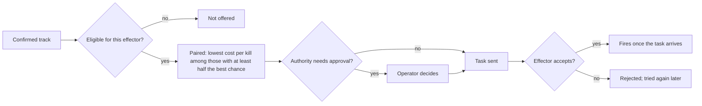

# Effectors

This is the inventory of every effector the defender can buy: RF jammers, interceptor drones, missiles, guns, and lasers with one radio frequency weapon, with their costs, magazines, hit chances and sources. It explains how the one budget pays for everything, how magazines and resupply work, which drones each weapon can and cannot defeat, and the rules that decide when it engages. It is written for a defence reader who wants to know what the numbers mean, and for a developer who wants to change them.

## Contents

- [How to read the tables](#how-to-read-the-tables)
- [Money and the budget](#money-and-the-budget)
- [How an engagement is decided](#how-an-engagement-is-decided)
- [How a shot works](#how-a-shot-works)
- [Magazines, reloads and resupply](#magazines-reloads-and-resupply)
- [RF jammers](#rf-jammers)
- [Interceptor drones](#interceptor-drones)
- [Missiles](#missiles)
- [Guns](#guns)
- [Lasers and the RF weapon](#lasers-and-the-rf-weapon)
- [Crewed systems off the network](#crewed-systems-off-the-network)
- [A soldier's shotgun and rifle, and the VEPR dome](#a-soldiers-shotgun-and-rifle-and-the-vepr-dome)
- [Limits and simplifications](#limits-and-simplifications)
- [Where this lives in the code](#where-this-lives-in-the-code)

The tables below were generated from the config modules by a script, and the hit chances by the same functions the game runs, so the numbers are copied exactly. If you change a figure in config, these tables go out of date.

## How to read the tables

- **Where the numbers live.** Effectors are entries in `EFFECTORS` ([`effectors.js:5`](../frontend/src/sim/config/effectors.js#L5)), `UK_SYSTEMS` ([`uk-systems.js:4`](../frontend/src/sim/config/uk-systems.js#L4)), `EU_SYSTEMS` ([`eu-systems.js:4`](../frontend/src/sim/config/eu-systems.js#L4)) and `CREW_SYSTEMS` ([`crew.js:27`](../frontend/src/sim/config/crew.js#L27)), merged into `STRUCTURES` ([`systems.js:9`](../frontend/src/sim/config/systems.js#L9)). As for sensors, each kind has a small, medium and large entry with no `variantOf`, and further real products carry `variantOf`. The purchase bar groups them by kind (`TOOLBAR`, [`systems.js:13`](../frontend/src/sim/config/systems.js#L13)): jammers on key 4, interceptors on 5, missiles on 6, lasers on 7 and guns on 0. The Terrahawk Paladin is a gun, though its id is `missile_paladin`. The **System** column is the config id, linked to its entry.
- **Money.** Config holds US dollars. The game shows pounds at 0.75 to the dollar ([`economy.js:26`](../frontend/src/sim/economy.js#L26)), and so do these tables. The game rounds to whole pounds, so a RapidDestroyer shot (£0.10 here) shows as £0 and a DragonFire second of beam (£9.75) as £10.
- **Range.** The `published` figure from the sources times `WORLD.rangeScale`, which is 1 ([`systems.js:27`](../frontend/src/sim/config/systems.js#L27)). **Minimum range** is how close a missile can engage, as it needs that far to arm and turn.
- **Hit chance (pk).** The chance a round works against an easy, slow target close in, on a good track ([`hit-chance.js:2`](../frontend/src/sim/hit-chance.js#L2)). Most are assumptions, and each `ref` says how it was set. The odds tables apply the full rule below to each drone type.
- **Odds tables.** For a weapon that fires rounds: the chance one round works, close in and at its limit, against each of the four drone types at wave 1, on a good track, as the Unit panel shows it ([`UnitPanel.jsx:158`](../frontend/src/ui/UnitPanel.jsx#L158)). "2 hits" means one hit does not do enough damage to destroy that type. For a beam: seconds of beam to destroy it, close in and at its limit. Drones evade better each wave, so later odds are lower.
- **Reloads during a wave.** Small and medium launchers reload from storage as they fight; a large one reloads only once the fighting stops (see [Magazines](#magazines-reloads-and-resupply)).
- **Health and armour.** A strike takes the drone's damage, divided by the armour, off the system's health ([`targeting.js:95`](../frontend/src/sim/targeting.js#L95)). Armour 2 halves it.
- **Settings.** Time between shots, beam strength, and a jammer's bands, antenna, receiver, technique and trigger can be changed on each placed unit, at a price. They are listed in [VEHICLES.md](VEHICLES.md#unit-settings).

## Money and the budget

Everything comes out of one budget of £11,250,000 (`ECONOMY.budget`, $15,000,000 in config, [`world.js:68`](../frontend/src/sim/config/world.js#L68)). Nothing is earned back: there are no rewards for kills or for surviving a wave.

- **Buying a system** charges its price, adjusted by any unit settings, at once ([`laydown.js:85`](../frontend/src/sim/laydown.js#L85)).
- **Every shot** charges `shotCost` as it is fired ([`economy.js:38`](../frontend/src/sim/economy.js#L38)). A launcher comes with a full magazine and storage, but those rounds are paid for only as they are fired. A laser is charged once when its beam comes on and again for every further second it stays on ([`effectors.js:66`](../frontend/src/sim/effectors.js#L66)). Jammers cost nothing to use.
- **A shot the budget cannot pay for is not fired.** The effector refuses the task ([`economy.js:35`](../frontend/src/sim/economy.js#L35)).
- **Network terminals** are bought too: to report or be tasked, a networked system needs a Starlink terminal (£262) or a cellular modem (£450), and the fusion node needs its own ([`comms.js:28`](../frontend/src/sim/config/comms.js#L28)). Crewed systems off the network need none.
- **Selling** a system before the first wave refunds its full price and its terminal ([`world.js:39`](../frontend/src/sim/config/world.js#L39), `sellRefund: 1`). Once the first wave starts the laydown is locked, so nothing can be bought or sold ([`lock.js:5`](../frontend/src/sim/lock.js#L5)).
- **Resupply** between waves buys rounds at their shot price (below).
- **Deployment packs and the sandbox.** With a deployment pack deployed, the budget only counts the cost and may go below zero; the pack's kit limits what can be placed instead ([`laydown.js:68`](../frontend/src/sim/laydown.js#L68)). In the sandbox, shots and resupply are free.

The large systems take most of the budget alone: Sky Sabre (£9,750,000), Skyranger 30 (£9,000,000) and Iron Beam (£10,500,000). The Cost tab compares what was spent with what the attack cost the enemy.

## How an engagement is decided

A networked effector acts only on a task from the fusion node ([`effectors.js:1`](../frontend/src/sim/effectors.js#L1)). The fusion node is covered in [FUSION_AND_TARGETING.md](FUSION_AND_TARGETING.md); this is the short version of the rules that touch the effectors themselves.

An effector is offered a track only if all of these hold ([`tasking.js:178`](../frontend/src/sim/network/tasking.js#L178), [`tasking.js:280`](../frontend/src/sim/network/tasking.js#L280)):

- the track is between its minimum range and its range ([`tasking.js:167`](../frontend/src/sim/network/tasking.js#L167)), and is not flying away from the site and every system ([`tasking.js:48`](../frontend/src/sim/network/tasking.js#L48));
- its round can meet the track inside its range, flying at where the track will be. A round slower than its target only catches one coming towards it ([`tasking.js:171`](../frontend/src/sim/network/tasking.js#L171), [`hit-chance.js:18`](../frontend/src/sim/hit-chance.js#L18));
- its `engages` list, if it has one, allows that airframe ([`tasking.js:26`](../frontend/src/sim/network/tasking.js#L26)). Only the DroneHunter has one: first-person-view and fibre-optic drones;
- for a missile marked `engagePolicy: 'fixed-wing'`, the track is classified fixed wing. A known multirotor is never offered; an unclassified track is offered only inside 800 m of the site (`FUSION.critZone`, [`world.js:90`](../frontend/src/sim/config/world.js#L90)) and when nothing else is on it;
- soft kill first: a weapon that fires rounds holds off while a jammer that could break the drone's control link covers enough of its way in. It stops holding once the drone is inside 800 m, once a jammer has had it for 10 s (`softKillWait`, [`world.js:95`](../frontend/src/sim/config/world.js#L95)) and it still flies, or once jamming has failed on more than half of three or more tries against that model ([`tasking.js:91`](../frontend/src/sim/network/tasking.js#L91));
- enough rounds are not already in the air at it (below).

Free effectors are then paired with tracks, most urgent first. Each track goes to the free effector with the lowest expected cost per kill (shot price over chance, or price per second times seconds to burn) among those with at least half the best chance at it ([`tasking.js:20`](../frontend/src/sim/network/tasking.js#L20), [`tasking.js:292`](../frontend/src/sim/network/tasking.js#L292)). So a gun or laser takes a quadcopter before a missile does. Inside 800 m of the site every free effector that can may take a track already engaged.

**Engagement authority** ([`world.js:99`](../frontend/src/sim/config/world.js#L99)): automatic by default; "costly" asks the operator before any shot priced at $50,000 (£37,500) or more; "all" asks every time. A request lapses after 20 s. Jammers are switched without asking.

**The effector's own check** ([`simulation.js:70`](../frontend/src/sim/simulation.js#L70)): it looks for a real drone within 300 m of where the track says it is (`FUSION.acquireRadius`, [`world.js:101`](../frontend/src/sim/config/world.js#L101)). It refuses if it finds none, if the drone is out of range, if a laser, a gun or a beam-riding missile has no line of sight, if the drone is outside its `engages` list (a permanent refusal), if the budget cannot pay for the shot, or if it is reloading or empty. A task takes time to arrive over the network, and the effector acts only once it has.

## How a shot works

**Rounds that fly** (`fire: 'guided'`: interceptor drones, missiles and guns). A gun fires straight at the drone; a missile or interceptor leaves its launcher climbing, then steers onto the target ([`effectors.js:34`](../frontend/src/sim/effectors.js#L34)). An interceptor drone, or a missile with its own seeker, needs no line of sight from the launcher: it is cued over the terrain. A gun, and a missile that rides a laser beam its launcher holds on the target (`beamRider`: the Rapid Ranger and the Stormer HVM), must see the drone from its muzzle, as a laser must from its emitter ([`site-range.js:29`](../frontend/src/sim/site-range.js#L29), [`effectors.js:25`](../frontend/src/sim/effectors.js#L25)). With no clear line it refuses the task and holds its fire, its drawn range stops at the hill or wood in the way, and a beam-rider already in flight misses if the line is lost before it arrives. A round bursts when it comes within its fuze radius, checking along the path it flew in the last step so a fast round cannot pass through ([`effectors.js:132`](../frontend/src/sim/effectors.js#L132)). Then one roll decides whether it works. If it does, it damages its target and every other drone within its blast radius; a miss costs the round and does nothing. A round whose target dies first turns to the nearest detected drone within 1.5 km ([`effectors.js:121`](../frontend/src/sim/effectors.js#L121)).

The chance one round works ([`hit-chance.js:34`](../frontend/src/sim/hit-chance.js#L34)) is pk multiplied by four factors, capped at 1:

- **Evasion:** (0.5 + 0.5 x evade) for a round no faster than three times the drone; a faster round feels less of it.
- **Lead:** 1 - 0.5 x (drone speed / round speed)², never below 0.1. A slow interceptor against a fast drone loses most of its chance.
- **Distance:** 1 - rangeLoss x (distance / range)². `rangeLoss` is 0.25 for most weapons ([`hit-chance.js:8`](../frontend/src/sim/hit-chance.js#L8)) and 0.75 for guns without airburst rounds, whose spread grows with distance.
- **Cue:** 1 / (1 + (track error / 300 m)²): a poor track lowers the chance, because the seeker has to find the drone from where the track says it is.

**Salvos.** A launcher fires again at its target while the rounds already flying at it could not destroy it between them. Otherwise, with time to see the result before the drone arrives, it holds fire; with too little, it keeps firing until those rounds have at least an 80% chance between them ([`effectors.js:19`](../frontend/src/sim/effectors.js#L19), [`effectors.js:48`](../frontend/src/sim/effectors.js#L48)).

**Beams** (`fire: 'beam'`: lasers and the RapidDestroyer). A beam needs a clear line of sight from its emitter ([`effectors.js:25`](../frontend/src/sim/effectors.js#L25)). On each new target it first takes 4 s to swing on and settle (none for the RF weapon, which steers electronically, [`hit-chance.js:49`](../frontend/src/sim/hit-chance.js#L49)). It then does its beam damage per second, times the evasion factor, times a distance factor: full strength out to a quarter of its range, then falling in proportion to distance ([`hit-chance.js:44`](../frontend/src/sim/hit-chance.js#L44)). It works one drone at a time. Rain and haze halve a laser's range, but not the RF weapon's ([`conditions.js:38`](../frontend/src/sim/conditions.js#L38)).

**Jamming** (`fire: 'jam'`) is applied to every drone a jammer that is on reaches: see [RF jammers](#rf-jammers).

## Magazines, reloads and resupply

Every weapon that fires rounds has three numbers ([`magazine.js:1`](../frontend/src/sim/magazine.js#L1)):

- **Magazine:** rounds ready to fire. A system starts each run full ([`magazine.js:15`](../frontend/src/sim/magazine.js#L15)).
- **Storage:** further rounds held in reserve.
- **Reload:** seconds to move rounds from storage to the magazine once it is empty ([`magazine.js:30`](../frontend/src/sim/magazine.js#L30)). With nothing left in storage, the system is out of rounds and the fusion node gives its target up so another can take it ([`tasking.js:244`](../frontend/src/sim/network/tasking.js#L244)).

A large system (Merops, NASAMS, Sky Sabre, Skyranger 30, Gepard, Skynex) reloads from storage only once the wave is over, as in the field that takes a reload vehicle and its crew. Small and medium ones reload as they fight ([`magazine.js:11`](../frontend/src/sim/magazine.js#L11)). The Unit panel shows a magazine as LOW at a quarter or less ([`magazine.js:24`](../frontend/src/sim/magazine.js#L24)).

A laser's magazine is seconds of stored beam. It recharges at magazine / reload seconds per second while the beam is off; if it runs dry, it waits the whole recharge time ([`magazine.js:79`](../frontend/src/sim/magazine.js#L79)). It needs no resupply.

**Resupply** is a button between waves (or at any time in the sandbox, [`magazine.js:47`](../frontend/src/sim/magazine.js#L47)). It refills every launcher's magazine and storage at once, finishes any reload in progress, and charges each round's shot price now. Those rounds are marked prepaid, so firing them later costs nothing more: a round is only ever paid for once. If the budget runs short it fills the emptiest launchers first ([`magazine.js:55`](../frontend/src/sim/magazine.js#L55)).

## RF jammers

A jammer transmits noise on drone radio bands. It costs nothing per use, but it is loud while on, it cannot touch a drone with no radio link, and it deafens your own RF detectors and network links on the bands it fills (see [PHYSICS_AND_PROPAGATION.md](PHYSICS_AND_PROPAGATION.md)). A networked jammer is switched on by the fusion node only while a track it reaches and faces is believed to use a band it jams ([`tasking.js:204`](../frontend/src/sim/network/tasking.js#L204)); off, it is a tenth as loud to emitter-seeking drones ([`targeting.js:58`](../frontend/src/sim/targeting.js#L58)).

**Reach.** A jammer needs a radio path to where the link is received, worked out on that band over the terrain, the same as a detector ([`jamming.js:19`](../frontend/src/sim/jamming.js#L19)). A control link is easier to jam the further the drone is from its operator, so its reach is scaled by the drone's distance from its launch point over 4.5 km ([`jamming.js:36`](../frontend/src/sim/jamming.js#L36)): a drone 9 km from its operator is jammed at twice the quoted range, one 2 km out at under half. A video link is received by the operator, so it is jammed only if the jammer reaches the launch point, with the same scaling ([`jamming.js:28`](../frontend/src/sim/jamming.js#L28)); a jammer by the site rarely does. GNSS is jammed at the drone, at the quoted range.

**Effect** ([`drones.js:197`](../frontend/src/sim/drones.js#L197)). The strength of every effect is multiplied by (1 - jam resistance).

- A jammed control link slows the drone to `slow` (50%) of its speed. After `killTime` (5 s) of full jamming the link is lost: a drone flown by hand comes down, counted as a jammer kill; one that flies itself turns for home, or comes down if its GNSS is jammed as well.
- A jammed video link alone brings down a drone flown by hand at half that rate, slowing it to 70%; one that flies itself is only blinded.
- Jammed GNSS makes a navigating drone drift off course, and the drift stays.
- Time jammed builds up while jammed and drains at half a second per second when it is not. A drone already turning for home is left alone, and one inside its homing distance (`terminal`, some real drones) cannot be jammed.

**Bands.** A jammer starts jamming its standard bands, and the operator can tick any band it is fitted for, at any time ([`laydown.js:240`](../frontend/src/sim/laydown.js#L240)). Every jammer is fitted for all four bands unless a band module is left out (a unit setting). Each band beyond its standard ones makes it louder, in proportion, to anti-radar drones ([`targeting.js:72`](../frontend/src/sim/targeting.js#L72)).

**Technique and receiver** (unit settings, [VEHICLES.md](VEHICLES.md#unit-settings)). Barrage, the standard, jams every drone on its bands. Reactive jams only links its receiver hears and its library knows, and not a link that hops frequency, but breaks them twice as fast ([`jamming.js:40`](../frontend/src/sim/jamming.js#L40), [`jamming.js:70`](../frontend/src/sim/jamming.js#L70)). GNSS spoofing pulls a navigating drone off course and jams nothing else ([`drones.js:18`](../frontend/src/sim/drones.js#L18)). Takeover lands a commercial drone whose link its library knows. The K-CEMA NEO and Jupiter come with a receiver and the full library fitted; the others can buy one.

What each drone type relies on, and how its jam resistance rises each wave (`ADAPT`, [`world.js:126`](../frontend/src/sim/config/world.js#L126)):

| Drone type | Radio links | On losing its control link | Link protocol | Jam resistance, wave 1 | Wave 5 | Wave 10 |
|---|---|---|---|---|---|---|
| Fixed-wing spotter drone | Control 868/915 MHz; Video 5.8 GHz; GNSS (receive only) | turns for home (comes down if GNSS is jammed too) | tactical | 0.75 | 0.85 | 0.95 |
| Fibre-optic strike drone | none (fibre) | comes down | none | 1 | 1 | 1 |
| First-person-view strike drone | Control 2.4 GHz; Video 5.8 GHz | comes down | hobby | 0 | 0.2 | 0.45 |
| Fixed-wing strike drone | GNSS (receive only) | comes down | none | 0.5 | 0.64 | 0.81 |

So, with only their standard bands on:

- **First-person-view strike drone:** every jammer reaches its 2.4 GHz control link, so it slows and comes down after 5 s of full jamming at wave 1, about 9 s by wave 10.
- **Fibre-optic strike drone:** no jammer touches it.
- **Fixed-wing strike drone:** it has no control link, so jamming never brings it down. Jammed GNSS only makes it drift, and spoofing turns it off course.
- **Fixed-wing spotter:** its control link is on 868/915 MHz, which the three generic jammers (`jammer_s`, `jammer`, `jammer_l`) do not jam as standard; tick that band, or use a jammer that jams it. With jam resistance 0.75 it takes 20 s of full jamming at wave 1 to break the link, after which it turns for home, or comes down if its GNSS is jammed too.

Real drones have their own links, protocols and resistance: see [DRONES.md](DRONES.md).

| System | Product | Size | Price | Range (m) | Mast (m) | Stands on | Bands jammed as standard | Rated power | Receiver | Beam |
|---|---|---|---|---|---|---|---|---|---|---|
| [`jammer_mk4`](../frontend/src/sim/config/crew.js#L52) | DroneShield DroneGun Mk4 | S | £22,500 | 1,000 | 1.5 | manpack, crewed, off the network, handheld | Control 868/915 MHz, Control 2.4 GHz, Video 5.8 GHz, GNSS L1/L2 | 40 W (assumption) | none | 30° aimed by hand |
| [`jammer_dgmk3`](../frontend/src/sim/config/crew.js#L88) | DroneShield DroneGun MkIII | S | £30,000 | 500 | 1.5 | manpack, crewed, off the network, handheld | Control 868/915 MHz, Control 2.4 GHz, Video 5.8 GHz | 10 W (assumption) | none | 30° aimed by hand |
| [`jammer_s`](../frontend/src/sim/config/effectors.js#L32) | Generic small jammer on a tripod, networked | S | £30,000 | 500 | 1.5 | manpack | Control 2.4 GHz, Video 5.8 GHz | 10 W (assumption) | none | all round |
| [`jammer_dgtac`](../frontend/src/sim/config/crew.js#L104) | DroneShield DroneGun Tactical | M | £45,000 | 1,000 | 1.5 | manpack, crewed, off the network, handheld | Control 868/915 MHz, Control 2.4 GHz, Video 5.8 GHz | 40 W (assumption) | none | 30° aimed by hand |
| [`jammer_kvertus`](../frontend/src/sim/config/crew.js#L76) | Kvertus AD G-6+ | M | £11,250 | 1,500 | 1.5 | manpack, crewed, off the network, handheld | Control 868/915 MHz, Control 2.4 GHz, Video 5.8 GHz, GNSS L1/L2 | 110 W (secondary) | none | 30° aimed by hand |
| [`jammer_skywiper`](../frontend/src/sim/config/crew.js#L64) | NT Service EDM4S SkyWiper | M | £18,750 | 3,000 | 1.5 | manpack, crewed, off the network, handheld | Control 868/915 MHz, Control 2.4 GHz, Video 5.8 GHz, GNSS L1/L2 | 40 W (secondary) | none | 30° aimed by hand |
| [`jammer`](../frontend/src/sim/config/effectors.js#L6) | Generic portable jammer on a tripod, networked | M | £45,000 | 1,000 | 1.5 | manpack | Control 2.4 GHz, Video 5.8 GHz | 40 W (assumption) | none | all round |
| [`jammer_neo`](../frontend/src/sim/config/uk-systems.js#L71) | Kirintec K-CEMA NEO | M | £112,500 | 1,100 | 1.5 | manpack | Control 868/915 MHz, Control 2.4 GHz, Video 5.8 GHz, GNSS L1/L2 | 45 W (published) | fitted, full library | all round |
| [`jammer_jupiter`](../frontend/src/sim/config/uk-systems.js#L89) | Kirintec K-CEMA Jupiter | M | £225,000 | 3,900 | 3 | vehicle | Control 868/915 MHz, Control 2.4 GHz, Video 5.8 GHz, GNSS L1/L2 | 600 W (secondary) | fitted, full library | all round |
| [`jammer_auds`](../frontend/src/sim/config/uk-systems.js#L53) | Blighter AUDS RF inhibitor | L | £1,125,000 | 2,000 | 9 | fixed | Control 868/915 MHz, Control 2.4 GHz, Video 5.8 GHz, GNSS L1/L2 | 150 W (published) | none | all round; turns a sector antenna onto the drone |
| [`jammer_l`](../frontend/src/sim/config/effectors.js#L54) | Generic fixed site jammer | L | £262,500 | 3,000 | 9 | fixed | Control 2.4 GHz, Video 5.8 GHz | 400 W (assumption) | none | all round |
| [`jammer_sf`](../frontend/src/sim/config/eu-systems.js#L28) | Sensofusion Portable Asymmetric Jammer | L | £34,500 | 4,500 | 3 | vehicle | Control 868/915 MHz, Control 2.4 GHz, Video 5.8 GHz, GNSS L1/L2 | 800 W (published) | none | all round |

| System | Slows a jammed drone to | Link lost after (s) | Signature while jamming | Health | Range used | Confidence | Sources |
|---|---|---|---|---|---|---|---|
| [`jammer_mk4`](../frontend/src/sim/config/crew.js#L52) | 50% speed | 5 | 0.8 | 15 | 1 km: a retailer figure, not verified | Maker and retailer figures | [Janes: DroneShield launches DroneGun Mk4](https://www.janes.com/defence-news/news-detail/droneshield-launches-dronegun-mk4) |
| [`jammer_dgmk3`](../frontend/src/sim/config/crew.js#L88) | 50% speed | 5 | 0.8 | 15 | 500 m: the launch figure (a manual says 1 km rural) | Vendor figures; the manual conflicts | [DroneShield: 2019 specification](https://www.asx.com.au/asxpdf/20190715/pdf/446lzqk0qszn9n.pdf); [DroneShield: DroneGun Mk3](https://droneshield.com/c-uas-products/dronegun-mk3); [Aviations UK: DroneGun Tactical vs Dedrone RF](https://aviationsouk.com/compare-products/dedrone-dedronesensors-rf-rf-160-rf-360-vs-droneshield-dronegun-tactical/) |
| [`jammer_s`](../frontend/src/sim/config/effectors.js#L32) | 50% speed | 5 | 0.8 | 30 | 500 m: DroneGun MkIII class figure | Vendor figures; the manual conflicts | [DroneShield: 2019 specification](https://www.asx.com.au/asxpdf/20190715/pdf/446lzqk0qszn9n.pdf); [DroneShield: DroneGun Mk3](https://droneshield.com/c-uas-products/dronegun-mk3); [Aviations UK: DroneGun Tactical vs Dedrone RF](https://aviationsouk.com/compare-products/dedrone-dedronesensors-rf-rf-160-rf-360-vs-droneshield-dronegun-tactical/) |
| [`jammer_dgtac`](../frontend/src/sim/config/crew.js#L104) | 50% speed | 5 | 0.8 | 15 | 1 km effective (older figures say 2 km) | Vendor claims; figures conflict across sources | [DroneDJ: DroneGun Tactical](https://dronedj.com/2021/06/23/dronegun-tactical-jammer-provides-powerful-but-flexible-anti-uav-neutralization/); [Athlon Outdoors: DroneGun Tactical](https://athlonoutdoors.com/article/dronegun-tactical-anti-drone-gun/); [Aviations UK: DroneGun Tactical vs Dedrone RF](https://aviationsouk.com/compare-products/dedrone-dedronesensors-rf-rf-160-rf-360-vs-droneshield-dronegun-tactical/) |
| [`jammer_kvertus`](../frontend/src/sim/config/crew.js#L76) | 50% speed | 5 | 0.8 | 15 | 1.5 km: the lower of two seller figures | Seller figures that conflict | [Flash Army: Kvertus AD G-6+](https://flasharmy.com.ua/en/kvertus-ad-g-6-plus) |
| [`jammer_skywiper`](../frontend/src/sim/config/crew.js#L64) | 50% speed | 5 | 0.8 | 15 | 3 km: low end of a reported 3 to 5 km | Encyclopaedia and press figures | [Wikipedia: EDM4S](https://en.wikipedia.org/wiki/EDM4S) |
| [`jammer`](../frontend/src/sim/config/effectors.js#L6) | 50% speed | 5 | 1.5 | 30 | 1 km: DroneGun Tactical class figure | Vendor claims; figures conflict across sources | [DroneDJ: DroneGun Tactical](https://dronedj.com/2021/06/23/dronegun-tactical-jammer-provides-powerful-but-flexible-anti-uav-neutralization/); [Athlon Outdoors: DroneGun Tactical](https://athlonoutdoors.com/article/dronegun-tactical-anti-drone-gun/); [Aviations UK: DroneGun Tactical vs Dedrone RF](https://aviationsouk.com/compare-products/dedrone-dedronesensors-rf-rf-160-rf-360-vs-droneshield-dronegun-tactical/); [ThePricer: cost to shoot down a drone](https://www.thepricer.org/how-much-does-it-cost-to-shoot-down-a-drone/) |
| [`jammer_neo`](../frontend/src/sim/config/uk-systems.js#L71) | 50% speed | 5 | 1.5 | 30 | Assessed from its 45 W output | Maker’s datasheet for power and bands; range is an assessment | [Kirintec: K-CEMA NEO datasheet](https://www.kirintec.com/wp-content/uploads/2022/12/Kirintec-K-CEMA-NEO-A4-0722-WEB.pdf); [EverythingRF: Aaronia jammers, 40 W handheld at 2 km](https://www.everythingrf.com/news/details/14983-aaronia-offers-portable-stationary-and-fully-integrated-counter-drone-jammers-with-10-km-range) |
| [`jammer_jupiter`](../frontend/src/sim/config/uk-systems.js#L89) | 50% speed | 5 | 1.5 | 30 | Worked out from up to 600 W | Power from Alex and a trade report; range worked out from it | [DALO Industry Days: K-CEMA Jupiter](https://www.daloindustrydays.com/products/product/kirintec-kcema-jupiter); [Kirintec: K-CEMA NEO datasheet](https://www.kirintec.com/wp-content/uploads/2022/12/Kirintec-K-CEMA-NEO-A4-0722-WEB.pdf) |
| [`jammer_auds`](../frontend/src/sim/config/uk-systems.js#L53) | 50% speed | 5 | 2 | 30 | Assumed: twice the DroneGun Tactical; no jammer range published | ASSUMPTION: no published jamming range | [Blighter: AUDS](https://www.blighter.com/?p=357); [Blighter: quad band RF inhibitor](https://blighter.com/worlds-first-fully-integrated-anti-uav-defence-system-auds-now-features-quad-band-rf-inhibitor-and-optical-disruptor/) |
| [`jammer_l`](../frontend/src/sim/config/effectors.js#L54) | 50% speed | 5 | 2.5 | 30 | Assessed: low end of stationary-jammer claims | ASSUMPTION: tune this yourself | [EverythingRF: Aaronia jammers](https://www.everythingrf.com/news/details/14983-aaronia-offers-portable-stationary-and-fully-integrated-counter-drone-jammers-with-10-km-range) |
| [`jammer_sf`](../frontend/src/sim/config/eu-systems.js#L28) | 50% speed | 5 | 3 | 30 | Assessed from its 800 W output | Maker’s power figure; range is an assessment | [Sensofusion: Military Edition](https://sensofusion.com/military/); [EverythingRF: Aaronia jammers, 40 W handheld at 2 km](https://www.everythingrf.com/news/details/14983-aaronia-offers-portable-stationary-and-fully-integrated-counter-drone-jammers-with-10-km-range) |

The handheld jammers (DroneGun Mk4, MkIII and Tactical, SkyWiper, Kvertus) are crewed and off the network: see [Crewed systems](#crewed-systems-off-the-network). The AUDS turns onto the most urgent drone when fitted with a sector antenna ([`tasking.js:214`](../frontend/src/sim/network/tasking.js#L214)).

## Interceptor drones

An interceptor drone is a small drone launched at a target, which rams it, bursts a warhead beside it or fires a net. Its rounds are cheap against missiles, and some reach a long way, but they are slow: the faster the drone, the lower the chance. The DroneHunter (25 m/s) is slower than a first-person-view drone, so it only meets one coming towards it, and it never takes the fixed-wing types (`engages`, [`effectors.js:175`](../frontend/src/sim/config/effectors.js#L175)).

| System | Product | Size | Price | Per shot | Range (m) | Minimum range (m) | Between shots (s) | Magazine | Storage | Reload (s) | Reloads during a wave |
|---|---|---|---|---|---|---|---|---|---|---|---|
| [`interceptor_s`](../frontend/src/sim/config/effectors.js#L172) | Fortem DroneHunter F700 | S | £75,000 | £750 | 3,000 | 0 | 4 | 2 | 6 | 180 | yes |
| [`interceptor`](../frontend/src/sim/config/effectors.js#L69) | Wild Hornets Sting | M | £75,000 | £3,750 | 25,000 | 0 | 3 | 12 | 24 | 30 | yes |
| [`interceptor_p1`](../frontend/src/sim/config/effectors.js#L95) | SkyFall P1-SUN | M (as interceptor) | £75,000 | £750 | 30,000 | 0 | 3 | 12 | 24 | 30 | yes |
| [`interceptor_l`](../frontend/src/sim/config/effectors.js#L197) | Project Eagle Merops | L | £225,000 | £11,250 | 15,000 | 0 | 3 | 8 | 16 | 60 | no |

| System | Round speed (m/s) | Hit chance (pk) | Chance lost at limit | Damage (hp) | Blast radius (m) | Fuze radius (m) | Takes | Networked | Armour | Health |
|---|---|---|---|---|---|---|---|---|---|---|
| [`interceptor_s`](../frontend/src/sim/config/effectors.js#L172) | 25 | 0.85 | 0.25 | 60 | 5 | 10 | only fpv, fo | yes | 1 | 30 |
| [`interceptor`](../frontend/src/sim/config/effectors.js#L69) | 80 | 0.9 | 0.25 | 60 | 10 | 15 | any drone | yes | 1 | 30 |
| [`interceptor_p1`](../frontend/src/sim/config/effectors.js#L95) | 80 | 0.5 | 0.25 | 60 | 10 | 15 | any drone | yes | 1 | 30 |
| [`interceptor_l`](../frontend/src/sim/config/effectors.js#L197) | 78 | 0.88 | 0.25 | 70 | 15 | 15 | any drone | yes | 1 | 30 |

Chance one round works, close in / at its limit, at wave 1 on a good track:

| System | Fixed-wing spotter drone | Fibre-optic strike drone | First-person-view strike drone | Fixed-wing strike drone |
|---|---|---|---|---|
| [`interceptor_s`](../frontend/src/sim/config/effectors.js#L172) | not taken | 57% / 43% | 19% / 14% | not taken |
| [`interceptor`](../frontend/src/sim/config/effectors.js#L69) | 79% / 60% | 82% / 61% | 67% / 50% | 68% / 51% |
| [`interceptor_p1`](../frontend/src/sim/config/effectors.js#L95) | 44% / 33% | 45% / 34% | 37% / 28% | 38% / 28% |
| [`interceptor_l`](../frontend/src/sim/config/effectors.js#L197) | 77% / 58% | 80% / 60% | 65% / 49% | 66% / 50% |

| System | Range used | Confidence | Price confidence | Sources |
|---|---|---|---|---|
| [`interceptor_s`](../frontend/src/sim/config/effectors.js#L172) | Top of a reported 2 to 3 km to a kill | Maker and trade figures; the range sources conflict | A dealer listing; per-shot is an ASSUMPTION | [The Defense Post: 85% claim](https://thedefensepost.com/2023/02/09/ukraine-drone-hunters/amp/); [Fortem: DroneHunter F700](https://fortemtech.com/products/dronehunter-f700/); [Army Technology: DroneHunter](https://www.army-technology.com/projects/dronehunter-counter-unmanned-aerial-system-c-uas/); [Aviations UK: DroneHunter F700](https://aviationsouk.com/products/fortem-dronehunter-f700/) |
| [`interceptor`](../frontend/src/sim/config/effectors.js#L69) | About 25 km reported | Press reports of maker’s figures, which conflict | ASSUMPTION for the launcher; per-shot from you and the press | [NV: Sting hit rate](https://english.nv.ua/nation/the-drone-killer-inside-the-sting-fpv-interceptor-50591418.html); [United24: 68% average](https://united24media.com/war-in-ukraine/how-ukraine-started-2026-with-record-anti-shahed-drone-production-and-a-new-era-in-air-defense-14847); [Wikipedia: Sting (drone)](https://en.wikipedia.org/wiki/Sting_(drone)); [Espreso: three Stings for each target](https://global.espreso.tv/russia-ukraine-war-ukraines-low-cost-sting-drones-prove-lethal-against-russian-attacks); [DroneXL: $2,000 Sting vs $50,000 Shahed](https://dronexl.co/2026/05/21/ukraine-sting-drone-shahed/) |
| [`interceptor_p1`](../frontend/src/sim/config/effectors.js#L95) | 30 km listed for a close version (JetKiller) | Press figures for price; performance is an assumption | ASSUMPTION for the launcher; per-shot from the press | [Oboronka: P1-SUN price](https://oboronka.mezha.ua/en/skyfall-rozpovila-pro-cinu-na-dron-perehoplyuvach-p1-sun-308453/); [Euromaidan Press: P1-SUN](https://euromaidanpress.com/2026/04/24/ukrainian-p1-sun-drones-down-3000-plus-shaheds-in-2026-at-about-3000-apiece/) |
| [`interceptor_l`](../frontend/src/sim/config/effectors.js#L197) | Inside a 5 to 20 km industry band | US press reports of official and industry figures | Press figure for the round; launcher is an ASSUMPTION | [Defense News: US Army and Merops](https://www.defensenews.com/unmanned/2026/04/20/us-army-turns-to-ukraine-tested-drones-to-counter-iranian-uav-threat) |

## Missiles

A missile is fast and almost always works, but each round is expensive. Five of the six are kept for fixed-wing tracks (`engagePolicy`); only the small Frankenburg takes any drone, and all have a minimum range: 300 m for the short-range ones and 1 km for NASAMS and Sky Sabre. A drone closer than that is left to something else. Speeds are held at 400 m/s or less so that a round cannot jump past its target in one simulation step ([`uk-systems.js:3`](../frontend/src/sim/config/uk-systems.js#L3)).

| System | Product | Size | Price | Per shot | Range (m) | Minimum range (m) | Between shots (s) | Magazine | Storage | Reload (s) | Reloads during a wave |
|---|---|---|---|---|---|---|---|---|---|---|---|
| [`missile_s`](../frontend/src/sim/config/effectors.js#L217) | Frankenburg Mark I | S | £75,000 | £33,750 | 2,000 | 300 | 2 | 4 | 12 | 30 | yes |
| [`missile_rr`](../frontend/src/sim/config/uk-systems.js#L107) | Thales Rapid Ranger (LMM) | M | £1,125,000 | £112,500 | 7,000 | 300 | 3 | 4 | 8 | 60 | yes |
| [`missile_hvm`](../frontend/src/sim/config/uk-systems.js#L134) | Stormer HVM (Starstreak) | M | £2,250,000 | £112,500 | 7,000 | 300 | 3 | 8 | 8 | 120 | yes |
| [`missile`](../frontend/src/sim/config/effectors.js#L114) | Raytheon Coyote Block 2 | M | £750,000 | £150,000 | 10,000 | 300 | 4 | 4 | 8 | 60 | yes |
| [`missile_l`](../frontend/src/sim/config/effectors.js#L237) | NASAMS with AIM-120 AMRAAM | L | £3,750,000 | £876,750 | 25,000 | 1,000 | 5 | 6 | 12 | 600 | no |
| [`missile_skysabre`](../frontend/src/sim/config/uk-systems.js#L175) | Sky Sabre (Land Ceptor, CAMM) | L | £9,750,000 | £750,000 | 25,000 | 1,000 | 5 | 8 | 8 | 600 | no |

| System | Round speed (m/s) | Hit chance (pk) | Chance lost at limit | Damage (hp) | Blast radius (m) | Fuze radius (m) | Takes | Networked | Armour | Health |
|---|---|---|---|---|---|---|---|---|---|---|
| [`missile_s`](../frontend/src/sim/config/effectors.js#L217) | 200 | 0.98 | 0.25 | 50 | 15 | 15 | any drone | yes | 1 | 30 |
| [`missile_rr`](../frontend/src/sim/config/uk-systems.js#L107) | 400 | 0.98 | 0.25 | 70 | 30 | 30 | kept for fixed-wing tracks | yes | 1 | 30 |
| [`missile_hvm`](../frontend/src/sim/config/uk-systems.js#L134) | 400 | 0.98 | 0.25 | 100 | 30 | 30 | kept for fixed-wing tracks | yes | 2 | 30 |
| [`missile`](../frontend/src/sim/config/effectors.js#L114) | 150 | 0.98 | 0.25 | 70 | 40 | 30 | kept for fixed-wing tracks | yes | 1 | 30 |
| [`missile_l`](../frontend/src/sim/config/effectors.js#L237) | 400 | 1 | 0.25 | 100 | 40 | 30 | kept for fixed-wing tracks | yes | 1 | 30 |
| [`missile_skysabre`](../frontend/src/sim/config/uk-systems.js#L175) | 400 | 0.98 | 0.25 | 100 | 40 | 30 | kept for fixed-wing tracks | yes | 1 | 30 |

Chance one round works, close in / at its limit, at wave 1 on a good track. A missile cannot engage inside its minimum range, so "close in" is a bound, not a shot it can take:

| System | Fixed-wing spotter drone | Fibre-optic strike drone | First-person-view strike drone | Fixed-wing strike drone |
|---|---|---|---|---|
| [`missile_s`](../frontend/src/sim/config/effectors.js#L217) | 95% / 71% | 95% / 71% | 88% / 66% | 89% / 67%, 2 hits |
| [`missile_rr`](../frontend/src/sim/config/uk-systems.js#L107) | 97% / 72% | 97% / 72% | 93% / 70% | 94% / 71% |
| [`missile_hvm`](../frontend/src/sim/config/uk-systems.js#L134) | 97% / 72% | 97% / 72% | 93% / 70% | 94% / 71% |
| [`missile`](../frontend/src/sim/config/effectors.js#L114) | 93% / 70% | 94% / 70% | 85% / 63% | 85% / 64% |
| [`missile_l`](../frontend/src/sim/config/effectors.js#L237) | 99% / 74% | 99% / 74% | 95% / 71% | 96% / 72% |
| [`missile_skysabre`](../frontend/src/sim/config/uk-systems.js#L175) | 97% / 72% | 97% / 72% | 93% / 70% | 94% / 71% |

| System | Range used | Confidence | Price confidence | Sources |
|---|---|---|---|---|
| [`missile_s`](../frontend/src/sim/config/effectors.js#L217) | About 2 km reported | Press reports; no manufacturer datasheet read | Press figure for the round; launcher is an ASSUMPTION | [Blue News: a 65 cm missile](https://www.bluewin.ch/en/news/international/a-65-centimetre-missile-is-now-supposed-to-stop-putin-li.2959490) |
| [`missile_rr`](../frontend/src/sim/config/uk-systems.js#L107) | 7 km engagement (Ukrainian defence ministry) | A defence ministry figure, and press reports | ASSUMPTION worked out from a contract value | [GlobalSecurity: Starstreak, 300 m minimum](https://www.globalsecurity.org/military/world/europe/starstreak-specs.htm); [SOFREP: Rapid Sentry downs 14 drones](https://sofrep.com/news/british-rapid-sentry-system-downs-14-iranian-drones-in-one-night); [ITC: Rapid Ranger](https://itc.ua/en/articles/what-is-known-about-the-rapid-ranger-air-defense-systems-to-be-purchased-by-ukraine-with-money-from-the-uk); [Euromaidan Press: Rapid Ranger downing Shaheds](https://euromaidanpress.com/2026/04/21/british-rapid-ranger-is-downing-shaheds-in-ukraine-from-spanish-armored-vehicles/); [Army Technology: Rapid Sentry](https://www.army-technology.com/news/what-is-rapid-sentry-the-uks-mysterious-air-defence-system/); [Military Leak: LMM contract](https://militaryleak.com/2026/06/03/thales-to-supply-hundreds-more-lightweight-multirole-missiles-to-uk-mod/) |
| [`missile_hvm`](../frontend/src/sim/config/uk-systems.js#L134) | 7 km (Starstreak, 0.3 to 7 km) | Secondary references | ASSUMPTION: tune this yourself | [GlobalSecurity: Starstreak, 300 m minimum](https://www.globalsecurity.org/military/world/europe/starstreak-specs.htm); [Wikipedia: Starstreak](https://en.wikipedia.org/wiki/Starstreak); [Forces News: Stormer](https://www.forcesnews.com/services/army/stormer-royal-artillerys-close-air-defence-weapons-platform) |
| [`missile`](../frontend/src/sim/config/effectors.js#L114) | Low end of a reported 10 to 15 km | Secondary reporting; no manufacturer numbers | Press estimates for the round; launcher is an ASSUMPTION | [TWZ: Coyote kills](https://www.twz.com/air/army-coyote-drone-hunting-drones-have-scored-170-combat-kills); [Norsk Luftvern: Coyote Block 2](https://norskluftvern.com/2025/03/31/coyote-block-2-counter-drone-system-us/); [TWZ: rocket-powered Coyote](https://www.twz.com/land/new-coyote-anti-drone-interceptor-swaps-jet-engine-for-rocket-power); [Wikipedia: Raytheon Coyote launchers](https://en.wikipedia.org/wiki/Raytheon_Coyote); [TWZ: Coyote purchase plans](https://www.twz.com/drastic-increase-in-army-coyote-drone-interceptor-purchase-plans); [Army Recognition: Coyote deal](https://armyrecognition.com/news/army-news/2026/u-s-army-to-secure-coyote-interceptors-in-first-long-term-deal-as-drone-swarms-surge) |
| [`missile_l`](../frontend/src/sim/config/effectors.js#L237) | The lower of two Wikipedia figures (25 and 40 km) | Secondary reporting; the sources conflict on range | Budget figure for the round, read second-hand; launcher is an ASSUMPTION | [Wikipedia: CAMM, under 1 km minimum](https://en.wikipedia.org/wiki/CAMM_(missile_family)); [Wikipedia: NASAMS](https://en.wikipedia.org/wiki/NASAMS); [Militarnyi: NASAMS 94% effective](https://militarnyi.com/en/news/nasams-air-defense-system-destroys-900-targets-in-ukraine-with-94-efficiency/); [ThePricer: AMRAAM cost](https://www.thepricer.org/how-much-does-an-amraam-missile-cost/) |
| [`missile_skysabre`](../frontend/src/sim/config/uk-systems.js#L175) | More than 25 km (MBDA) | Manufacturer and defence press figures | Contract value for the launchers; prices are ASSUMPTIONS | [Wikipedia: CAMM, under 1 km minimum](https://en.wikipedia.org/wiki/CAMM_(missile_family)); [British Army: Land Ceptor](https://www.army.mod.uk/equipment/land-ceptor/); [Janes: six more Land Ceptor launchers](https://www.janes.com/defence-intelligence-insights/defence-news/weapons/uk-to-procure-six-more-land-ceptor-launchers-for-sky-sabre-air-defence-systems); [DE&S: £118 million Land Ceptor contract](https://des.mod.uk/des-secures-118m-contract-to-deliver-six-new-land-ceptor-missile-systems-strengthening-uk-air-defence) |

## Guns

A gun's shot is a burst. Guns are cheap per burst and fast, so they suit close-in work, but their reach is short. The three machine guns have no airburst rounds, so their low chance per burst falls to a quarter at their limit (`rangeLoss` 0.75), as does the Gepard's. The Terrahawk Paladin, Skyranger 30 and Skynex fire programmable airburst rounds and keep most of their chance at range. The two crewed guns are worked by hand and off the network: see [Crewed systems](#crewed-systems-off-the-network).

| System | Product | Size | Price | Per shot | Range (m) | Minimum range (m) | Between shots (s) | Magazine | Storage | Reload (s) | Reloads during a wave |
|---|---|---|---|---|---|---|---|---|---|---|---|
| [`gun_s`](../frontend/src/sim/config/crew.js#L28) | L7A2 general purpose machine gun on a vehicle pintle | S | £15,000 | £19 | 600 | 0 | 1.5 | 8 | 32 | 20 | yes |
| [`gun_50`](../frontend/src/sim/config/crew.js#L40) | L111A1 heavy machine gun (12.7 mm) on a vehicle pintle | S | £30,000 | £113 | 1,000 | 0 | 1.5 | 6 | 24 | 25 | yes |
| [`gun_hmg`](../frontend/src/sim/config/effectors.js#L305) | 12.7 mm machine gun on a remote weapon station | M | £187,500 | £113 | 1,200 | 0 | 1.5 | 20 | 60 | 60 | yes |
| [`missile_paladin`](../frontend/src/sim/config/uk-systems.js#L155) | MSI-DS Terrahawk Paladin (30 mm gun) | M | £2,250,000 | £1,500 | 2,000 | 0 | 1 | 30 | 60 | 120 | yes |
| [`gun_skyranger`](../frontend/src/sim/config/eu-systems.js#L65) | Rheinmetall Skyranger 30 on Boxer | L | £9,000,000 | £3,000 | 3,000 | 0 | 1 | 16 | 16 | 900 | no |
| [`gun_gepard`](../frontend/src/sim/config/eu-systems.js#L83) | Flakpanzer Gepard (twin 35 mm) | L | £3,750,000 | £1,125 | 3,500 | 0 | 1 | 40 | 40 | 1200 | no |
| [`gun_l`](../frontend/src/sim/config/eu-systems.js#L47) | Rheinmetall Skynex (35 mm Revolver Gun Mk3) | L | £6,750,000 | £3,750 | 4,000 | 0 | 1 | 15 | 45 | 300 | no |

| System | Round speed (m/s) | Hit chance (pk) | Chance lost at limit | Damage (hp) | Blast radius (m) | Fuze radius (m) | Takes | Networked | Armour | Health |
|---|---|---|---|---|---|---|---|---|---|---|
| [`gun_s`](../frontend/src/sim/config/crew.js#L28) | 840 | 0.08 | 0.75 | 40 | 0 | 2 | any drone | no, crewed | 1 | 20 |
| [`gun_50`](../frontend/src/sim/config/crew.js#L40) | 890 | 0.12 | 0.75 | 60 | 0 | 2 | any drone | no, crewed | 1 | 20 |
| [`gun_hmg`](../frontend/src/sim/config/effectors.js#L305) | 850 | 0.2 | 0.75 | 60 | 0 | 3 | any drone | yes | 1 | 30 |
| [`missile_paladin`](../frontend/src/sim/config/uk-systems.js#L155) | 300 | 1 | 0.25 | 60 | 25 | 25 | any drone | yes | 1 | 30 |
| [`gun_skyranger`](../frontend/src/sim/config/eu-systems.js#L65) | 1100 | 0.85 | 0.25 | 60 | 15 | 15 | any drone | yes | 2 | 40 |
| [`gun_gepard`](../frontend/src/sim/config/eu-systems.js#L83) | 1175 | 0.73 | 0.75 | 60 | 0 | 5 | any drone | yes | 2 | 40 |
| [`gun_l`](../frontend/src/sim/config/eu-systems.js#L47) | 1050 | 0.9 | 0.25 | 60 | 20 | 20 | any drone | yes | 1 | 40 |

Chance one burst works, close in / at its limit, at wave 1 on a good track:

| System | Fixed-wing spotter drone | Fibre-optic strike drone | First-person-view strike drone | Fixed-wing strike drone |
|---|---|---|---|---|
| [`gun_s`](../frontend/src/sim/config/crew.js#L28) | 8% / 2%, 2 hits | 8% / 2% | 8% / 2% | 8% / 2%, 2 hits |
| [`gun_50`](../frontend/src/sim/config/crew.js#L40) | 12% / 3% | 12% / 3% | 12% / 3% | 12% / 3% |
| [`gun_hmg`](../frontend/src/sim/config/effectors.js#L305) | 20% / 5% | 20% / 5% | 20% / 5% | 20% / 5% |
| [`missile_paladin`](../frontend/src/sim/config/uk-systems.js#L155) | 98% / 74% | 98% / 74% | 94% / 70% | 94% / 71% |
| [`gun_skyranger`](../frontend/src/sim/config/eu-systems.js#L65) | 85% / 63% | 85% / 63% | 84% / 63% | 84% / 63% |
| [`gun_gepard`](../frontend/src/sim/config/eu-systems.js#L83) | 73% / 18% | 73% / 18% | 72% / 18% | 72% / 18% |
| [`gun_l`](../frontend/src/sim/config/eu-systems.js#L47) | 90% / 67% | 90% / 67% | 88% / 66% | 89% / 67% |

| System | Range used | Confidence | Price confidence | Sources |
|---|---|---|---|---|
| [`gun_s`](../frontend/src/sim/config/crew.js#L28) | Assumed, below the 800 m ground figure | Army figures for ground fire; air performance is an assumption | ASSUMPTION: tune this yourself | [MDPI Applied Sciences: seeing a Mavic Air and a Phantom 4 by eye](https://www.mdpi.com/2076-3417/10/16/5501); [British Army: general purpose machine gun](https://www.army.mod.uk/learn-and-explore/equipment/small-arms-and-support-weapons/general-purpose-machine-gun); [British Army: heavy machine gun](https://www.army.mod.uk/learn-and-explore/equipment/small-arms-and-support-weapons/heavy-machine-gun); [Ukrainian News: Shahed hit rates and mobile fire groups](https://ukranews.com/en/news/1015783-since-beginning-of-year-russians-launched-over-2-000-shaheds-across-ukraine-what-is-hit-percentage) |
| [`gun_50`](../frontend/src/sim/config/crew.js#L40) | Assumed, below the 2 km ground figure | Army figures for ground fire; air performance is an assumption | ASSUMPTION: tune this yourself | [MDPI Applied Sciences: seeing a Mavic Air and a Phantom 4 by eye](https://www.mdpi.com/2076-3417/10/16/5501); [British Army: general purpose machine gun](https://www.army.mod.uk/learn-and-explore/equipment/small-arms-and-support-weapons/general-purpose-machine-gun); [British Army: heavy machine gun](https://www.army.mod.uk/learn-and-explore/equipment/small-arms-and-support-weapons/heavy-machine-gun); [Ukrainian News: Shahed hit rates and mobile fire groups](https://ukranews.com/en/news/1015783-since-beginning-of-year-russians-launched-over-2-000-shaheds-across-ukraine-what-is-hit-percentage) |
| [`gun_hmg`](../frontend/src/sim/config/effectors.js#L305) | Assumed, inside a reported 2 km limit for machine guns | Reported share of kills; performance is an assumption | ASSUMPTION: tune this yourself | [Ukraine’s Arms Monitor: stopping Shaheds](https://ukrainesarmsmonitor.substack.com/p/stopping-shaheds-ukraines-solutions); [Euromaidan Press: fire groups down drones in the north](https://euromaidanpress.com/2024/01/03/firearm-groups-down-large-share-of-russias-drones-missiles-in-ukraines-north-on-2-january); [Kongsberg: counter-UAS contract in Poland](https://www.kongsberg.com/news/news-archive/2026/kongsberg-wins-nok-16-billion-contract-to-deliver-counter-uas-solutions-in-poland/) |
| [`missile_paladin`](../frontend/src/sim/config/uk-systems.js#L155) | 2 km effective (maker) | Maker’s claim, reported by the press; performance is an assumption | ASSUMPTION: tune this yourself | [The Defense Post: Terrahawk Paladin](https://www.thedefensepost.com/2023/10/19/uk-drone-killer-ukraine/); [Kyiv Post: Terrahawk Paladin](https://www.kyivpost.com/amp/post/22656); [United24: Gepard rounds per Shahed](https://united24media.com/latest-news/germany-sends-200000-rounds-for-ukraines-gepard-guns-enough-to-down-thousands-of-drones-10077) |
| [`gun_skyranger`](../frontend/src/sim/config/eu-systems.js#L65) | About 3 km against air targets (maker) | Maker’s brochure; performance is an assumption | ASSUMPTION: tune this yourself | [ARTEC: Boxer Skyranger 30 brochure](https://www.artec-boxer.com/fileadmin/user_upload/product-brochures/Update/Artec-BOXER-Skyranger-30-brochure.pdf); [Wikipedia: Skyranger 30](https://en.wikipedia.org/wiki/Skyranger_30) |
| [`gun_gepard`](../frontend/src/sim/config/eu-systems.js#L83) | Assumed, near the reported 3 km engagements | Crew reports in the press; performance is an assumption | ASSUMPTION: tune this yourself | [Espreso: how many shots Gepard takes to down a Shahed](https://global.espreso.tv/russia-ukraine-war-how-many-shots-does-it-take-for-gepard-to-down-shahed-and-what-is-best-weapon-against-drones); [United24: a Gepard crew downs 17](https://united24media.com/war-in-ukraine/russian-drones-came-one-after-another-ukraines-gepard-crew-shot-down-17-19881) |
| [`gun_l`](../frontend/src/sim/config/eu-systems.js#L47) | 4 km nominal effective (maker) | Maker’s figures and press reports; performance is an assumption | ASSUMPTION: tune this yourself | [Militarnyi: Skynex used against Shaheds](https://militarnyi.com/en/news/skynex-anti-aircraft-systems-were-used-to-shoot-down-shaheds/); [Army Technology: Oerlikon Skynex](https://www.army-technology.com/projects/oerlikon-skynex-air-defence-system-germany/) |

## Lasers and the RF weapon

A laser burns a drone with a beam. Each second of beam is cheap, but it needs a clear line of sight, takes 4 s to settle on each new target, works one drone at a time, and loses half its range in rain and haze. The Thales RapidDestroyer is a radio frequency weapon that burns out a drone's electronics: it uses the laser's rules, with no settling time and no loss in rain, and is listed here until the game has a row for it.

| System | Product | Size | Price | Per second of beam | Range (m) | Beam damage (hp/s) | Beam store (s) | Full recharge (s) | Lay time (s) | Rain and haze | Stands on |
|---|---|---|---|---|---|---|---|---|---|---|---|
| [`laser_rfdew`](../frontend/src/sim/config/uk-systems.js#L200) | Thales RapidDestroyer (RF weapon) | S | £3,750,000 | £0.10 | 1,000 | 56 | 600 | 300 | 0 | no effect (RF) | vehicle |
| [`laser_s`](../frontend/src/sim/config/effectors.js#L258) | AeroVironment LOCUST | S | £6,000,000 | £3.75 | 2,000 | 14 | 150 | 150 | 4 | range halved | vehicle |
| [`laser`](../frontend/src/sim/config/effectors.js#L143) | UK DragonFire | M | £1,500,000 | £9.75 | 3,000 | 28 | 300 | 300 | 4 | range halved | fixed |
| [`laser_l`](../frontend/src/sim/config/effectors.js#L281) | Rafael Iron Beam | L | £10,500,000 | £2.63 | 10,000 | 56 | 600 | 300 | 4 | range halved | fixed |

Seconds of beam to destroy each type, close in / at its limit, at wave 1. Add the lay time for each new target:

| System | Fixed-wing spotter drone | Fibre-optic strike drone | First-person-view strike drone | Fixed-wing strike drone |
|---|---|---|---|---|
| [`laser_rfdew`](../frontend/src/sim/config/uk-systems.js#L200) | 0.9 s / 3.8 s | 0.4 s / 1.6 s | 0.4 s / 1.8 s | 1.2 s / 4.8 s |
| [`laser_s`](../frontend/src/sim/config/effectors.js#L258) | 3.8 s / 15.0 s | 1.6 s / 6.3 s | 1.8 s / 7.1 s | 4.8 s / 19.0 s |
| [`laser`](../frontend/src/sim/config/effectors.js#L143) | 1.9 s / 7.5 s | 0.8 s / 3.2 s | 0.9 s / 3.6 s | 2.4 s / 9.5 s |
| [`laser_l`](../frontend/src/sim/config/effectors.js#L281) | 0.9 s / 3.8 s | 0.4 s / 1.6 s | 0.4 s / 1.8 s | 1.2 s / 4.8 s |

| System | Range used | Confidence | Price confidence | Sources |
|---|---|---|---|---|
| [`laser_rfdew`](../frontend/src/sim/config/uk-systems.js#L200) | Up to 1 km reported | Press reports; not yet in service | One trade report for the shot; the unit is an ASSUMPTION | [DefenseScoop: RFDEW trials](https://defensescoop.com/2024/12/23/british-troops-test-drone-zapper-radio-frequency-directed-energy-weapon-rfdew/); [Militarnyi: 80 drones destroyed](https://militarnyi.com/en/news/thales-microwave-weapon-destroys-80-drones-during-trials); [CBS News: RapidDestroyer](https://cbsnews.com/amp/news/uk-new-radio-wave-weapon-rapiddestroyer-takes-down-drone-swarms); [Army Recognition: RapidDestroyer](https://www.armyrecognition.com/archives/archives-land-defense/defense-news-army-2025/how-uk-is-preparing-for-drone-warfare-with-its-rapiddestroyer-microwave-weapon) |
| [`laser_s`](../frontend/src/sim/config/effectors.js#L258) | Assessed: Rafael’s 5 km at 50 kW scaled to about 20 kW | Maker’s per-shot claim; range and beam effect are assumptions | Unconfirmed press estimate | [Wikipedia: LOCUST](https://en.wikipedia.org/wiki/Locust_Laser_Weapon_System); [Breaking Defense: LOCUST X3](https://breakingdefense.com/2026/03/av-unveils-locust-x3-latest-entrant-into-laser-counter-drone-race/); [ThePricer: LOCUST cost](https://www.thepricer.org/how-much-does-the-locust-laser-weapon-cost/) |
| [`laser`](../frontend/src/sim/config/effectors.js#L143) | Assessed: between 1 km trials and 5 km at 50 kW | ASSUMPTION for range and power; per-shot cost from the MoD | Your figure for the unit; per-shot from the MoD | [ST Engineering: CDLE brochure](https://www.stengg.com/getmedia/f2bf2478-35e2-4c37-9ff3-e9029811a1ed/CDLE-Online-Brochure.pdf); [GOV.UK: DragonFire](https://www.gov.uk/government/news/advanced-future-military-laser-achieves-uk-first); [Tom's Hardware: DragonFire trials](https://www.tomshardware.com/tech-industry/uk-dragonfire-laser-downs-high-speed-drones); [Laser Wars: the infinite magazine myth](https://www.laserwars.net/p/laser-weapon-infinite-magazine-myth); [Army Technology: Raytheon laser, three drones in 34 s](https://www.army-technology.com/news/dsei-2023-wolfhounds-laser-system-takes-out-uavs-for-the-price-of-a-cup-of-coffee/); [gCaptain: DragonFire contract](https://gcaptain.com/uk-fast-tracks-naval-laser-weapon-after-successful-high-speed-drone-trials); [The Register: £10 per shot](https://www.theregister.com/2025/11/24/royal_navy_dragonfire_laser/) |
| [`laser_l`](../frontend/src/sim/config/effectors.js#L281) | About 10 km reported (Globes) | Press reports; no official range or price | ASSUMPTION: tune this yourself | [Task & Purpose: Iron Beam](https://taskandpurpose.com/military-life/israel-iron-beam-air-defense/); [Wikipedia: Iron Beam](https://en.wikipedia.org/wiki/Iron_Beam); [Globes: three versions of Iron Beam](https://en.globes.co.il/en/article-1001512085); [Globes: Iron Beam](https://en.globes.co.il/en/article-1001492671) |

## Crewed systems off the network

Nine systems are worked by hand by a crew and cannot be wired to the fusion node (`networked: false`, [`crew.js:1`](../frontend/src/sim/config/crew.js#L1)): the GPMG and the .50 cal on a vehicle pintle, the DroneGun Mk4, MkIII and Tactical, SkyWiper and Kvertus handheld jammers, the shotgun and the rifle with Drone Round. Nothing tasks them and they need no network terminal.

The crew picks its own target ([`crew.js:38`](../frontend/src/sim/crew.js#L38)): every 0.5 s it looks for the nearest drone in reach that it can see by eye, and keeps it while it can. A jammer crew may also take one it is warned of. It fires or jams 3 s after first seeing the drone, or at once if it was warned 3 s or more before. It is warned by its wearable detector, which hears a drone with a radio link within 400 m, or by ear. A handheld jammer jams through a 30° beam pointed at its target ([`jamming.js:17`](../frontend/src/sim/jamming.js#L17)). How far a crew sees and hears each drone type is tabled in [VEHICLES.md](VEHICLES.md#crews), and the crews as people in [PEOPLE.md](PEOPLE.md).

## A soldier's shotgun and rifle, and the VEPR dome

Added in November 2026 ([`field-systems.js`](../frontend/src/sim/config/field-systems.js)). Prices are game prices in dollars; the game shows them in pounds at 0.75.

| id | Product | Range | Hit chance at close range / at its limit | Damage | Shot cost | Basis |
|---|---|---|---|---|---|---|
| `gun_shotgun` | 12-gauge shotgun, birdshot | 40 m | 25% / 6% | 25 | $1 | 30 to 50 m reported against small aerial targets, 30 to 45 m against FPV drones in Ukraine. Hit chance assumed |
| `gun_droneround` | 5.56 mm rifle firing Drone Round L Variant | 100 m | 15% / 4% a round | 30 | $3 | Drone Round: 5 projectiles, 2,200 ft/s, 100 m (the K Variant, 8 projectiles, 50 m); bought by the US Marine Corps. Hit chance and price assumed |
| `jammer_vepr` | Kvertus AD VEPR M100 dome | 3 km | jams | | $0 | Retailer: 420 to 5,900 MHz, 4 x 100 W, up to 3 km. Networking it is an assumption |

Both are carried by a soldier and fired by hand, off the network, like the crewed machine guns below. The shotgun holds 8 cartridges, carries 40 and takes 8 s to reload; the rifle a 30-round magazine, 7 carried, 4 s to change, as a rifleman's standard load. A soldier can carry either in a patrol's column ([PATROL_MODE.md](PATROL_MODE.md#soldiers-on-foot)), but no vehicle takes one: they are fired on foot.

## Limits and simplifications

- **Hit chances are mostly assumptions.** Public sources give hit rates for very few systems (NASAMS's reported 94% in Ukraine is the one firm figure for a missile); the rest are set by class and tuned against reported rounds per kill, as each `ref` explains. Treat the odds tables as the model's, not the systems'.
- **Prices are rough.** Launcher prices are mostly placeholders marked ASSUMPTION; several large systems are priced below their real cost so that they fit in the budget at all. Per-shot prices are better sourced but often second-hand.
- **Simplified rounds.** A gun burst, a Starstreak's three darts and an interceptor's net are each one round with one roll. Round speeds are capped at 400 m/s for missiles. Bursts of a gun do not spread; the distance factor stands in for it.
- **Simplified jamming.** A jammer either reaches a link or does not; there is no jamming-to-signal ratio, no partial link loss and no frequency hopping except the reactive jammer's rule. The operator's position is taken as the launch point. A jammer's quoted range is assumed to hold against a drone 4.5 km from its operator.
- **No own sensors.** Gepard, Skyranger 30, Skynex and Sky Sabre have their own radars in reality; here every networked weapon depends on the sensors you buy. Only the crews see for themselves.
- **One target at a time.** A laser or the RF weapon engages one drone at a time; the RapidDestroyer's reported effect on swarms is not modelled.
- **No logistics beyond rounds.** Fuel, power, maintenance and crew fatigue are not modelled. A resupply arrives at once.

## Where this lives in the code

- [`config/effectors.js`](../frontend/src/sim/config/effectors.js): the S, M and L entries of each effector kind, and the P1-SUN.
- [`config/uk-systems.js`](../frontend/src/sim/config/uk-systems.js), [`config/eu-systems.js`](../frontend/src/sim/config/eu-systems.js) and [`config/crew.js`](../frontend/src/sim/config/crew.js): UK, European and crewed systems, and the spectrum bands.
- [`economy.js`](../frontend/src/sim/economy.js): the ledger, pounds, paying for shots and terminals.
- [`magazine.js`](../frontend/src/sim/magazine.js): magazines, reloads, laser recharge and resupply.
- [`effectors.js`](../frontend/src/sim/effectors.js): firing, rounds in flight, salvos and beams.
- [`hit-chance.js`](../frontend/src/sim/hit-chance.js): the hit chance, burn time and lay time rules.
- [`jamming.js`](../frontend/src/sim/jamming.js) and [`drones.js`](../frontend/src/sim/drones.js): what a jammer reaches and what jamming does to a drone.
- [`crew.js`](../frontend/src/sim/crew.js): crews working systems by hand.
- [`network/tasking.js`](../frontend/src/sim/network/tasking.js) and [`network/authority.js`](../frontend/src/sim/network/authority.js): which effector takes which track, and engagement authority.
