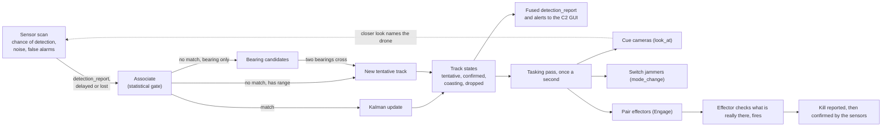

# Fusion and targeting

How the fusion node turns noisy sensor reports into tracks, decides what each track is and how urgent it is, points cameras, switches jammers and assigns weapons, and how well that automatic targeting performs when measured against the truth. It is for a defence reader who wants to know what the numbers mean and how far to trust them, and for a developer who wants to change the rules. The messages themselves are in [SAPIENT.md](SAPIENT.md); how sensors detect and how shots work are in [PHYSICS_AND_PROPAGATION.md](PHYSICS_AND_PROPAGATION.md).

Config stores money in US dollars; this document shows it as the game does, in pounds at 0.75 ([`economy.js:26`](../frontend/src/sim/economy.js#L26)).

## Contents

- [The pipeline](#the-pipeline)
- [How detections arrive](#how-detections-arrive)
- [Association](#association)
- [The Kalman filter](#the-kalman-filter)
- [Track states](#track-states)
- [Bearing-only fixes](#bearing-only-fixes)
- [Classification](#classification)
- [Threat evaluation](#threat-evaluation)
- [Camera cueing](#camera-cueing)
- [Jammers](#jammers)
- [Weapon-target assignment](#weapon-target-assignment)
- [Reloads, salvoes and deconfliction](#reloads-salvoes-and-deconfliction)
- [Kill reports and kill confirmation](#kill-reports-and-kill-confirmation)
- [Truth and belief](#truth-and-belief)
- [Measured performance](#measured-performance)
- [Limits and simplifications](#limits-and-simplifications)
- [Where this lives in the code](#where-this-lives-in-the-code)

## The pipeline

The simulation moves in fixed steps of 0.05 s ([`simulation.js:29`](../frontend/src/sim/simulation.js#L29)). In each step the network does its work in this order ([`network/index.js:35`](../frontend/src/sim/network/index.js#L35)):

1. Messages that have now arrived are acted on (a report fed to the tracker, a task carried out).
2. Each sensor whose report interval has passed scans; every node sends a status report every 5 s.
3. The tracker drops stale tracks and updates coasting flags ([`tracker.js:245`](../frontend/src/sim/tracker.js#L245)).
4. Track estimates, speed, closing rate, airframe and loitering are refreshed ([`fusion.js:21`](../frontend/src/sim/network/fusion.js#L21)).
5. Engagement requests that have lapsed are cancelled, kill reports are checked, track alerts are raised and, once a second, fused reports go to the C2 GUI.
6. Once a second ([`world.js:87`](../frontend/src/sim/config/world.js#L87)) the fusion node checks contact with every node and runs the tasking pass.

## How detections arrive

Each sensor scans at its own interval: 1 s for radars, RF detectors, acoustic sensors and the perimeter sensor, 0.5 s for cameras (each system's `sapient.interval`, listed in [SENSORS.md](SENSORS.md)). In a scan each drone is detected with a probability that falls off steeply beyond the sensor's reach for that drone, and a sensor raises a false alarm with its own chance per scan ([`sensors.js:196`](../frontend/src/sim/network/sensors.js#L196)). How reach and the chance of detection are worked out is in [PHYSICS_AND_PROPAGATION.md](PHYSICS_AND_PROPAGATION.md).

A detection is measured with Gaussian noise ([`sensors.js:133`](../frontend/src/sim/network/sensors.js#L133)). The standard deviations are the sensor's `sapient.noise` (degrees of azimuth and elevation, metres of range) multiplied by an error scale that grows as the signal weakens: `k = min(8, hypot(1, 2 × (range / reach)^p))`, with `p = 2` for radar and 1 for other sensors ([`site-range.js:68`](../frontend/src/sim/site-range.js#L68)). At the edge of its reach a sensor's errors are about 2.2 times its quoted noise. The report carries those error figures, so the fusion node knows how good each measurement is.

Measurements come in three shapes, set by which noise figures a sensor has:

| Shape | Sensors | What it fixes |
|---|---|---|
| Range, azimuth and elevation | radars, the perimeter sensor | a point in 3D, with an error ellipsoid long along the line of sight or across it |
| Azimuth and elevation, no range | cameras, the medium acoustic sensor | a line of sight in 3D |
| Azimuth only | RF detectors, the small and large acoustic sensors | a vertical plane through the sensor |

A fourth case, range and azimuth with no elevation (a 2D radar), is handled by the tracker ([`tracker.js:141`](../frontend/src/sim/tracker.js#L141)) but no catalogue sensor uses it.

An acoustic sensor hears where the drone was when the sound left it, range / 343 s ago ([`sensors.js:24`](../frontend/src/sim/network/sensors.js#L24)). A report reaches the tracker only when the communications model delivers it, and it is applied at the time it was measured, not the time it arrived ([`fusion.js:12`](../frontend/src/sim/network/fusion.js#L12)).

False alarms appear at a random direction and range inside what the sensor covers (a camera only inside its current view), with a confidence of 0.3 to 0.5 and the classification `Unknown` at 0.4 ([`sensors.js:114`](../frontend/src/sim/network/sensors.js#L114)). The fusion node is not told which reports are false alarms.

## Association

The fusion node is never told which drone a report came from. Each measurement is matched to the nearest existing track inside a statistical gate ([`tracker.js:161`](../frontend/src/sim/tracker.js#L161)):

- Every track is predicted forward to the measurement time.
- The measurement is turned into a point `z` and covariance `R` in east, north, up metres (below).
- The squared Mahalanobis distance `d² = yᵀ S⁻¹ y` is computed, with innovation `y = z − predicted position` and `S = P_pos + R`. (The Mahalanobis distance measures how far off a measurement is in units of the combined uncertainty.)
- The track with the smallest `d²` below the gate of 14.2 wins. 14.2 is the chi-square value for three degrees of freedom at about 99.7% ([`tracker.js:56`](../frontend/src/sim/tracker.js#L56)).
- A track takes at most one measurement from each scan of each sensor.

This is greedy nearest-neighbour association: each report is decided on its own, as it arrives. Close targets can swap tracks or share one, and a wide gate on a vague measurement lets it update the wrong track.

For a measurement with range, `z` is the measured point and `R` is an ellipsoid with the range error along the line of sight and range × angle error across it ([`tracker.js:47`](../frontend/src/sim/tracker.js#L47), [`tracker.js:146`](../frontend/src/sim/tracker.js#L146)). For a bearing-only measurement, `z` is placed on the line of sight at the point nearest the track's prediction, with a standard deviation of 4,000 m along the line (`bigSigma`, "unknown") and distance × angle error across it; with no elevation the vertical deviation is also 4,000 m ([`tracker.js:151`](../frontend/src/sim/tracker.js#L151)). So a bearing pulls a track sideways onto its line but says nothing about range.

## The Kalman filter

Each track is a constant-velocity Kalman filter (a recursive estimator that blends a motion model with noisy measurements, weighting each by its uncertainty) over position and velocity in metres east, north and up ([`tracker.js:82`](../frontend/src/sim/tracker.js#L82)).

| Item | Value | Where |
|---|---|---|
| State | position (3) and velocity (3), m and m/s | [`tracker.js:119`](../frontend/src/sim/tracker.js#L119) |
| Motion model | constant velocity: position += velocity × dt | [`tracker.js:93`](../frontend/src/sim/tracker.js#L93) |
| Process noise | white acceleration of 6 m/s² on each axis (`accel`): adds q·dt³/3 to position variance, q·dt²/2 to the cross term and q·dt to velocity variance, q = 36 m²/s⁴ | [`tracker.js:57`](../frontend/src/sim/tracker.js#L57), [`tracker.js:85`](../frontend/src/sim/tracker.js#L85) |
| Initial position covariance | the first measurement's `R`, or the crossing's covariance for a bearing fix | [`tracker.js:227`](../frontend/src/sim/tracker.js#L227) |
| Initial velocity | zero, with a standard deviation of 45 m/s (`velSigma`) | [`tracker.js:58`](../frontend/src/sim/tracker.js#L58) |
| Measurement model | position only (H = [I 0]); each measurement's `R` as above | [`tracker.js:104`](../frontend/src/sim/tracker.js#L104) |
| Height with no measurement | 60 m above the sensor, standard deviation 150 m (`flatHeight`, `flatSigma`) | [`tracker.js:66`](../frontend/src/sim/tracker.js#L66) |

The update is the standard one: gain `K = P Hᵀ S⁻¹`, state += `K y`, covariance reduced by `K H P` ([`tracker.js:104`](../frontend/src/sim/tracker.js#L104)). The filter does not use the radar's measured Doppler velocity; velocity comes only from successive positions.

A track's reported error (`estErr`, drawn as the ring round a track) is the root mean square of the position standard deviations, horizontal only for a track with no measured height, combined with ½ × 6 m/s² × t² for the t seconds since its last update ([`tracker.js:117`](../frontend/src/sim/tracker.js#L117), [`tracker.js:257`](../frontend/src/sim/tracker.js#L257)). A track is "flat" until a measurement with elevation updates it; a flat track's height is a guess, so distances to it are measured across the ground only.

## Track states

| State | Rule | Value |
|---|---|---|
| Tentative | made by one ranged measurement, or by two crossing bearings | |
| Confirmed | at least `confirmHits` updates, and either a range measurement or `confirmSensors` different sensors (two bearings always cross somewhere) | 3 hits; 3 sensors ([`tracker.js:239`](../frontend/src/sim/tracker.js#L239)) |
| Coasting | a confirmed track no sensor has updated for `coastAfter` | 1.6 s |
| Dropped, tentative | no update for `tentativeTimeout` | 2.5 s |
| Dropped, confirmed or coasting | no update for `confirmedTimeout` | 5 s |
| Unmatched bearing kept for a crossing | `candidateLife` | 3 s |

The values are in [`tracker.js:55`](../frontend/src/sim/tracker.js#L55). The timeouts are for sensors that report about once a second; each sensor stretches them by its own interval if it is slower than 1 s, and a track drops only when every sensor that fed it has gone quiet for that long ([`tracker.js:72`](../frontend/src/sim/tracker.js#L72)). No catalogue sensor reports less often than once a second, so in practice the stretch is 1.

A coasting track is still reported and still drawn (dimmer), but only confirmed tracks are offered to effectors and cameras ([`fusion.js:19`](../frontend/src/sim/network/fusion.js#L19)). When a track is first confirmed it gets a short name (`T1`, `T2` and so on) and a "New track" alert.

## Bearing-only fixes

A bearing-only measurement that matches no track cannot start one alone. It is kept as a candidate, and the next bearing from a different sensor is tested against every candidate ([`tracker.js:194`](../frontend/src/sim/tracker.js#L194)):

- The two lines are crossed at their closest approach, in 3D if both have elevation, otherwise across the ground ([`tracker.js:177`](../frontend/src/sim/tracker.js#L177)).
- Lines within about 1.8° of parallel give no fix (`1 − cos² < 0.001`), nor does a crossing behind either sensor.
- A crossing more than 1.5 times either sensor's reach away is ignored ([`tracker.js:192`](../frontend/src/sim/tracker.js#L192)).
- The miss distance between the lines must be under 2.5 × (range × angle error, summed over both) + 40 m, and the closest crossing wins ([`tracker.js:200`](../frontend/src/sim/tracker.js#L200)).
- The new track's position error is the largest of 60 m, 4% of the longer range and the miss distance; with no elevation from either, its height is the sensors' mean height + 60 m with a 150 m error ([`tracker.js:205`](../frontend/src/sim/tracker.js#L205)).

The candidate used is removed so one bearing cannot start two tracks. Two drones seen by two direction finders give four crossings, two of them wrong: this is the classic way a bearing-only network makes ghosts, and the game reproduces it. The renderer draws unclaimed bearings as rays from the sensor so the player can see it happen.

## Classification

Sensors classify on their own, and the fusion node keeps the most detailed answer it has heard. Classifications are a tree in the SAPIENT form: `Air Vehicle`, then `UAV` (level 1), then the airframe (level 2: `Multirotor` or `Fixed wing`), then the model (level 3) ([`sensors.js:94`](../frontend/src/sim/network/sensors.js#L94)).

| Sensor | What it reports for a real drone |
|---|---|
| Camera | Air Vehicle 0.95, UAV 0.9; the airframe once the drone covers 8 pixels (0.85) or 13 (0.95); the model at 13 pixels (0.9). Pixels across = 4 × reach / range ([`camera-model.js:8`](../frontend/src/sim/camera-model.js#L8)) |
| RF detector with a library | Air Vehicle 0.85, UAV 0.8; the airframe (0.9) if its library knows the drone's link family; the model (0.9) as well for a commercial (DJI or Autel) link |
| RF detector with no library | Unknown 0.5 |
| Radar with micro-Doppler, inside half its reach | Air Vehicle 0.8, UAV 0.7, airframe 0.6 ([`sensor-model.js:29`](../frontend/src/sim/sensor-model.js#L29)) |
| Other radars, the perimeter sensor | Air Vehicle 0.7, UAV 0.55 |
| Acoustic | Air Vehicle 0.7, UAV 0.6 |
| Any false alarm | Unknown 0.4 |

Fusion is simple: a track keeps the classification with the deepest tree it has received, replaced only by one at least as deep ([`fusion.js:16`](../frontend/src/sim/network/fusion.js#L16)). Confidences are carried but not combined, and nothing ever lowers a classification. The track's airframe and model are read from levels 2 and 3 ([`fusion.js:29`](../frontend/src/sim/network/fusion.js#L29)). When a sensor does name a real drone, the name is always right: a wrong classification can only reach a track through association, when a report from one drone updates another drone's track.

## Threat evaluation

The fusion node judges a track from what its sensors have named, never from the real drone, using a threat library built from the drone catalogue ([`threats.js:15`](../frontend/src/sim/network/threats.js#L15)):

- A named model brings its own figures. A named airframe brings the average of the drones of that airframe the enemy is known to send (the attack mix, `state.attack`, [`simulation.js:63`](../frontend/src/sim/simulation.js#L63)). An unnamed track is judged as the average of everything the enemy sends.
- **Harm** is the drone's `damage`. A spotter does no damage itself, so its harm is its `spotBonus` × the mean damage of the strike drones ([`threats.js:20`](../frontend/src/sim/network/threats.js#L20)).
- **Breakable** is true only if every drone it could be has a radio control link with jam resistance below 1 ([`threats.js:9`](../frontend/src/sim/network/threats.js#L9)). This decides whether the fusion node may hold fire for a jammer.
- **Bands** are every link band it could use: control, video and satellite navigation. This decides which jammers are switched on.

**Urgency** orders tracks: distance to the defended area / max(speed, 10 m/s) / max(harm, 1) ([`tasking.js:36`](../frontend/src/sim/network/tasking.js#L36)). The lower, the sooner it must be dealt with. The distance is to the outline of a drawn area if there is one, otherwise to the station ([`core.js:76`](../frontend/src/sim/network/core.js#L76)). The code ranks by speed rather than closing speed on purpose: a velocity built from bearings can point anywhere, and emitter-seeking drones head for systems further out, so ranking by closing speed lost the radar sooner in testing (the comment in the code records 4 of 6 mixed runs letting strikes through).

Other judgements:

| Judgement | Rule | Value |
|---|---|---|
| Leaving | closing on the site faster than −10 m/s and not heading for the site or any of your systems at more than 10 m/s ([`tasking.js:48`](../frontend/src/sim/network/tasking.js#L48)) | `minClosing` 10 m/s |
| Loitering, "probable spotter" | moving at 8 m/s or more, with less than 0.3 of its speed towards or away from the site, for 10 s, outside any drawn area ([`fusion.js:56`](../frontend/src/sim/network/fusion.js#L56)) | `loiterAfter` 10 s |
| Warning alert | track within 2,500 m of the site | `warnZone` |
| Critical alert | track within 800 m | `critZone` |

The values are in [`world.js:85`](../frontend/src/sim/config/world.js#L85).

## Camera cueing

Radar and RF find things; a camera has a narrow view and must be told where to look. In each tasking pass every camera that is not busy is sent a SAPIENT `look_at` task for the most useful confirmed track it can reach (within 1.3 times its zoomed reach) ([`cameras.js:8`](../frontend/src/sim/network/cameras.js#L8)):

- Unclassified tracks come first, nearest the site first; a classified track scores 1,000,000 m worse ([`cameras.js:22`](../frontend/src/sim/network/cameras.js#L22)).
- A track it has looked at in the last 4 s is skipped. A classified track is looked at again only if it is close enough for the model to be named.
- The camera turns at its slew rate once the task arrives, zooms to its track view and dwells for its `dwell` time. A look to name a model is cut short by a new unclassified track.
- For a flat track (no measured height) the camera starts at the guessed height, then steps up one view at a time, three looks at each, to the angle that reaches 500 m above the camera at the track's range or 45°, whichever is lower, then starts again at the horizon ([`sensors.js:222`](../frontend/src/sim/network/sensors.js#L222)).
- With nothing to look at, it is sent a `mode_change` back to `Search` and sweeps, facing away from what is defended.

## Jammers

A networked jammer is switched to `Jam` by a SAPIENT `mode_change` task when any confirmed track it reaches and faces could use a band it jams, and back to `Standby` when none does ([`tasking.js:204`](../frontend/src/sim/network/tasking.js#L204)). The mode changes when the task arrives. A jammer with `trigger: 'receiver'` switches itself on what its own receiver hears, and stops to listen after 2.5 s of hearing nothing (`LOOK`, an assumption, [`tasking.js:17`](../frontend/src/sim/network/tasking.js#L17)); one with `trigger: 'manual'` follows the player. A sector jammer on a pan-and-tilt head is turned onto the most urgent track it could jam, at once and without a SAPIENT task (a recorded shortcut at [`tasking.js:213`](../frontend/src/sim/network/tasking.js#L213)).

**Soft kill first.** An interceptor or missile launcher is not offered a track that a jammer should be left to deal with ([`tasking.js:91`](../frontend/src/sim/network/tasking.js#L91)). The track is left to the jammers when all of these hold:

- the track is named to its model (by a camera or an RF library), that model has a radio control link jamming can break, and a networked jammer that jams that band and can follow that link is available (one switched by its own receiver must already be jamming);
- it is not yet inside the 800 m critical zone;
- its path to the site spends at least `softKillWait` (10 s) inside a jammer's reach before reaching the critical zone, judged over the real ground between them;
- a jammer has not already had it for more than 10 s;
- that model has not outlasted the jammers in more than half of at least 3 holds this run (the fusion node learns, as a crew would, [`tasking.js:87`](../frontend/src/sim/network/tasking.js#L87)).

## Weapon-target assignment

Once a second the tasking pass decides what every networked effector does ([`tasking.js:229`](../frontend/src/sim/network/tasking.js#L229)). Systems with `networked: false` are worked by their crews and are never tasked ([`crew.js`](../frontend/src/sim/crew.js)).

**An effector already engaged** first checks its task. It reports and drops the task if it can no longer fire, if its target is dead (and starts a kill watch), if the track has gone, if the track has left its envelope or if the track is leaving. Otherwise it looks for the most urgent track it could take; it switches only if that track's urgency score is at most 75% of its current target's (`retaskGain` 0.25), or freely if the rounds already in the air are enough for the current one ([`tasking.js:274`](../frontend/src/sim/network/tasking.js#L274)). A switch sends `CONTROL_STOP` for the old task, then a new `Engage`.

**Free effectors** are paired with tracks in order of urgency ([`tasking.js:292`](../frontend/src/sim/network/tasking.js#L292)):

1. A track already being engaged is skipped unless it is inside the 800 m critical zone, where every effector that can takes it on.
2. Of the free effectors that can take the track, those with at least half the best chance of a kill (`FAIR` 0.5) are kept.
3. The one with the lowest expected cost per kill wins: shot cost / chance of a hit, or for a beam, shot cost × seconds to burn a drone of the model's hit points (20 if unknown) ([`tasking.js:283`](../frontend/src/sim/network/tasking.js#L283)). This is why a gun or laser takes a quadcopter before a missile does.
4. Repeat until no pairing is made.

The chance used is the game's own hit chance with the target's evasion unknown (taken as 1), at the distance to the track's estimate, including the penalty for the track's error ([`hit-chance.js:34`](../frontend/src/sim/hit-chance.js#L34)).

**What an effector can take** ([`tasking.js:280`](../frontend/src/sim/network/tasking.js#L280), [`tasking.js:178`](../frontend/src/sim/network/tasking.js#L178)):

- the track's estimate is between its minimum range and its range, and the track is not leaving;
- a flying round (interceptor or missile) could meet the track at its estimated speed within the round's range ([`tasking.js:171`](../frontend/src/sim/network/tasking.js#L171));
- the effector has not been refused that track by the operator, has no approval request waiting, is not in its 3 s back-off after a rejection for that track (`rejectBackoff`), and the track is not on a 10 s hold after an effector found nothing there (`emptyHold`);
- the airframe is one it engages (an unnamed track is always offered, and the effector can refuse it);
- for an interceptor or missile, the track is not being left to the jammers;
- for a launcher with `engagePolicy: 'fixed-wing'` (the missile in these laydowns): a fixed-wing track, or an unnamed track inside the critical zone that nothing else is engaging. A known multirotor is never worth the round ([`tasking.js:185`](../frontend/src/sim/network/tasking.js#L185));
- rounds already in the air at the target are not enough on their own.

**Engagement authority.** With authority `auto` the fusion node engages by itself. With `costly` it asks the operator first for a shot costing at least $50,000 (£37,500), and with `all` for every engagement. The request is a SAPIENT alert and the answer an alert acknowledgement; it lapses after 20 s, after which that effector may ask again about that track 10 s later. An operator's rejection rules that effector out for that track for good ([`authority.js:33`](../frontend/src/sim/network/authority.js#L33)). An approval is acted on only if the engagement still makes sense ([`tasking.js:314`](../frontend/src/sim/network/tasking.js#L314)). How this sits outside the standard is in [SAPIENT.md](SAPIENT.md#where-the-game-departs-from-the-standard).

**The effector's answer.** The `Engage` task names the track. The effector looks for a real drone within 300 m of the track's estimate (`acquireRadius`); with none it rejects the task with "nothing found at the cued position" and the track goes on its 10 s hold ([`tasking.js:139`](../frontend/src/sim/network/tasking.js#L139)). It also rejects a target out of range or out of sight (measured to the real drone), a type it cannot engage (permanently), and a shot the budget cannot pay for or a launcher that is reloading ([`simulation.js:70`](../frontend/src/sim/simulation.js#L70)). Once it accepts, it acts when the task arrives over the network, and it then fires at the real drone it found.

## Reloads, salvoes and deconfliction

- **Reloads.** A launcher that cannot fire (reloading, or out of rounds) gives up its task with `TASK_STATUS_FAILED` and is offered nothing until it can fire again. The fusion node reads the magazine directly rather than from a status report (a recorded shortcut at [`tasking.js:243`](../frontend/src/sim/network/tasking.js#L243)). Large systems reload only after the wave ([`magazine.js:11`](../frontend/src/sim/magazine.js#L11)); magazines are in [EFFECTORS.md](EFFECTORS.md).
- **Salvoes.** A guided launcher holds fire while the rounds already flying at its target could kill it and there is time to see the result and fire again (the drone needs more than twice the round's flight time plus the launcher's cooldown to reach the site). When there is not, it keeps firing until the rounds in the air have an 80% chance that one works (`SALVO_ASSURANCE`, an assumption, [`effectors.js:48`](../frontend/src/sim/effectors.js#L48)). While enough rounds are on their way, the launcher may look for another target.
- **Deconfliction.** One effector per track outside the critical zone; all comers inside it. One approval request per effector at a time. An effector that gave up a task while its rounds may still be flying is credited with a kill they make for 30 s (`RELEASED_FOR`, [`tasking.js:22`](../frontend/src/sim/network/tasking.js#L22)), so the fusion node waits for the sensors instead of cueing another effector at a dead track.

## Kill reports and kill confirmation

SAPIENT has no kill message. When an effector's target dies, the effector reports its task `COMPLETED` with "target destroyed or removed", the fusion node raises a "Kill reported" alert and puts the track on a kill watch, which takes it out of tasking ([`tasking.js:124`](../frontend/src/sim/network/tasking.js#L124)). After 2.5 s (`killConfirmDelay`) times the slowest sensor's stretch, the fusion node checks whether any sensor has updated the track since. If none has, it raises "Kill confirmed" and deletes the track; if one has, it warns "Kill NOT confirmed" and the track returns to play ([`fusion.js:79`](../frontend/src/sim/network/fusion.js#L79)). A drone brought down by jamming produces no kill report: its track simply goes quiet and drops.

## Truth and belief

The fusion node works only from reports. The game keeps the truth separately and shows the gap:

- **Truth overlay** (key T): every drone drawn where it really is, grey if no sensor has it; each track drawn where the fusion node believes it is, with a ring for its error, and a line from track to drone when a real drone is within 300 m of the track. A ghost has no line ([`belief-view.js`](../frontend/src/render/belief-view.js)).
- With the overlay off the player sees only the fusion node's picture.

Where the truth is used, and where it is not:

| Used by | Truth or belief |
|---|---|
| Association, track states, classification, threat evaluation, urgency, pairing, camera cueing, jammer switching | belief only |
| Linking a track to a drone (`droneAt`, [`fusion.js:43`](../frontend/src/sim/network/fusion.js#L43)) | truth: the nearest drone within 300 m of the estimate, for the seeker, the overlay and the statistics. It never feeds the fusion node's picture |
| An effector's acceptance (range, line of sight, type) | truth, at the moment the task is sent |
| An accepted engagement | truth: the effector follows the real drone it found, wherever the track goes |
| A shot's chance | the track's error when it was fired lowers the chance by 1 / (1 + (error / 300 m)²) ([`hit-chance.js:38`](../frontend/src/sim/hit-chance.js#L38)) |
| A round whose target dies | re-targets the nearest real drone within 1,500 m of it that the fusion node is tracking (a confirmed or coasting track is linked to it) ([`effectors.js:122`](../frontend/src/sim/effectors.js#L122)) |
| Magazines | read directly by the fusion node |

## Measured performance

### Method

A Node script, [`tools/measure-fusion.js`](../frontend/tools/measure-fusion.js) (`npm run measure` from `frontend/`), plays each run headless, one 0.05 s step at a time, and observes the state after every step without changing it. It stops if a reference scenario does not end on its digest in `frontend/tests/support/reference-digests.json`, so the observed runs are the reference runs. The figures below were measured on 10 November 2026, at game version 0.19.3.

**Scenarios.** The five reference scenarios in [`scenarios.js`](../frontend/tests/support/scenarios.js), set up as `runReferences` sets them up (no resupply between waves), plus the `MIXED` laydown on three more seeds:

| Scenario | Laydown | Seed | Waves |
|---|---|---|---|
| mixed-seed1, mixed-seed7 | MIXED: 1 medium radar, 2 medium RF detectors, 2 medium cameras, 2 medium jammers, 3 interceptor launchers, 1 missile launcher | 1, 7 | 6 |
| mixed-gnss-seed42 | MIXED, with the jammers also jamming satellite navigation | 42 | 4 |
| lasers-seed42 | LASERS: 1 medium radar, 2 small radars, 5 lasers | 42 | 8 |
| jammers-seed1 | JAMMERS: 3 small radars, 6 medium jammers, no other effectors | 1 | 4 |
| mixed-seed2, 3, 4 (not references) | MIXED | 2, 3, 4 | 6 |

All runs: generated terrain seed 1, the "Clear day" conditions, the default attack mix (the four generic types: first-person-view, fixed-wing and fibre-optic strike drones and the fixed-wing spotter), automatic engagement authority, no drawn area. Each run took 1 to 4 s of wall time, one at a time. The definitions below say exactly what each number counts.

**Definitions.**

- *Detected*: a sensor scan detected the drone at least once (the flight log's first sighting, which `stats.js` also uses), whether or not the report then arrived.
- *Confirmed track*: the first step at which a confirmed or coasting track was linked to the drone by the game's own test, a track estimate within 300 m in 3D (across the ground for a flat track). *Detect to confirm* is that time minus the first detection.
- *First detected by a bearing-only sensor*: the earliest sighting was by an RF detector, camera or acoustic sensor.
- *Median and 90th percentile*: the nearest value in the sorted list, never one worked out between two.
- *Track error*: once per simulated second, on the second, for each confirmed or coasting track linked to a drone, the distance from the estimate to the drone's true position, across the ground and (for tracks with a measured height) in 3D. A track more than 300 m off is not linked, so this error is capped at 300 m by construction; the unlinked time is counted separately below.
- *Error / claimed error*: the error across the ground divided by the track's own `estErr`. Below 1 means the track claims more uncertainty than it has.
- *Track ids per drone*: distinct confirmed tracks linked to one drone over its flight. 1 is one unbroken track; more means breaks, swaps or duplicates.
- *Ghost*: a track that reached confirmed status and was never linked to any drone in any step of its confirmed or coasting life. A link while it was still tentative does not count.
- *Detect to first shot*: the flight log's first shot or beam second at the drone minus its first detection. It includes the time the drone took to fly into reach, so it is not a reaction time.
- *Rounds per round kill*: rounds from guided weapons fired at drones of the type / kills of that type by guided weapons. *Beam seconds per beam kill* likewise. *Shot cost per kill*: everything spent on shots at the type / all kills of the type, including free jamming kills.

### Outcomes

| Scenario | Waves played | Launched | Killed | Leaked or struck | Site health at end | Spent on shots |
|---|---|---|---|---|---|---|
| mixed-seed1 | 6 | 79 | 58 | 20 | 10 | £1,305,000 |
| mixed-seed7 | 6 | 79 | 73 | 6 | 100 | £1,155,000 |
| mixed-gnss-seed42 | 4 | 40 | 39 | 0 | 100 | £262,500 |
| mixed-seed2 | 6 | 79 | 74 | 5 | 100 | £855,000 |
| mixed-seed3 | 6 | 79 | 75 | 4 | 100 | £1,155,000 |
| mixed-seed4 | 6 | 79 | 67 | 12 | 10 | £1,005,000 |
| lasers-seed42 | 8 | 131 | 126 | 1 | 100 | £5,519 |
| jammers-seed1 | 4 (site lost) | 40 | 31 | 6 | 0 | £0 |

"Leaked or struck" counts drones that reached the site and drones that hit one of your systems.

### Tracking, by drone type

MIXED (six runs pooled):

| Drone | Launched | Detected | Confirmed track | First seen, median distance from site | First detected bearing-only | Detect to confirm, median / 90th | Same, first seen by radar, median | Error across the ground, median / 90th | Error in 3D, median | Error / claimed | Track ids per drone |
|---|---|---|---|---|---|---|---|---|---|---|---|
| Fibre-optic strike | 32 | 100% | 97% | 4,362 m | 6% | 7.1 / 119.7 s | 7.1 s | 27 / 120 m | 49 m | 0.89 | 2.35 |
| First-person-view strike | 332 | 331 of 332 | 95% | 4,951 m | 58% | 25.1 / 110.2 s | 12.8 s | 25 / 118 m | 48 m | 0.80 | 1.66 |
| Fixed-wing strike | 49 | 48 of 49 | 90% | 7,821 m | 21% | 7.1 / 81.1 s | 7.1 s | 35 / 114 m | 76 m | 0.67 | 1.77 |
| Fixed-wing spotter | 22 | 100% | 95% | 13,190 m | 77% | 116.1 / 237.2 s | 105.1 s | 51 / 157 m | 109 m | 0.65 | 1.86 |

LASERS (lasers-seed42; only radars, so every first detection is by radar):

| Drone | Launched | Detected | Confirmed track | First seen, median distance from site | Detect to confirm, median / 90th | Error across the ground, median / 90th | Error in 3D, median | Error / claimed | Track ids per drone |
|---|---|---|---|---|---|---|---|---|---|
| Fibre-optic strike | 12 | 100% | 100% | 4,758 m | 32.1 / 76.1 s | 48 / 132 m | 91 m | 0.67 | 2.17 |
| First-person-view strike | 96 | 100% | 100% | 4,652 m | 13.1 / 85.2 s | 48 / 120 m | 95 m | 0.69 | 1.70 |
| Fixed-wing strike | 16 | 100% | 100% | 9,790 m | 18.1 / 87.1 s | 40 / 124 m | 83 m | 0.69 | 2.63 |
| Fixed-wing spotter | 7 | 100% | 100% | 12,786 m | 145.1 / 148.1 s | 46 / 139 m | 95 m | 0.72 | 5.14 |

JAMMERS (jammers-seed1, three small radars): 24 of 32 first-person-view drones, 2 of 4 fixed-wing strikes and both spotters were detected; neither fibre-optic drone was. Detect to confirm was 19.1 s median for the first-person-view drones and track error across the ground 35 m median (112 m at the 90th percentile), 62 m in 3D.

### Engagement, by drone type

MIXED (six runs pooled):

| Drone | Detect to first shot, median | Killed | by rounds / beam / jamming | Leaked or struck | Rounds per round kill | Shot cost per kill |
|---|---|---|---|---|---|---|
| Fibre-optic strike | 17.4 s | 21 of 32 (66%) | 21 / 0 / 0 | 11 | 1.19 | £11,429 |
| First-person-view strike | 36.2 s | 302 of 332 (91%) | 222 / 0 / 80 | 30 | 2.03 | £7,041 |
| Fixed-wing strike | 56.3 s | 43 of 49 (88%) | 43 / 0 / 0 | 6 | 2.88 | £58,430 |
| Fixed-wing spotter | 180.3 s | 20 of 22 (91%) | 20 / 0 / 0 | 0 (2 airborne at the end) | 1.70 | £42,938 |

LASERS (lasers-seed42): the lasers killed every fibre-optic (12) and fixed-wing (16) strike drone, 95 of 96 first-person-view drones (one got through) and 3 of 7 spotters (3 left, 1 was airborne at the end). Beam seconds per beam kill were 3.0, 3.7, 9.1 and 9.7, and shot cost per kill £29, £36, £89 and £94. Median detect to first shot was 64 s for first-person-view drones and 151 s for fixed-wing strikes, which are seen far out.

JAMMERS (jammers-seed1): 31 of 32 first-person-view drones were brought down by jamming, at no shot cost. All 4 fixed-wing strikes and a fibre-optic drone got through, and the site fell in wave 4.

### The picture and the tasking, per run

| Scenario | Confirmed tracks | Ghosts | Ghosts with a false alarm among their latest reports | Ghosts with a drone within 300 m across the ground | Confirmed-track time with no drone linked | of which after a drone had been linked | False alarms raised | Engage tasks | at a linked drone | at a dead drone's track (already under kill watch) | at a track that had drifted off its live drone | at a track never linked so far | Rejected: "nothing found" | "Kill NOT confirmed" alerts |
|---|---|---|---|---|---|---|---|---|---|---|---|---|---|---|
| mixed-seed1 | 128 | 31 (24%) | 23 | 12 | 42% | 19% | 1,164 | 307 | 107 | 42 (23) | 60 | 98 | 167 | 5 |
| mixed-seed7 | 164 | 27 (16%) | 24 | 4 | 35% | 20% | 1,332 | 315 | 124 | 63 (28) | 38 | 90 | 159 | 6 |
| mixed-gnss-seed42 | 78 | 11 (14%) | 8 | 2 | 35% | 24% | 698 | 193 | 67 | 40 (20) | 40 | 46 | 110 | 7 |
| mixed-seed2 | 175 | 47 (27%) | 30 | 14 | 38% | 19% | 1,214 | 372 | 121 | 61 (32) | 85 | 105 | 220 | 10 |
| mixed-seed3 | 170 | 37 (22%) | 26 | 14 | 36% | 16% | 1,274 | 316 | 117 | 51 (35) | 49 | 99 | 175 | 6 |
| mixed-seed4 | 152 | 46 (30%) | 34 | 11 | 33% | 17% | 1,134 | 288 | 114 | 55 (36) | 40 | 79 | 148 | 11 |
| lasers-seed42 | 294 | 31 (11%) | 1 | 20 | 18% | 13% | 2,080 | 801 | 695 | 98 (96) | 7 | 1 | 93 | 0 |
| jammers-seed1 | 35 | 3 (9%) | 0 | 2 | 20% | 17% | 1,154 | 0 | 0 | 0 | 0 | 0 | 0 | 0 |

"A false alarm among their latest reports" checks the last report the track kept from each sensor, so it is a lower bound. The sensors that fed the 233 ghosts across all runs: radar, RF and camera 92; radar and RF 70; radar alone 47; camera and RF (bearings only) 20; radar and camera 4.

Engage tasks across all runs: 2,592 were sent. 346 were lost on the network and drew no answer (the fusion node then backs that effector off the track for 3 s, [`tasking.js:151`](../frontend/src/sim/network/tasking.js#L151)). The other 2,246 were answered: rejected, nothing found at the cued position 1,072; accepted 843; rejected, no line of sight (lasers) 317; rejected, out of range 14. Accepted tasks later ended as: completed on re-tasking 517, completed with the target destroyed 222, failed as the track was lost 48, failed while reloading 38, failed out of rounds 16, completed as the target was leaving 1, completed as the target left the engagement envelope 1.

### What the numbers say

What works:

- Detection and tracking are reliable in these laydowns. All but 2 of the 566 drones in the MIXED and LASERS runs were detected (one first-person-view drone and one fixed-wing strike in MIXED never were), and 90% to 100% of each type got a confirmed track.
- Positions across the ground are good enough to cue a seeker: in the MIXED and LASERS runs, median errors of 25 to 51 m, and 90th percentiles of 114 to 157 m, against the 300 m a seeker searches. These count only tracks within 300 m of their drone; the time tracks spent further off is in the per-run table.
- The filter's stated error is cautious. In the median the real error across the ground is 0.65 to 0.89 of what the track claims, so for a track that is on its drone the error ring is a fair upper guide, not an understatement. (The same 300 m cap applies, so badly placed tracks are not in this figure.)
- The cost-aware pairing does what it is meant to. The rules keep the missile for fixed-wing tracks, and the cost per kill shows it: £58,430 per fixed-wing kill against £7,041 per first-person-view kill in MIXED, where jammers took 80 of the 302 first-person-view kills for nothing. Lasers kill everything they reach for tens of pounds a kill.

Weaknesses:

- **Height is poor.** The median error in 3D is 1.8 to 2.2 times the median across the ground (48 to 109 m; the 3D figure covers only tracks with a measured height). The likely cause is radar elevation noise, which grows with range. In the LASERS run, 20 of the 31 "ghosts" had a real drone within 300 m across the ground: they were real drones whose height was far enough off that the 3D link test failed. For an effector the effect is the same as a ghost: "nothing found".
- **Ghosts in mixed networks.** In the MIXED runs 14% to 30% of confirmed tracks never had a drone near them. 162 of those 199 ghosts were fed by the radar together with RF bearings, and 145 (nearly three quarters) had a false alarm among their latest reports. A likely mechanism (an interpretation, not traced report by report): a radar false alarm opens a tentative track, and RF bearings, whose errors are several degrees wide and 4 km long along the line, fall inside its gate and supply the extra hits that confirm it.
- **Slow confirmation from first detection.** First-person-view drones in MIXED took 25 s median from first detection to a confirmed track (110 s at the 90th percentile). 58% were first detected by a bearing-only sensor (an RF detector or a camera); with two RF detectors and two cameras, a bearing-only track needs a third sensor or the radar. When the radar saw them first the median was 13 s. Even radar-first, a far target's detections are intermittent and a tentative track that goes 2.5 s without an update is dropped, so the 3 hits often take longer than 3 s. The spotter is the extreme case: an RF detector hears its 900 MHz link far beyond the radar, so 77% were first detected bearing-only, at a median 13.2 km, and then waited 116 s in the median (237 s at the 90th percentile) for a confirmed track.
- **Wasted tasking.** In the MIXED runs only 36% of Engage tasks (650 of 1,791) were sent to a track with a real drone at it, and 55% (979) were rejected with "nothing found". The rest went to tracks whose drone was dead, tracks that had drifted more than 300 m off their drone, and ghosts. A rejection costs no round, but it puts the track on a 10 s hold for every effector, gives that effector a 3 s back-off from it, and leaves the effector unpaired until the next pass.
- **A same-pass kill-watch gap.** Many tasks to dead drones' tracks went to tracks already under kill watch: 96 of 801 Engage tasks in lasers-seed42. The tasking pass builds its list of confirmed tracks once, at the start (`const live = confirmedTracks()`, [`tasking.js:230`](../frontend/src/sim/network/tasking.js#L230)); a kill reported earlier in the same pass puts the track on kill watch, but the pairing at the end still uses the old list ([`tasking.js:277`](../frontend/src/sim/network/tasking.js#L277)). Each such task is rejected at once and wastes the effector's turn for up to a second. From reading the code, the re-task loop at [`tasking.js:267`](../frontend/src/sim/network/tasking.js#L267) uses the same list, so an engaged effector can also be stopped and switched to a track that was put on kill watch earlier in that pass.
- **Tracks lose their drones.** 13% to 24% of all confirmed-track time was spent on tracks that had been linked to a drone and no longer were: the drone was dead, or the track had drifted more than 300 m off it. MIXED runs also raised 5 to 11 "Kill NOT confirmed" alerts each, where some sensor report kept a dead drone's track alive.
- **Fragmented tracks.** A drone was covered by 1.7 to 2.4 confirmed tracks on average in MIXED and up to 5.1 for spotters in LASERS: tracks break and restart, or two tracks follow one drone.
- **Fibre-optic drones are the hardest.** With no radio link to hear or jam, they were first seen, nearly always by radar, at about 4.4 km, and in MIXED 11 of 32 got through, the worst share of any type. In the JAMMERS laydown neither was even detected.

Against the first measurement, taken before RF detector reach went by band and radio paths were sampled more finely (see [PHYSICS_AND_PROPAGATION.md](PHYSICS_AND_PROPAGATION.md)): the MIXED runs confirmed fewer tracks (867, was 951) and fewer ghosts (199, was 235). A likely cause, not traced: the radar no longer sees through ground its samples used to step over, so it reports less from far out. Spotters are heard sooner and confirmed later: first detected bearing-only 77% of the time (was 45%), with 116 s to a confirmed track (was 103 s). Engage tasks sent to a track never linked to a drone rose from 444 to 517. These compare the same eight runs, so some of each difference is one seed's luck.

How far to trust these numbers: they come from one generated terrain, a clear day, three laydowns, eight runs and 606 drones, with only 32 to 49 fibre-optic and fixed-wing strikes in MIXED and a single run each for LASERS and JAMMERS. They measure this model against its own truth. They say nothing about any real system's tracker, whose association, gating and sensor errors will differ.

## Limits and simplifications

- **Greedy association.** Each report goes to its nearest track on arrival; there is no multiple-hypothesis tracking, joint probabilistic association or track-to-track fusion.
- **One motion model.** Constant velocity with 6 m/s² of process noise. There is no manoeuvre model or switching between models, which a diving or orbiting drone would call for.
- **Bearings as pseudo-measurements.** A bearing is turned into a point on its line with a 4 km error along it, a linearised stand-in for a true angle-only update.
- **No out-of-sequence handling.** A late report is applied at the filter's current time rather than retrodicted.
- **Radar velocity unused.** Radars report Doppler velocity, but the filter takes velocity only from positions.
- **Classification never wrong at source.** A sensor that names a drone names it correctly; errors come only from association. Confidences are not combined.
- **Truth at the effector.** Acceptance and the engagement after it use the real drone; the track only decides whether a drone is within 300 m of the cue.
- **Instant acceptance.** The effector decides to accept or reject when the task is sent, though it acts only when the task arrives. The fusion node also knows at once when a task was lost, rather than waiting for an acknowledgement that never comes.
- **Magazines read directly** by the fusion node, not from status reports.
- **Fixed tasking rhythm.** Tasking runs once a second, so a decision can wait up to 1 s.
- **Assumed rules.** `softKillWait`, `emptyHold`, `FAIR`, `LOOK`, `RELEASED_FOR` and `SALVO_ASSURANCE` are game assumptions, marked as such in the code.

## Where this lives in the code

- [`frontend/src/sim/tracker.js`](../frontend/src/sim/tracker.js): the Kalman filter, association, bearing crossings and track states.
- [`frontend/src/sim/network/sensors.js`](../frontend/src/sim/network/sensors.js): scans, measurement noise, false alarms, classification, camera aiming.
- [`frontend/src/sim/network/fusion.js`](../frontend/src/sim/network/fusion.js): feeding the tracker, refreshing tracks, fused reports, kill confirmation, track alerts.
- [`frontend/src/sim/network/threats.js`](../frontend/src/sim/network/threats.js): the threat library.
- [`frontend/src/sim/network/tasking.js`](../frontend/src/sim/network/tasking.js): urgency, soft kill first, jammer switching, pairing, re-tasking.
- [`frontend/src/sim/network/cameras.js`](../frontend/src/sim/network/cameras.js): camera cueing.
- [`frontend/src/sim/network/authority.js`](../frontend/src/sim/network/authority.js): alerts and engagement authority.
- [`frontend/src/sim/config/world.js`](../frontend/src/sim/config/world.js): `FUSION` and `SENSING` figures.
- [`frontend/src/sim/hit-chance.js`](../frontend/src/sim/hit-chance.js), [`effectors.js`](../frontend/src/sim/effectors.js), [`magazine.js`](../frontend/src/sim/magazine.js): what happens once an effector fires.
- [`frontend/src/sim/stats.js`](../frontend/src/sim/stats.js), [`flight-log.js`](../frontend/src/sim/flight-log.js): the run statistics the game shows, from which some of the measures above are taken.
- [`frontend/src/render/belief-view.js`](../frontend/src/render/belief-view.js): how tracks and the truth overlay are drawn.
