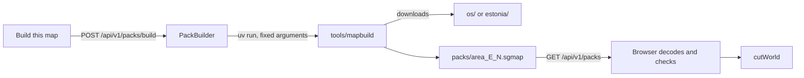

# Maps

This document covers the ground Site Guard plays on: generated ground made from a seed, and real maps of Great Britain and Estonia cut from map packs. It explains every base map and overlay, how packs are built, stored, imported and checked, the grids and coordinate conversions, what reveals your area of interest to outside servers, the data licences, and the known limits. It is for players who want to know how far to trust the ground, and for developers who want to change the builder or the pack format. The plan and its history, including the measurements that shaped the design, are in [REAL_MAPPING_PLAN.md](REAL_MAPPING_PLAN.md).

## Contents

- [Two kinds of ground](#two-kinds-of-ground)
- [Generated ground](#generated-ground)
- [Real maps](#real-maps)
- [Base maps and overlays in the game](#base-maps-and-overlays-in-the-game)
- [The start screen's 2D map](#the-start-screens-2d-map)
- [Building packs](#building-packs)
- [Installing, importing and exporting packs](#installing-importing-and-exporting-packs)
- [The .sgmap pack format](#the-sgmap-pack-format)
- [Grids and coordinates](#grids-and-coordinates)
- [Lidar coverage](#lidar-coverage)
- [Privacy](#privacy)
- [Licences and credits](#licences-and-credits)
- [Troubleshooting](#troubleshooting)
- [Limits and simplifications](#limits-and-simplifications)
- [Where this lives in the code](#where-this-lives-in-the-code)

## Two kinds of ground

Both kinds give the rules the same thing: a square world 54 km across (`WORLD.radius` of 27,000 m, [`world.js:13`](../frontend/src/sim/config/world.js#L13)), sampled every 20 m into four grids. A *post* is one sample point of those grids. The four grids are ground height, canopy (tree) height, building height and a cover class (0 open, 1 woodland, 2 built, 3 power line corridor, 4 water). Line of sight, detection, placement and drone flight all read these grids, so the rules never see a picture. How line of sight uses them is in [PHYSICS_AND_PROPAGATION.md](PHYSICS_AND_PROPAGATION.md).

| | Generated ground | Real map |
|---|---|---|
| Identity | Terrain seed, any string | `pack:<32 hex>:<easting>:<northing>:real` ([`world-pack.js:9`](../frontend/src/sim/world-pack.js#L9)) |
| Posts | 2,701 x 2,701 | 2,701 x 2,701, cut from a larger pack |
| Positions sent over [SAPIENT](SAPIENT.md) | A fictional origin at latitude 0, longitude 0 ([`world.js:30`](../frontend/src/sim/config/world.js#L30)) | Real latitude and longitude from the pack's fit |
| Bearing datum | True north | Grid north ([`core.js:12`](../frontend/src/sim/network/core.js#L12)) |
| Base maps | Its own colouring only | Eight, plus overlays |
| Needs a download | No | A pack, built once or imported |

Pictures, base maps and overlays never reach the rules, so changing them mid-run cannot change a run's result.

## Generated ground

[`generateTerrain`](../frontend/src/sim/terrain.js#L54) makes the ground from the terrain seed, which is separate from the scenario seed. Change it under **Advanced: scenario and terrain seeds** on the start card, or with `?terrain=` in the address. The default is `1` ([`simulation.js:40`](../frontend/src/sim/simulation.js#L40)). The same seed always gives the same ground, and the last ground made is kept, as making a 54 km world takes seconds (3.9 to 4.6 s in Node, measured in [REAL_MAPPING_PLAN.md](REAL_MAPPING_PLAN.md#54-km-worlds)).

What it contains, from [`terrain.js`](../frontend/src/sim/terrain.js) and `TERRAIN` in [`world.js:43`](../frontend/src/sim/config/world.js#L43):

| Feature | How it is made |
|---|---|
| Heights | Seeded value noise, twisted by 700 m of domain warping so ridges wind, with ridged noise for mountains up to about 380 m (`relief`), river valleys cut along a noise contour, and a broad valley round the station ([`terrain.js:75`](../frontend/src/sim/terrain.js#L75)). Flat within 450 m of the middle, full relief from 1,300 m. |
| Water | Anything down at the water level, 12 m below the station, is river or lake. |
| Forest | Where the forest noise passes 0.56, on slopes under 0.5, below 55% of the relief (209 m), and more than 450 m from the middle. Trees are 12 to 20 m tall. |
| Power station | Nine parts at the middle: turbine hall, boiler house, a 100 m stack, two 70 m cooling towers, control building, workshop, stores and switchyard ([`terrain.js:39`](../frontend/src/sim/terrain.js#L39)). |
| Hamlets | 48 tries at a cluster of 6 to 12 houses, 1.8 km from the middle out to 2 km inside the edge, on gentle, dry, unwooded ground below 30% of the relief ([`terrain.js:129`](../frontend/src/sim/terrain.js#L129)). |
| Power lines | Two lines from the switchyard, a pylon every 260 m, with a cleared corridor under them (cover class 3). |
| Masts | Three cell masts on the highest of 60 candidates 3.5 to 7 km out, at least 3 km apart ([`world.js:25`](../frontend/src/sim/world.js#L25)). |

Generated ground has one map: its own colouring by height, slope, cover and snow above 72% of the relief, with trees drawn within 4.5 km of the middle and models drawn twice their true size so they show ([`terrain-view.js:21`](../frontend/src/render/terrain-view.js#L21)). The map switcher offers only **Generated** ([`MapControls.jsx:31`](../frontend/src/ui/MapControls.jsx#L31)), with no overlays or grids, and the M, G and C keys do nothing there. An older demo that laid live OpenStreetMap tiles over generated ground was deleted on 8 November 2026 (commit `06236ff`), as the tiles matched nothing.

## Real maps

### Packs and worlds

A **map pack** is one `.sgmap` file holding the grids, buildings, power lines, roads, place names and map pictures for a square of real ground, 70 km across by default. A **world** is the 54 km square cut from a pack around the start point you choose. One pack serves any start point within 8 km of its middle in each direction (half the pack less the world's radius, [`world-pack.js:53`](../frontend/src/sim/world-pack.js#L53)).

Packs exist for two countries, because each needs its own open data and grid:

- **Great Britain**, on the British National Grid, from Ordnance Survey (OS) open data, with Environment Agency lidar in England.
- **Estonia**, on L-EST97, from the Land and Spatial Development Board (Maa- ja Ruumiamet), with lidar across the whole country.

A position says for itself which grid it is on: British northings stop at 1,300 km, and Estonian ones start at 6,365 km ([`grids.js:10`](../frontend/src/sim/grids.js#L10)). Anywhere else is refused as "outside Great Britain and Estonia".

### How a world is cut from a pack

[`cutWorld`](../frontend/src/sim/world-pack.js#L69) does this, synchronously and with no DOM, so it is deterministic:

1. The start point snaps to the nearest 20 m post, so the cut needs no resampling. It must be far enough from the pack's edge for a full world, and not on water ([`siteProblem`](../frontend/src/sim/world-pack.js#L51)).
2. It copies the 2,701 x 2,701 posts around that point from each grid. Heights become metres above the start point's ground (`H0`), so the site sits at height 0 as on generated ground.
3. Buildings and power line pylons inside the world move to be relative to the site. Roads and names stay with the map pictures.
4. Three notional masts are picked on high ground with a generator seeded from the world string ([`world-pack.js:93`](../frontend/src/sim/world-pack.js#L93)), as OS open data has no masts. The credit line says "Masts are notional."
5. The world keeps `geo`: the start point, `H0`, the pack's position fit, its geoid separation, its tier and its lidar width, for positions and the map.

There is no power station on real ground: the real buildings are the site.

## Base maps and overlays in the game

The map switcher sits beside the minimap. On a real map it offers eight base maps ([`MapControls.jsx:20`](../frontend/src/ui/MapControls.jsx#L20)), each with a small preview of 6 km around the site, except the live map. In Estonia, "OS map" reads **Basic map**. The default is the OS or basic map, with the national grid on ([`view.js:13`](../frontend/src/render/view.js#L13)).

Everything is painted into one 4,096 pixel canvas laid over the 3D ground, about 13.2 m of ground per pixel, so grid lines and roads always follow the ground ([`map-texture.js:11`](../frontend/src/render/map-texture.js#L11)). A 1,024 pixel copy becomes the minimap and the Plan tab's picture.

| Base map | What it shows | Where it comes from | Works offline |
|---|---|---|---|
| OS map / Basic map | In Great Britain, OS VectorMap District at 2.5 m a pixel. In Estonia, the agency's 1:10,000 basic map at about 3.9 m a pixel. Past Estonia's border, where the basic map is blank, the ground is shaded from its heights with labelled contours ([`paintBeyond`](../frontend/src/render/map-texture.js#L156)). | The pack | Yes |
| Light | The OS or basic map turned to pale greys | The pack, recoloured in the browser ([`map-texture.js:21`](../frontend/src/render/map-texture.js#L21)) | Yes |
| Dark | The OS or basic map inverted and tinted blue, for night | The pack, recoloured | Yes |
| Satellite | A cloud-free Sentinel-2 composite at 10 m a pixel | The pack, if it has one | Yes |
| Hybrid | Satellite with roads and names forced on | The pack | Yes |
| Topographic | Colours from the lowest to the highest dry ground in the world, hill shading lit from the north-west, darker woods, grey buildings, light blue water, with labelled contours forced on and a legend ([`topo.js`](../frontend/src/render/topo.js)) | Worked out in the browser from the world's grids | Yes |
| Shaded relief | The same picture generated ground uses for its minimap, about 44 m a pixel, shaded by slope ([`makeHillshade`](../frontend/src/render/terrain-view.js#L234)) | The world's grids | Yes |
| Live map | OpenStreetMap's standard tiles at zoom 14, each stretched by its own corners onto the national grid ([`paintLive`](../frontend/src/render/map-texture.js#L78)). A 54 km world needs 1,369 tiles at Hereford and 2,162 at Narva (counted with `tilesOver` on those packs). Fetched again each time it is chosen. | `tile.openstreetmap.org` | No |

Satellite and Hybrid say "Not in this map pack" when the pack has no satellite picture, and the live map says "Needs internet" when the browser reports it is offline ([`MapControls.jsx:46`](../frontend/src/ui/MapControls.jsx#L46)).

| Overlay | What it adds | Where it comes from |
|---|---|---|
| Roads and names | Roads coloured by class, drawn to a width in metres on the ground (34 m for a motorway down to 7 m for local roads), and the names of large and medium places. Small names and landforms are left out ([`map-texture.js:117`](../frontend/src/render/map-texture.js#L117)). | The pack's features: OS OpenMap Local, or Estonia's ETAK roads and settlement names, with GeoNames past the border |
| Contours (C) | A line every 5, 10 or 25 m, chosen by the world's height range (under 60 m, under 400 m, or more), a thick line every fifth with its height, at most one label per level in each 1.5 km square ([`topo.js:71`](../frontend/src/render/topo.js#L71)). They follow a lightly smoothed copy of the ground, so lidar banks and ditches do not make them fizz. | The world's grids |
| OS grid or L-EST97 grid | 1 km squares of the national grid, thicker every 10 km, labelled with two-figure kilometres every 5 km ([`paintGrid`](../frontend/src/render/map-texture.js#L174)) | Worked out in the browser |
| MGRS grid | 1 km squares of the Military Grid Reference System in the UTM zone of the world's middle, with each 100 km square named, for example `30U WC` ([`paintMgrs`](../frontend/src/render/map-texture.js#L194)) | Worked out in the browser |
| Trees and buildings | The 3D tree and building models. Hiding them only changes the picture: they still block sight lines. | The world |

Keys on a real map ([`useHotkeys.js:45`](../frontend/src/ui/useHotkeys.js#L45)): **M** moves to the next usable base map, **G** steps through national grid, MGRS and off, and **C** turns contours on and off. **P** looks straight down on any ground. The cursor's readout gives a grid reference on whichever grid is showing, and the height above sea level.

A credit line is always on screen on a real map, and changes with the base map ([`Credits`](../frontend/src/ui/MapControls.jsx#L57)). The map panel also says when part of the world has no lidar, and that live tiles tell OpenStreetMap which area you are viewing.

## The start screen's 2D map

The start screen draws a flat map with Leaflet, to choose where to defend ([`site-map.js`](../frontend/src/ui/site-map.js)). It opens on the whole world, zoomed out, so its first tile requests say nothing about a site. Buttons above it choose a style ([`site-map.js:23`](../frontend/src/ui/site-map.js#L23)), and the choice is remembered in this browser under `site-guard-start-map`.

| Style | What it shows | Asks |
|---|---|---|
| Street | OpenStreetMap's standard tiles | `tile.openstreetmap.org` |
| Light | The same tiles in greys, by a CSS filter | `tile.openstreetmap.org` |
| Dark | The same tiles inverted, by a CSS filter | `tile.openstreetmap.org` |
| Satellite | EOxCloudless 2025, a cloud-free Sentinel-2 mosaic at 10 m a pixel | `tiles.maps.eox.at` |
| Hybrid | EOxCloudless with EOX's label overlay drawn from OpenStreetMap data | `tiles.maps.eox.at` |
| No live map | No tiles at all. It turns on the pictures from your loaded packs instead. | Nothing |

Tick boxes under the map ([`SiteMap.jsx:8`](../frontend/src/ui/SiteMap.jsx#L8)) show:

- **Maps ready to play:** a blue square and dot for each loaded pack. Far out, the dot stands in for the square, and clicking it goes there.
- **Lidar heights:** a green square for the part of each pack built with lidar.
- **Data downloaded:** dashed orange 100 km squares of OS data already on this computer, and a box round Estonia once its heights are here.
- **Map pictures** and **Satellite pictures:** each pack's own pictures, made at 1,024 pixels across only when first ticked.

A red square marks your 54 km world, and a dashed red square the 70 km map a build would make. If any live tile fails to load, the pack pictures are turned on, so the packs still show with no internet ([`site-map.js:102`](../frontend/src/ui/site-map.js#L102)).

## Building packs



### From the start screen

Choose a spot with no pack and the card lists what a build would use from this computer, what it would download, and roughly how much ([`SiteStatus.jsx`](../frontend/src/ui/SiteStatus.jsx)). That list is worked out in the browser from `GET /api/v1/packs/downloads`, so looking at a spot sends nothing. The lidar box is ticked by default.

**Build this map** sends the point and the lidar choice to the local server. The server checks the point is on one of the two grids, refuses a second build with "A map is already being built." (409), and runs the builder as a separate process with a fixed list of arguments ([`packs.py:111`](../backend/app/services/packs.py#L111)): a 70 km pack centred on the chosen kilometre square, named "Area around E, N", written to `packs/area_E_N.sgmap` (E and N in kilometres), with `--fetch`. Lidar covers the middle 54 km in Great Britain and the whole 70 km in Estonia, where the lidar file is already on the computer by then ([`packs.py:118`](../backend/app/services/packs.py#L118)). The card shows the builder's latest line every 2 seconds, and opens the new map when it finishes. There is no way to cancel a build from the app.

### From the command line

```bash
uv --directory tools/mapbuild run python -m mapbuild --centre "SU 22 66" --name "Savernake" --data ~/site-guard-maps/os --out ~/site-guard-maps/packs/savernake.sgmap --fetch
uv --directory tools/mapbuild run python -m mapbuild --centre 611700,6570700 --name "Tapa" --data ~/site-guard-maps/estonia --out ~/site-guard-maps/packs/tapa.sgmap --fetch
```

| Option | Meaning ([`__main__.py:46`](../tools/mapbuild/mapbuild/__main__.py#L46)) |
|---|---|
| `--centre` | An OS grid reference such as `"SU 22 66"`, or `easting,northing` on either grid. Rounded down to the kilometre. A northing of 6,000 km or more means Estonia. |
| `--name` | The name shown in the game, up to 80 characters |
| `--data` | The downloads folder: `os` for Great Britain, `estonia` for Estonia |
| `--out` | The `.sgmap` file to write |
| `--size` | Width in km, even, 56 to 80. Default 70. |
| `--lidar-km` | Width of the middle part with lidar, even, no bigger than `--size`, 0 for none. Default 54. |
| `--fetch` | Download any files missing from `--data`. Without it, they must already be there. |
| `--no-satellite` | Leave out the satellite picture |

The builder works out the position fit first, so a refusal does not waste an hour of downloads ([`__main__.py:60`](../tools/mapbuild/mapbuild/__main__.py#L60)). It needs Python 3.12 or later and `uv`, and its mapping packages (numpy, pyogrio, pyproj, rasterio, shapely) stay out of the game's backend ([`pyproject.toml`](../tools/mapbuild/pyproject.toml)).

### What a British build downloads and does

| Data | What it gives | Size, measured on the development machine | Kept? |
|---|---|---|---|
| OS Terrain 50, all of Great Britain | Ground heights at 50 m posts, resampled to 20 m | 162 MB | Yes, `os/terrain50` |
| OS OpenMap Local, per 100 km square | Woods, building outlines, power lines, water, tidal water, roads and place names | 53 MB (TF) to 220 MB (TQ) | Yes, `os/openmap_xx` |
| OS VectorMap District raster, per 100 km square | The OS map picture, 10 km tiles at 2.5 m a pixel | 140 MB (TF) to 335 MB (TQ) | Yes, `os/vmd_xx` |
| Environment Agency lidar, England | 1 m bare earth (DTM) and first return surface (DSM), one 1 km square at a time, both products together | About 7.1 GB for 54 km, the start screen's estimate ([`SiteStatus.jsx:13`](../frontend/src/ui/SiteStatus.jsx#L13)) | No, reduced to 20 m in memory |
| Copernicus Sentinel-2 L2A | Summer scenes for the satellite picture, read only for the pack's area | Not measured | No |
| PROJ grid files (OSTN15, OSGM15) | Exact national grid and geoid for the position fit | PROJ's cache was 3.4 MB here | Yes, in PROJ's own cache |

OS files come from the OS Data Hub download API, only from `api.os.uk` over https, each checked against the size and MD5 that OS lists ([`download.py:21`](../tools/mapbuild/mapbuild/download.py#L21)). A 70 km pack needs one to four 100 km squares.

From these the builder makes the grids ([`terrain.py`](../tools/mapbuild/mapbuild/terrain.py), [`features.py`](../tools/mapbuild/mapbuild/features.py)):

- **Cover:** OS woodland is class 1, buildings 2, a 50 m corridor round power lines 3, and water 4. A missing Terrain 50 tile is open sea, which OS tidal water does not reach.
- **With lidar:** ground is the mean of the 1 m DTM in each 20 m cell. Anything at least 5 m tall (the 90th percentile of DSM minus DTM) that is not a building or water is trees, which catches hedgerows and tree belts outside OS woods. A building's height is the 90th percentile inside OS footprints covering at least 10% of the cell, if 2 m or more.
- **Without lidar:** Terrain 50 ground, trees assumed 16 m tall inside OS woodland, and buildings 8 m tall ([`terrain.py:169`](../tools/mapbuild/mapbuild/terrain.py#L169)).
- **Features:** each building as a rotated box, pylons every 260 m along each power line, roads simplified to 5 m, and place names.
- **Satellite:** Earth Search is asked for Sentinel-2 scenes over the pack from May to September of the last two years, under 10% cloud. Scenes are read clearest first; each must cover a quarter of the pack. The builder stops once it has five and every pixel is seen three times, takes the median of each pixel to remove leftover cloud, and saves a JPEG at 10 m a pixel. With fewer than two usable scenes the pack has no satellite layer ([`pictures.py:89`](../tools/mapbuild/mapbuild/pictures.py#L89)).

### What an Estonian build downloads and does

| Data | What it gives | Size, measured | Kept? |
|---|---|---|---|
| `DTM_10m_eesti.tif` | Ground heights at 10 m, whole country | 2.16 GB | Yes, `estonia/` |
| `ndsm_5m_2020-2023_kogu_Eesti.zip` | Height above ground from lidar at 5 m, one sheet per square km. Only fetched with lidar. | 3.78 GB | Yes |
| Five `ETAK_Eesti_SHP_*.zip` themes (ETAK is the Estonian Topographic Database) | Buildings, woods, water, roads and power lines | 1.32 GB together | Yes |
| `asustusyksus_shp.zip` (EHAK settlement units) | Place names | 17 MB | Yes |
| Basic map tiles (`epk_v`, zoom 10) | The map picture, one 1 km tile at a time, with a 0.25 s pause after each | Not kept as tiles | Only inside the pack |
| Copernicus DEM GLO-30, per 1 degree tile | 30 m heights and a water mask where Estonian heights stop, at the border or the sea | 14 to 32 MB a tile; six tiles came to 138 MB | Yes, `estonia/copernicus` |
| GeoNames `RU.zip` | Place names in Russia, only when the pack reaches past the border | 15 MB | Yes, `estonia/geonames` |
| Sentinel-2 and PROJ | As in Great Britain. PROJ supplies EGM2008 here. | | As above |

The national files come to 7.28 GB (6.8 GiB). The agency publishes no checksums, so each file is checked by its declared size and by opening it, and a stopped download resumes ([`estonia_files.py:50`](../tools/mapbuild/mapbuild/estonia_files.py#L50)). Copernicus tiles are checked against the MD5 that S3 gives as their ETag.

Processing follows the British rules with Estonian inputs ([`estonia.py`](../tools/mapbuild/mapbuild/estonia.py)): ground is the mean of the 10 m pixels in each cell, tall cover and building heights are the 90th percentile of the 5 m lidar, woods are ETAK's forest type only, power lines are 35 kV and over, and roads map to the game's classes. Place names are the settlement units, each named once with its type word ("linn", "küla") left off. A build where more than 90% of the posts have no Estonian height is refused. Past the border, Copernicus heights fill the gaps, the pack carries an outline of where the basic map is blank so the game can shade it, and GeoNames supplies names in Latin letters, drawn large for an administrative centre or a place of 2,000 people or more.

### Size and time

Measured on 9 November 2026 by reading the headers of the three packs on the development machine, all 70 km:

| Pack | File | Grids, stored | Features, stored | Map pictures | Satellite | Fit error |
|---|---|---|---|---|---|---|
| Hereford | 128.4 MB | 24.5 MB | 4.8 MB | 88.1 MB, 64 PNG pieces | 11.0 MB | 1.59 m |
| Tapa | 87.4 MB | 15.5 MB | 2.6 MB | 61.1 MB, 56 JPEG pieces | 8.2 MB | 1.95 m |
| Narva | 36.3 MB | 13.7 MB | 0.8 MB | 15.5 MB, 56 JPEG pieces | 6.3 MB | 2.06 m |

Time depends on the network and the area. The start screen says a British build takes about 2.5 hours with lidar and about 8 minutes without ([`SiteStatus.jsx:44`](../frontend/src/ui/SiteStatus.jsx#L44)); with lidar the builder fetches 2,916 squares of 1 km. An Estonian 70 km pack fetches 4,970 basic map tiles, so the pauses alone add about 21 minutes. The first 30 km Tapa build took 19 minutes ([REAL_MAPPING_PLAN.md](REAL_MAPPING_PLAN.md#estonia)).

### Where files live, and what is kept

Everything lives under `~/site-guard-maps`, or the folder named by `SITE_GUARD_MAPS` ([`packs.py:31`](../backend/app/services/packs.py#L31)):

| Folder | Holds |
|---|---|
| `os/` | `terrain50/`, and `openmap_xx/` and `vmd_xx/` for each 100 km square |
| `estonia/` | The national files, `copernicus/` and `geonames/` |
| `packs/` | Finished `.sgmap` files, which the server lists |

Downloads are kept, so later builds in the same area fetch only lidar, map tiles and satellite. British lidar is kept too, as each 1 km square's 20 m results in `os/lidar_cache`, so a stopped build carries on where it was and an overlapping pack reuses the squares ([`terrain.py`](../tools/mapbuild/mapbuild/terrain.py)). Basic map tiles and satellite scenes are never kept outside the pack.

**When the lidar service refuses.** The Environment Agency rate-limits the web service: in November 2026 it answered `429 Too Many Requests` for hours after builds fetched eight squares at once. The builder now stops at the first refusal rather than retrying. Two ways on from there:

- `--saved-lidar-only` builds now from the squares already kept, asking for nothing; the rest of the ground gets Terrain 50.
- LiDAR tile files from the [Survey Data Catalogue](https://environment.data.gov.uk/survey) (the 1 m Composite DTM and First Return DSM, 5 km GeoTIFF tiles, both for each tile) go in `os/lidar_tiles`, as zips or `.tif` files. The next build takes every square they cover from them ([`lidar_tiles.py`](../tools/mapbuild/mapbuild/lidar_tiles.py)). For a large area the catalogue asks for a request through its support desk, with the order details file it gives, and sends the tiles. Files are never refreshed once present, and nothing in the app deletes downloads or packs. The only free-space check is for Estonia: the builder refuses to start fetching missing national files with less than 8 GB free ([`estonia_files.py:25`](../tools/mapbuild/mapbuild/estonia_files.py#L25)).

## Installing, importing and exporting packs

- **On the server:** put a `.sgmap` file in `packs/`. Its name must be letters, digits, `_` or `-`, at most 64 characters, then `.sgmap` ([`packs.py:14`](../backend/app/services/packs.py#L14)). The server lists packs by reading only their headers, and serves the file as it is. The browser checks it.
- **Import:** press **Import** on the start screen and choose a file. It is decoded and checked in full, then kept in this browser's IndexedDB (database `site-guard-packs`), with persistent storage requested, so it works with the server stopped ([`pack-store.js:153`](../frontend/src/api/pack-store.js#L153)). Importing a different pack with the same ground as one already here is refused, as it would change worlds saved against it.
- **Export:** choose a map and press **Export** to save it as a file for someone else to import. They need no downloads.

When the start screen opens, every listed pack is fetched and decoded in the background, so moving between them is instant ([`WorldPicker.jsx:55`](../frontend/src/ui/WorldPicker.jsx#L55)). The first pack is chosen automatically, unless you have already chosen or the address asks for generated ground. A saved laydown on a real world loads its pack by fingerprint, or says "The map pack for this laydown is not available here. Import or build it first." ([`game.js:72`](../frontend/src/game.js#L72)).

## The .sgmap pack format

One file, written by [`packfile.py`](../tools/mapbuild/mapbuild/packfile.py) and read by [`decodePack`](../frontend/src/api/pack-store.js#L47):

| Bytes | Content |
|---|---|
| 0 to 4 | `SGMAP` |
| 5 | Format version, 1 |
| 6 to 9 | Header length, unsigned 32-bit little-endian |
| 10 onwards | JSON header, then the sections, each at an offset counted from the end of the header |

**Header fields:** `name`; `east`, `north` (the pack's middle on its national grid, in metres); `half` (metres from the middle to the edge); `cell` (20); `N` (posts a side, odd, so a post sits at the middle); `tier` (`lidar` or `terrain50`); `lidarHalf`; `built` (date); `credits`; `lonFit` and `latFit` (six coefficients each); `fitErrorM`; `geoidSeparation`; `gridsSha256`; and `sections`, each with `name`, `offset`, `length` and `rawLength`.

**Grids:** four gzip sections, rows north to south and columns west to east, one value a post:

| Section | Type | Meaning |
|---|---|---|
| `ground` | 32-bit float, little-endian | Height above the national height datum, rounded to 0.1 m |
| `canopy` | 8-bit | Tree height in metres, 0 for none |
| `bldg` | 8-bit | Building height in metres, 0 for none |
| `cover` | 8-bit | 0 open, 1 woodland, 2 built, 3 power line corridor, 4 water |

**Features:** one gzip JSON section with `buildings` (`[x, z, width, depth, height, angle]`), `lines` (pylon positions), `roads` (`[class, points]`), `names` (`[text, kind, size, x, z]`) and, for Estonia near the border, `beyond` (outlines of ground the basic map leaves blank). Positions are metres from the pack's middle, x east and z south.

**Pictures:** sections `picture0` onwards, stored as they are, each with `layer` (`osmap` or `satellite`), `west`, `top`, `width`, `height` in metres, and `type` (`image/png` or `image/jpeg`).

**The grids hash** is SHA-256 over the four raw grids in order ([`packfile.py:44`](../tools/mapbuild/mapbuild/packfile.py#L44)). A world's identity uses its first 32 hex characters, so rebuilding pictures, roads or names does not change a world, but any change to the ground does.

**Limits the browser enforces** ([`pack-store.js:6`](../frontend/src/api/pack-store.js#L6), [`world-pack.js:29`](../frontend/src/sim/world-pack.js#L29)):

| Check | Limit |
|---|---|
| Header | At most 1 MiB |
| Pack width | At least a world (2,701 posts) and at most 80 km (4,001 posts) |
| Grid sizes | Must match `N` before anything is unpacked; at most 64 MiB each; decompression stops at the declared size |
| Fingerprint | The grids must match `gridsSha256` |
| Heights | Every one finite and within 20,000 m |
| Features | At most 32 MiB unpacked; at most 500,000 buildings, each side at most 1,000 m; every road and name well formed |
| Position | Centre on a 20 m post, with a valid fit and geoid separation |
| Pictures | Known layer and type, at most 64 MiB, and at most 8,192 x 8,192 pixels by their own header, or they are left out |

The builder refuses non-finite heights and features over 32 MiB, and draws only the 500,000 buildings nearest the middle, though the building grid keeps them all for line of sight.

## Grids and coordinates

| System | Where | Used for |
|---|---|---|
| British National Grid (EPSG:27700) | Great Britain | Pack positions, grid references such as `SU 220 660`, the OS grid overlay |
| L-EST97 (EPSG:3301) | Estonia | Pack positions, references such as `E 611700 N 6570700` (Estonia has no letter squares), the L-EST97 overlay |
| MGRS | Anywhere north of the equator | The MGRS overlay, and the cursor readout while it shows |
| WGS 84 latitude and longitude | Everywhere | GPS, typed positions, SAPIENT messages, OpenStreetMap tiles |

How each conversion is done:

- **In the builder,** pyproj does the accurate work once: OSTN15 for Great Britain, and PROJ's own transformation for Estonia. It fits a quadratic for longitude and latitude over 61 x 61 sample points across the pack and refuses a fit worse than 5 m ([`fit.py:52`](../tools/mapbuild/mapbuild/fit.py#L52)). The three packs above fit to 1.6 to 2.1 m. The pack stores the fit, so the browser needs no projection library.
- **Positions in a world** use that fit ([`latLonOf`](../frontend/src/sim/world-pack.js#L63)). Altitude sent over SAPIENT is the height above the site plus `H0` plus one geoid separation for the pack: OSGM15 in Great Britain, and EGM2008 standing in for Estonia's own height system, which PROJ has no grid for ([`fit.py:47`](../tools/mapbuild/mapbuild/fit.py#L47)). See [SAPIENT.md](SAPIENT.md).
- **GPS to the British grid** in the browser uses the published Helmert shift and the OS transverse Mercator series ([`bng.js:31`](../frontend/src/sim/bng.js#L31)), good to about 5 m by the code's own note. The reverse steps towards the answer through the same function, so the two agree.
- **L-EST97** is a Lambert conformal conic projection of GRS 80, worked directly both ways ([`lest97.js`](../frontend/src/sim/lest97.js)). WGS 84 is taken as ETRS89, a difference far below a 20 m post.
- **MGRS** is UTM on WGS 84 using the same transverse Mercator series, with the standard letters ([`mgrs.js`](../frontend/src/sim/mgrs.js)).

Positions can be typed as an OS grid reference, decimal latitude and longitude (`51.39, -1.68`), or eastings and northings (`422000 166000`). Estonian northing-first order is understood ([`grids.js:30`](../frontend/src/sim/grids.js#L30)). MGRS references cannot be typed. **Use my location** asks the browser once, and shows how accurate the answer is, as most laptops estimate from Wi-Fi.

## Lidar coverage

Lidar gives real tree and building heights, which matter for low-level sight lines. Measured differences between lidar and assumed heights are in [REAL_MAPPING_PLAN.md](REAL_MAPPING_PLAN.md#measured-m0-test-areas).

- **Great Britain:** the Environment Agency's composite covers England only. By default it covers the middle 54 km of a pack, the world for a start point at the pack's middle. The outer band, and any post where the service returns no height (Wales, Scotland, open sea, or a square that fails with HTTP 500 three times), keeps Terrain 50 ground with assumed heights.
- **Estonia:** lidar covers the whole country. Builds from the start screen use it across the whole pack.
- **Without lidar:** trees are assumed 16 m tall, but only inside mapped woodland, so hedgerows and tree belts are missing; every building is assumed 8 m tall.
- **Past Estonia's border:** Copernicus GLO-30 is a surface model from radar, so woods and buildings there are part of the ground's height. They block sight as ground does, and none are drawn.

The start card says "Lidar heights across this world" or that heights are assumed, the map panel notes any part without lidar, and the start map shades each pack's lidar square green. All three go by the pack's lidar width, not by where the service actually had data.

## Privacy

What reveals the area you are looking at, and how to avoid it:

| Action | Who it tells | What they learn |
|---|---|---|
| Start map, Street, Light or Dark | OpenStreetMap | Every area you view. It opens on the whole world. |
| Start map, Satellite or Hybrid | EOX, Austria | Every area you view |
| Start map, No live map | Nobody | Nothing |
| **Use my location** | The browser's location service | Your position. The game keeps it in the browser unless you deploy there. |
| In-game Live map | OpenStreetMap | The whole world's area, tile by tile. There is no preview, so opening the switcher sends nothing. |
| British build | OS, Environment Agency, Element 84's Earth Search, AWS, `cdn.proj.org` | OS files are per 100 km square. Lidar requests name every 1 km square of the middle 54 km. The satellite search and reads cover the pack. |
| Estonian build | Land Board portal and file store, `tiles.maaamet.ee`, AWS, GeoNames, `cdn.proj.org` | National files and GeoNames say nothing. Map tiles name every 1 km square, and their address carries `ASUTUS=SITEGUARD`. Copernicus tiles say which 1 degree square. Satellite as in Great Britain. |
| Pack built from the start screen | Anyone who sees the request or the file | It is centred on your chosen kilometre square, and named after it, so its centre points at the site. |

All other map work happens on this computer: packs, topography, contours, grids and relief need no network. The site's position is never put in the address bar, though saved laydowns and runs store it in the local database ([SECURITY_NOTES.md](SECURITY_NOTES.md)).

**For a sensitive site:** choose **No live map** on the start screen before moving the map (the choice is remembered), do not choose the live map in the game, and build packs beforehand, or on another computer, then move them with Export and Import. To avoid a pack centred on the site, build from the command line with a centre up to 8 km away. The browser's Content Security Policy only lets it load images from OpenStreetMap and EOX, and connect to its own server ([`security.py:11`](../backend/app/security.py#L11)). Only the builder contacts the data sources.

## Licences and credits

Credits travel inside each pack's header, so an exported pack carries its own, and the game shows the ones that apply on screen.

| Data | Licence | Credit shown |
|---|---|---|
| OS Terrain 50, OpenMap Local, VectorMap District | [Open Government Licence](https://www.nationalarchives.gov.uk/doc/open-government-licence/version/3/) | Contains OS data © Crown copyright and database right (year) |
| Environment Agency lidar | Open Government Licence | Contains Environment Agency information © Environment Agency and/or database right (year) |
| Copernicus Sentinel-2 ([on AWS](https://registry.opendata.aws/sentinel-2-l2a-cogs/)) | Free and open, with credit | Contains modified Copernicus Sentinel data (year) |
| Estonian Land and Spatial Development Board data | [Its open data licence](https://geoportaal.maaruum.ee/opendata-licence), which asks for the owner, title, age, and the licence to travel with the data | Estonian basic map (year)... with the licence address, and "Elevation data 2020-2023" ([`estonia.py:296`](../tools/mapbuild/mapbuild/estonia.py#L296)) |
| Copernicus DEM GLO-30 ([on AWS](https://registry.opendata.aws/copernicus-dem/)) | Free, with a notice and a no-liability sentence | The full notice, whatever the base map ([`copernicus.py:23`](../tools/mapbuild/mapbuild/copernicus.py#L23)) |
| GeoNames ([export](https://www.geonames.org/export/)) | CC BY 4.0 | Place names past the border: GeoNames, geonames.org, CC BY 4.0 |
| OpenStreetMap tiles | [© OpenStreetMap contributors](https://www.openstreetmap.org/copyright) | Map © OpenStreetMap contributors, on the live map and start map |
| EOxCloudless, start map only | [CC BY-NC-SA 4.0](https://cloudless.eox.at), non-commercial only | Shown by Leaflet. The code notes it must go if the app ever makes money ([`site-map.js:13`](../frontend/src/ui/site-map.js#L13)). |

Licence wording here is a summary of the sources' own terms, not legal advice.

## Troubleshooting

| You see | Why, and what to do |
|---|---|
| "The save server is not running, so only maps imported into this browser are listed." | The backend is stopped. Start it, or import the pack. |
| "That is outside Great Britain and Estonia..." | No grid covers that spot. Choose a spot in either country. |
| "That is too near the edge of this map pack for a full world." | Choose a start point nearer the pack's middle, or build a pack there. |
| "The site cannot be on water." | Move the start point onto land. |
| "This pack is smaller than a 54 km world. Build it again at a larger size." | An older 30 or 44 km pack. Rebuild it at 56 km or more. |
| Satellite and Hybrid say "Not in this map pack" | The build found fewer than two clear scenes, or used `--no-satellite`. Rebuild later, or use the OS map. |
| Live map says "Needs internet", or "The live map could not load" | The browser is offline, or no tile arrived. The game goes back to the OS map ([`game.js:312`](../frontend/src/game.js#L312)). "N of M map tiles could not load" means some did. |
| The start map shows only pack pictures | A tile failed to load, so it switched to pictures from your packs. Check the connection, or keep **No live map**. |
| "The map builder could not start. It needs uv installed." | Install `uv` and restart the backend. |
| "A map is already being built." | One build at a time. Wait for it to finish. |
| "There is no Estonian height data here. It stops at the national border." | More than 90% of the pack is outside Estonia's data. Move the centre inland. |
| "Estonian maps need about 8 GB free in ..." | Free space on that drive, or set `SITE_GUARD_MAPS` to another. |
| "...the agency sent a web page instead of ..." | The agency's download address may have changed. The fixed addresses are in [`estonia_files.py`](../tools/mapbuild/mapbuild/estonia_files.py). |
| "The position fit is out by ... over the 5 m limit." | The pack is too large for the quadratic fit. Build it smaller. |
| "This map pack is damaged" or "made by a different version of the game" | The file is truncated, altered or from another format version. Rebuild or fetch it again. |
| "A different map pack with the same ground is already here." | This browser already holds a pack with the same grids but different pictures or features. |
| "This browser has no room to keep that map pack." | Browser storage is full or blocked. Free space, or put the file in the server's `packs/` folder. |

## Limits and simplifications

- **The ground is 20 m posts.** Thin gaps in hedges and narrow streets do not show, and buildings are boxes. Terrain 50 has a stated 4 m RMSE, and assumed heights report a clear line more often than lidar does ([REAL_MAPPING_PLAN.md](REAL_MAPPING_PLAN.md#measured-m0-test-areas)).
- **The map picture is softer than its source.** The 4,096 pixel canvas gives about 13.2 m a pixel over a 54 km world, below the OS map's 2.5 m. Satellite is 10 m at best.
- **Lidar width is recorded per pack, not per post,** so near the Welsh and Scottish borders the start card and start map can claim lidar where the builder fell back to assumed heights.
- **3D trees are drawn only within 4.5 km of the site,** on any ground ([`terrain-view.js:96`](../frontend/src/render/terrain-view.js#L96)). Further out, woods show only in the map picture, though they still count for sight lines.
- **Masts on real maps are invented,** and there is no model site.
- **One geoid separation per pack,** and EGM2008 instead of Estonia's own height system, affect only reported altitudes.
- **MGRS:** one UTM zone across the whole map, no special zones round Norway and Svalbard, northern hemisphere only, and no typing ([`map-texture.js:193`](../frontend/src/render/map-texture.js#L193), [`mgrs.js:9`](../frontend/src/sim/mgrs.js#L9)).
- **The start map lays pack pictures straight,** up to about 1.5 degrees off true at the far east and west of Britain. Clicks are still converted exactly ([`site-map.js:46`](../frontend/src/ui/site-map.js#L46)).
- **Shaded relief on a real map uses generated ground's colour scale:** height above the site against 380 m, so ground more than about 274 m above the site is coloured as snow ([`terrain-view.js:247`](../frontend/src/render/terrain-view.js#L247)).
- **Memory:** every listed pack is decoded at the start screen and held. A 70 km pack's grids alone are 85.8 MB unpacked (7 bytes a post), plus its pictures.

Disk use, checked against the code on 9 November 2026:

- **Every build from the start screen at a new 1 km centre writes a new pack** named `area_E_N.sgmap` ([`packs.py:116`](../backend/app/services/packs.py#L116)). The three 70 km packs on the development machine are 36 to 128 MB. There is no cap on how many, and the app cannot delete one: remove files from `packs/` by hand.
- **A build in the same 1 km square overwrites** that file. If its ground differs, for example with lidar on one time and off the next, laydowns saved against the old pack can no longer find it.
- **British builds have no free-space check.** Only the Estonian national files have one ([`estonia_files.py:133`](../tools/mapbuild/mapbuild/estonia_files.py#L133)).
- **The pack is written straight to its final name** ([`packfile.py:74`](../tools/mapbuild/mapbuild/packfile.py#L74)), so a write that fails part way, for example on a full disk, leaves a truncated pack, and replaces any good pack of that name. The server still lists it from its header, and the browser refuses it as damaged.
- **An Estonian download has no size cap when the server sends no `Content-Length`** ([`estonia_files.py:77`](../tools/mapbuild/mapbuild/estonia_files.py#L77)): the read loop only stops at a declared total. OS downloads stop at OS's listed size, and Copernicus and GeoNames files at fixed caps.
- **Packs imported into a browser are kept permanently,** with persistent storage requested and no delete in the app. Clearing the site's data in the browser removes them all.
- **Downloads are never refreshed or tidied.** If OS lists a file under a new name, it is downloaded beside the old one, and the builder reads whichever zip `glob` returns first.

## Where this lives in the code

- [`tools/mapbuild/mapbuild/__main__.py`](../tools/mapbuild/mapbuild/__main__.py): the builder's command line and the order of a build.
- [`tools/mapbuild/mapbuild/download.py`](../tools/mapbuild/mapbuild/download.py), [`estonia_files.py`](../tools/mapbuild/mapbuild/estonia_files.py), [`copernicus.py`](../tools/mapbuild/mapbuild/copernicus.py), [`geonames.py`](../tools/mapbuild/mapbuild/geonames.py): fetching and checking source files.
- [`terrain.py`](../tools/mapbuild/mapbuild/terrain.py), [`features.py`](../tools/mapbuild/mapbuild/features.py), [`estonia.py`](../tools/mapbuild/mapbuild/estonia.py), [`beyond.py`](../tools/mapbuild/mapbuild/beyond.py): grids, cover and features for each country.
- [`pictures.py`](../tools/mapbuild/mapbuild/pictures.py): the OS map and the satellite composite. [`fit.py`](../tools/mapbuild/mapbuild/fit.py): the position fit. [`packfile.py`](../tools/mapbuild/mapbuild/packfile.py): writing a pack.
- [`backend/app/services/packs.py`](../backend/app/services/packs.py), [`routes/packs.py`](../backend/app/routes/packs.py): listing, serving and building packs. The endpoints are in [API.md](API.md).
- [`frontend/src/api/pack-store.js`](../frontend/src/api/pack-store.js): decoding, checking, listing and importing packs.
- [`frontend/src/sim/world-pack.js`](../frontend/src/sim/world-pack.js): checking a pack for the rules and cutting a world. [`terrain.js`](../frontend/src/sim/terrain.js): generated ground.
- [`frontend/src/sim/bng.js`](../frontend/src/sim/bng.js), [`lest97.js`](../frontend/src/sim/lest97.js), [`mgrs.js`](../frontend/src/sim/mgrs.js), [`grids.js`](../frontend/src/sim/grids.js): grids and conversions.
- [`frontend/src/render/map-texture.js`](../frontend/src/render/map-texture.js), [`topo.js`](../frontend/src/render/topo.js), [`terrain-view.js`](../frontend/src/render/terrain-view.js): painting base maps and overlays, and the 3D ground.
- [`frontend/src/ui/MapControls.jsx`](../frontend/src/ui/MapControls.jsx), [`Minimap.jsx`](../frontend/src/ui/Minimap.jsx): the switcher, credits and minimap.
- [`frontend/src/ui/WorldPicker.jsx`](../frontend/src/ui/WorldPicker.jsx), [`SiteStatus.jsx`](../frontend/src/ui/SiteStatus.jsx), [`SiteMap.jsx`](../frontend/src/ui/SiteMap.jsx), [`site-map.js`](../frontend/src/ui/site-map.js): the start screen, the build offer and the 2D map.
