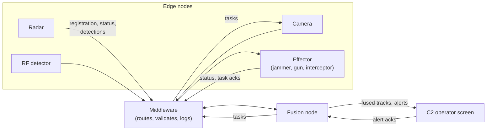

# SAPIENT

What SAPIENT is, how a SAPIENT system works, and how this game uses it. Every simulated sensor, weapon and the fusion node talk to each other in SAPIENT messages, so this page is the reference for the network the whole game runs on. How the fusion node turns those messages into tracks and decisions is in [FUSION_AND_TARGETING.md](FUSION_AND_TARGETING.md).

## What SAPIENT is

SAPIENT (Sensing for Asset Protection with Integrated Electronic Networked Technology) is an open standard and open architecture for networking sensors and effectors from different makers. The UK Ministry of Defence developed it through Dstl, and the British Standards Institution publishes it as **BSI Flex 335**, the interface control document (ICD). The game follows **BSI Flex 335 version 2.0**.

The idea behind it, as Dstl's summary puts it, rests on four principles:

1. **Autonomy at the edge.** Each sensor processes its own data.
2. **Information, not raw data.** A sensor sends what it found (a detection with its uncertainty), not its video or radar returns, which keeps network traffic low.
3. **Fusion and tasking at the centre.** A fusion node combines everyone's information and decides what each node should do next.
4. **Autonomous execution.** A node carries out a task it receives by itself.

Because every node speaks the same interface whatever kind of sensor or weapon it is, a fusion node can take a radar from one maker and a camera from another without bespoke integration. The standard says what is exchanged, not how a node works inside.

### History and status

| | |
|---|---|
| Origins | Dstl's SAPIENT ICD went through several versions; version 7 replaced XML messages with Protocol Buffers (protobuf) |
| BSI Flex 335 v1.0 | Came into effect on 31 May 2023, sponsored by the MOD, with an industry advisory group |
| BSI Flex 335 v2.0 | Published in 2024, and the current version at the time of writing. Both BSI versions cover effectors (jammers, kinetic systems, lasers and RF weapons) as well as sensors |
| Defence adoption | The MOD has adopted SAPIENT as its standard for counter-uncrewed aircraft systems (counter-UAS) |
| NATO | Evaluated in NATO's counter-UAS Technical Interoperability Exercises (TIE); NATO is adopting it as the basis of a standardisation recommendation (STANREC) for counter-UAS |
| In use | Used to help protect the 2025 NATO summit in The Hague |
| Governance | BSI publishes new versions. Dstl runs the SAPIENT Standardisation Committee (S3C), open to industry |

The ICD is free to download from BSI. Dstl publishes the protobuf message definitions ([dstl/SAPIENT-Proto-Files](https://github.com/dstl/SAPIENT-Proto-Files)), an open-source test harness that checks a component's messages against version 2 ([dstl/BSI-Flex-335-v2-Test-Harness](https://github.com/dstl/BSI-Flex-335-v2-Test-Harness), Apache 2.0) and optional middleware for routing and logging messages.

## How a SAPIENT system works

**Roles.**

- **Edge nodes** are the sensors and effectors. Comments in the message definitions still call a node an ASM (autonomous sensor module), the name from earlier versions.
- **The fusion node** combines detections into tracks, works out what they are, and tasks the edge nodes. Earlier versions and Dstl's tools call this role the DMM (decision-making module). Fusion nodes can be layered, a child reporting its coverage to a parent.
- **Middleware** passes messages between nodes, checks them and logs them. It answers a message that breaks the rules with an Error.
- **The C2 operator screen** shows the picture and lets a person respond to alerts.

**A node's life on the network.**

1. **It registers.** It sends a Registration describing itself: its node type (radar, camera, jammer, kinetic, laser and so on), its modes, what it reports and in what form, and the commands it accepts. The fusion node answers with a RegistrationAck.
2. **It keeps in touch.** It sends a StatusReport at the interval it declared: its mode, health, position, power, current task, and conditions such as weather or clutter. When it leaves, it says goodbye in a final status report.
3. **It reports.** A sensor sends a DetectionReport for each thing it detects: where (as range and bearing from itself, or as a position), how sure it is, what it thinks it is (a classification tree), its velocity and any radio signal it heard. Each node numbers the objects it sees itself (`object_id`).
4. **It is tasked.** The fusion node sends a Task: point at a place (`look_at`), change mode (`mode_change`), change sensitivity or reporting rate, move, patrol or follow, or a free-text `request`. The node answers with a TaskAck: accepted, rejected with reasons, and later completed or failed.
5. **People are told.** Alerts carry anything an operator should know or decide; an AlertAck carries the answer.

**On the wire.** Every message is a protobuf `SapientMessage`: a timestamp, the sender's node id, an optional destination id, and exactly one content message. Node ids are UUIDs; reports, objects, tasks and alerts are identified by ULIDs, which sort by time. Dstl's test harness sends each message over TCP as binary protobuf, preceded by its length as a 4-byte little-endian integer.

**What the standard leaves open.** It does not define how a node detects or fuses, the names used in classifications and behaviours (free text), or any message for permission to fire or for confirming a kill. Systems agree those between themselves.

## How the game uses SAPIENT

The game runs a complete SAPIENT network inside the simulation. It has no real network connection; messages are JavaScript objects in the proto3 JSON form of the official definitions (`snake_case` field names, enums by name, RFC 3339 timestamps), so they map one to one onto the binary messages.

**What is simulated.**

- **Nodes.** Every placed system is a node with its own UUID, plus three fixed nodes: the fusion node, the C2 operator screen and the site's perimeter sensor. Sensors and effectors register with the fusion node; the fusion node registers with the operator screen.
- **Middleware.** Every message passes a validator ([`sapient.js`](../frontend/src/sim/sapient.js)) that checks the envelope, the ids and each message type's mandatory fields, and answers a bad message with an Error, as middleware would.
- **The network itself.** Each message is carried by Starlink or cellular, with delay, queueing and loss that depend on the sky, terrain, cell towers and your own jammers ([`comms.js`](../frontend/src/sim/comms.js)). A task only takes effect when it arrives, and a node whose status reports stop getting through is reported as lost contact.
- **Time and ids.** Timestamps follow simulated time from 2026-01-01T00:00:00Z, so a paused or fast-forwarded run stays consistent. Ids come from the seeded random stream, so a replayed run produces the same ids.

### Code

| File | What it does |
|---|---|
| [`sim/sapient.js`](../frontend/src/sim/sapient.js) | The message envelope, ULID and UUID generators, locations, the validator, and the message bus |
| [`sim/network/registration.js`](../frontend/src/sim/network/registration.js) | Registration, status reports, leaving the network, and lost-contact alerts |
| [`sim/network/sensors.js`](../frontend/src/sim/network/sensors.js) | Sensor detection reports |
| [`sim/network/fusion.js`](../frontend/src/sim/network/fusion.js) | Fused detection reports to the operator screen, track and kill alerts |
| [`sim/network/tasking.js`](../frontend/src/sim/network/tasking.js), [`cameras.js`](../frontend/src/sim/network/cameras.js) | Tasks to effectors, jammers and cameras, and their acknowledgements |
| [`sim/network/authority.js`](../frontend/src/sim/network/authority.js) | Alerts, and operator approval of engagements |
| [`sim/comms.js`](../frontend/src/sim/comms.js) | Delay and loss over Starlink or cellular |
| [`ui/dock/`](../frontend/src/ui/dock/) | The Nodes, Messages, Network and Learn tabs |
| [`ui/sapient-help.js`](../frontend/src/ui/sapient-help.js) | Plain-English notes for each field, used by Explain and Learn |

### Nodes

| Systems | `node_type` |
|---|---|
| Radars | `NODE_TYPE_RADAR` |
| EO/IR cameras | `NODE_TYPE_CAMERA` |
| RF detectors | `NODE_TYPE_PASSIVE_RF` |
| Acoustic sensors | `NODE_TYPE_ACOUSTIC` |
| Perimeter sensor | `NODE_TYPE_PROXIMITY_SENSOR` |
| RF and GNSS jammers | `NODE_TYPE_JAMMER` |
| Guns, missiles, interceptor drones | `NODE_TYPE_KINETIC` |
| Lasers | `NODE_TYPE_LDEW` |
| RF directed-energy weapon | `NODE_TYPE_RFDEW` |
| Fusion node | `NODE_TYPE_FUSION_NODE` |

Crewed systems worked by hand ([EFFECTORS.md](EFFECTORS.md#crewed-systems-off-the-network)) still register, but they cannot be wired, are never tasked and are never reported as lost. Each registration declares, for each mode, the commands the node accepts:

| Node | Commands declared | Used for |
|---|---|---|
| Camera | `COMMAND_TYPE_LOOK_AT`, `COMMAND_TYPE_MODE_CHANGE` (Search, Track) | Cueing it onto a track, and sending it back to its search sweep |
| Jammer | `COMMAND_TYPE_MODE_CHANGE` (Standby, Jam) | Switching it on and off |
| Other effectors | `COMMAND_TYPE_REQUEST` (Engage) | Engaging a track; `command_parameter` carries the track's `object_id` |
| Other sensors, fusion node | none | They are never tasked |

### Message flow

| Message | From → to | When |
|---|---|---|
| Registration, RegistrationAck | node → fusion node, and back | A system is built (the fusion node: at the start of a run) |
| StatusReport | node → fusion node | Every 5 s, and at once on a change of mode or task. Sensors include light, weather and clutter as `status` entries. `SYSTEM_GOODBYE` when a system is removed |
| DetectionReport | sensor → fusion node | Each scan that finds something, in range and bearing from the sensor. Bearing-only sensors leave out range |
| DetectionReport | fusion node → operator screen | Every second for each track past tentative, as a position, with `derived_detection` naming the sensor reports it was built from |
| Task, TaskAck | fusion node → node, and back | Engaging, re-tasking and stopping effectors; switching jammers; pointing cameras |
| Alert, AlertAck | fusion node → operator screen, and back | New tracks, warning and critical zones, loitering, lost and restored contact, kills, engagement requests |
| Error | middleware → sender | A message that fails validation |

### Seeing it in the game

The **SAPIENT** panel shows the network as it runs ([USER_GUIDE.md](USER_GUIDE.md)):

- **Nodes:** every node with its SAPIENT type, mode, task and message counts.
- **Messages:** every message, filterable by type and node. **Explain** adds a plain-English note beside each field, **Inject fault** sends a malformed report to show the middleware's Error, and **Export** saves the log as newline-delimited JSON.
- **Network:** each node's Starlink or cellular link and the packets on it.
- **Learn:** a step-by-step tour of the protocol using real messages from your run, and **Follow a track** to see every message behind one track.

## Where the game departs from the standard

These are deliberate. The Learn tab explains the first three to the player.

- **Engaging.** SAPIENT has no engage command. The fusion node sends a Task with `request: "Engage"` and the track in `command_parameter`, which effectors declare in their registration.
- **Weapon release.** SAPIENT has no message for asking permission to fire. When engagement authority requires it, the fusion node sends an Alert to the operator screen, and the operator's answer comes back as an AlertAck: accepted, rejected, or cancelled if it lapses.
- **Kill confirmation.** There is no message for it. The effector completes its task, the fusion node raises an Alert, and confirms only once the sensors have lost the track.
- **Free-text values.** Classification types (Air Vehicle, UAV, Multirotor, the drone's model), behaviour (Approaching, Departing, Loitering) and capability entries are free-form in the standard. The values here are illustrative, not taken from any taxonomy.
- **Regions.** The standard requires every mode to declare a region definition, so each declares an area of interest, but no node acts on region tasks and the fusion node never sends them.
- **Two shortcuts outside the network.** The fusion node reads an effector's magazine directly rather than from its status, and a slewing jammer turns to its target without a task of its own. Both are marked `shortcut:` in `tasking.js`.
- **Height on generated ground.** On a real map, `z` is height above the WGS84 ellipsoid, as `LOCATION_DATUM_WGS84_E` says. On generated ground there is no real geodesy, so `z` is height above the station base and latitude and longitude are placed around a fictional origin ([MAPS.md](MAPS.md)).
- **Bearings.** On generated ground bearings are from true north (`RANGE_BEARING_DATUM_TRUE`). On a real map the scene is aligned to the national grid, so they are from grid north (`RANGE_BEARING_DATUM_GRID`).

## Conformance

In November 2026 a run with one of each common system type (radars, RF detectors, cameras, jammers, interceptors, a missile and lasers) was played for two waves without a browser. All 10,040 messages were then parsed strictly against the official v2.0 `.proto` files with Python `protobuf`, rejecting unknown fields, and checked against the standard's own field rules (`is_mandatory`, `is_ulid`, `is_uuid`, mandatory `oneof`s).

- Every message parsed: every field name and enum value is the standard's.
- 10,039 met every rule. The one that did not is the deliberate fault from **Inject fault**.
- Before this check every registration failed at least one rule (missing `settle_time`, task definitions and `sub_class` levels, and declared no commands), and the RF directed-energy weapon was typed as a laser. Those were fixed.

The in-game validator checks the envelope, ids and the mandatory fields of each message type, including each registration's modes. It is lighter than a full check against the `.proto` files. [`sapient-registration.test.js`](../frontend/tests/sapient-registration.test.js) registers every system in the catalogue and requires the validator to accept each one. The game has not been run against Dstl's test harness, which needs a live TCP connection (see below).

## Interoperability

The simulation runs in the browser and never opens a network connection to SAPIENT equipment.

**What works today.** **Export** on the Messages tab saves the log as newline-delimited JSON in the proto3 JSON form, which a protobuf library reads directly. Two limits:

- The log keeps the newest 5,000 messages, so in a long run the registrations that describe each node have already gone from an export.
- An Error's `packet` holds the offending message as base64 JSON, not as protobuf bytes.

**What a live link would need.** A browser cannot open a raw TCP connection, so a link would go through the backend:

1. The browser streams messages to the FastAPI backend over a WebSocket.
2. The backend encodes each one as binary protobuf, using classes generated from the official `.proto` files, and sends it over TCP, length-prefixed, to Dstl's middleware or test harness, or to a C2 system.

Sending only (the game as a source of simulated sensors and tracks for a real operator screen, or for checking with the test harness) is the useful and contained case. Feeding real sensors into the game's fusion node would break seeded replays and is not planned. [ADR 0001](adr/0001-simulation-runs-in-the-browser.md) records that real SAPIENT nodes are a reason to move work to the server.

SAPIENT itself has no authentication or encryption. A bridge should listen only on the local machine or a closed network, treat every inbound message as untrusted, and validate it against the `.proto` files before use.

## Further reading

- [GOV.UK: SAPIENT autonomous sensor system](https://www.gov.uk/guidance/sapient-autonomous-sensor-system): what it is, adoption, and where to get the ICD and tools.
- [GOV.UK: BSI publishes updated SAPIENT standard](https://www.gov.uk/government/news/new-milestone-as-bsi-publishes-updated-sapient-standard): the version 2.0 announcement.
- [dstl/SAPIENT-Proto-Files](https://github.com/dstl/SAPIENT-Proto-Files): the message definitions this game follows.
- [dstl/BSI-Flex-335-v2-Test-Harness](https://github.com/dstl/BSI-Flex-335-v2-Test-Harness): Dstl's compliance test harness.
- [GLOSSARY.md](GLOSSARY.md): node, fusion node, ICD and other terms.
