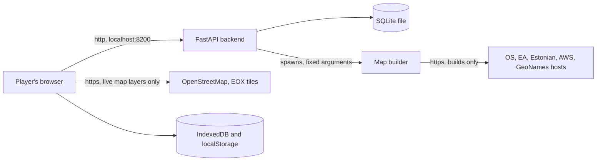

# Secure by Design review

This document says how well Site Guard follows Secure by Design practice, with the code as evidence and the gaps stated plainly. It is for a security reviewer or accreditor who needs to judge the app, and for a developer who has to close the gaps. The detailed register of protections and accepted limits is [SECURITY_NOTES.md](SECURITY_NOTES.md): this document links to it and does not repeat it.

Review date: 9 November 2026, branch `docs/handbook`, read from the code. Nothing here was exploited. The only command run was `npm audit --package-lock-only` (see [Dependencies](#6-dependencies)). No server was started, no test suite was run, and no code or configuration was changed.

## Contents

1. [Frameworks used, and what could not be verified](#1-frameworks-used-and-what-could-not-be-verified)
2. [Threat model](#2-threat-model)
3. [Secure defaults](#3-secure-defaults)
4. [Authentication and sessions](#4-authentication-and-sessions)
5. [Authorisation, route by route](#5-authorisation-route-by-route)
6. [Dependencies](#6-dependencies)
7. [Input validation at the trust boundaries](#7-input-validation-at-the-trust-boundaries)
8. [Secrets](#8-secrets)
9. [Privacy of a site's location](#9-privacy-of-a-sites-location)
10. [Logging and auditing](#10-logging-and-auditing)
11. [Resilience, and the disk-growth findings](#11-resilience-and-the-disk-growth-findings)
12. [Build and supply chain](#12-build-and-supply-chain)
13. [Testing of security behaviour](#13-testing-of-security-behaviour)
14. [Scorecard](#14-scorecard)
15. [Prioritised improvements](#15-prioritised-improvements)
16. [Limits and simplifications](#limits-and-simplifications)
17. [Where this lives in the code](#where-this-lives-in-the-code)

## 1. Frameworks used, and what could not be verified

| Framework | Status in this review |
|---|---|
| NCSC, [Secure development and deployment guidance](https://www.ncsc.gov.uk/collection/developers-collection) | Verified. The index page was fetched and lists eight principles. Their exact names are used in the [scorecard](#14-scorecard). Each principle's own page was not read, so the scoring uses the principle titles and the NCSC summary of them, not their full text. |
| CISA, [Secure by Design pledge](https://www.cisa.gov/securebydesign/pledge) | Verified. The page was fetched and lists seven goals, used in the scorecard. The pledge is written for software manufacturers who ship to many customers. Site Guard is a single-machine tool with no customers, so some goals apply only loosely. |
| UK MOD Secure by Design (JSP 440 and JSP 453, and the cross-government principles on [security.gov.uk](https://www.security.gov.uk/guidance/secure-by-design/principles)) | **Not verified.** The security.gov.uk principles page answered HTTP 403 to the fetch tool, and the MOD pages found by search ([digital.mod.uk](https://www.digital.mod.uk/secure-by-design/secure-from-the-start), [Defence Technology Principles](https://www.digital.mod.uk/service-manual/architecture/defence-technology-principles/make-your-technical-solution-secure)) answered 404 or were not retrievable. Search results confirm that the MOD requires Secure by Design, that JSP 440 and JSP 453 are the policy documents, and that a secondary source puts the mandate in JSP 440 Leaflet 5C. They did not give the principle names. This document does not list or paraphrase MOD principle names from memory. |

For the MOD, this document gives evidence organised by topic (sections 2 to 13). An accreditor can map that evidence onto the current MOD principles after reading them at source. JSP 440 and JSP 453 may also be restricted to MOD networks, which this review could not reach.

Also noted but not assessed: the NCSC's newer Software Security Code of Practice (reported in search results as 14 principles, voluntary) and Def Stan 05-138 (MOD supplier cyber requirements, Issue 4 dated 14 May 2024 according to a secondary source). Site Guard has no MOD contract, so neither is binding on it.

## 2. Threat model

Site Guard is a local, offline, single-machine tool. The backend binds to `127.0.0.1` ([`__main__.py:9`](../backend/app/__main__.py#L9)). Nothing is hosted, so the realistic attackers are few.

### Who could attack

| Attacker | How | Main control |
|---|---|---|
| A web page the player visits | Sends requests to `localhost:8200` from the player's browser, or tries DNS rebinding | Host check, JSON-only writes, no CORS, `SameSite=Strict` cookie, session required |
| Someone on the same network | Connects to the port | Loopback binding |
| Another local account on the same machine, or another local program | Registers an account, reads or deletes shared saves, fills the disk, reads files | Per-account packs only. Shared saves and disk growth are open (sections 5 and 11). Local programs are outside the model. |
| A malicious or corrupted data file | A crafted `.sgmap` map pack, an imported figures file, or a damaged national data download | Browser-side pack validation, builder size limits and checksums |
| A compromised dependency or data host | A poisoned package, or a hostile reply from a download host | Locked, hashed dependencies; fixed hosts over https; size and checksum checks (partial) |
| Someone with the laptop or disk | Reads the database, pack files, browser storage | Not encrypted. Relies on the operating system. |

### What matters

| Asset | Where it lives | Why it matters |
|---|---|---|
| **The location and layout of a real site being defended** | `spec` and `world` columns in the database, kept runs in browser `localStorage`, map packs in `~/site-guard-maps` and browser IndexedDB, map and data requests to outside hosts | The most sensitive asset. Sensor positions and gaps are what an adversary would want. See [section 9](#9-privacy-of-a-sites-location). |
| Account credentials | `users` table: scrypt hashes of password and recovery code | Protect the packs and profile of each account. |
| Session tokens | `sessions` table (SHA-256 of the token) and the cookie | Proof of sign-in. |
| Saves, run history and tuning figures | `laydowns`, `runs`, `figure_sets` tables | Player work. Run results are self-reported by the browser and are not proof of a score ([`records.py:69`](../backend/app/services/records.py#L69)). |
| Availability of the machine's disk | Database and map folders | A full disk stops the game and the machine. |

Out of scope by design: network attackers, multiple untrusted users, and hosting. [SECURITY_NOTES.md](SECURITY_NOTES.md#before-hosting) lists what hosting would need.

## 3. Secure defaults

| Default | Evidence | Verdict |
|---|---|---|
| Loopback-only binding | `host="127.0.0.1"` in [`__main__.py:9`](../backend/app/__main__.py#L9); Vite dev and preview servers also bind `127.0.0.1` ([`vite.config.js:7`](../frontend/vite.config.js#L7)) | Good. The port and host are hard-coded, so a mistaken environment variable cannot widen them. |
| Host header allowlist (stops DNS rebinding) | `ALLOWED_HOSTS = ["localhost", "127.0.0.1"]` ([`security.py:8`](../backend/app/security.py#L8)), applied by `TrustedHostMiddleware` ([`main.py:83`](../backend/app/main.py#L83)). Tests refuse `evil.example`, `192.168.1.5` and `[::1]`. | Good. `[::1]` is refused, which is safe because the server does not listen on IPv6. |
| Content Security Policy | [`security.py:11`](../backend/app/security.py#L11): `default-src 'none'`, scripts and styles from `self` only, no inline script, `connect-src 'self'`, `base-uri 'none'`, `form-action 'none'`, `frame-ancestors 'none'`. Images allow `self`, `data:`, `tile.openstreetmap.org` and `tiles.maps.eox.at`. | Strong for an app that renders with React and draws pack text on a canvas. The two image hosts are a privacy trade-off (section 9). |
| Other headers | `X-Content-Type-Options: nosniff`, `Referrer-Policy: no-referrer`, `Cross-Origin-Resource-Policy: same-origin`, `Cache-Control: no-store` on `/api/` and `no-cache` on HTML ([`security.py:63`](../backend/app/security.py#L63)). Headers are added by the outermost middleware, so refusals carry them too. | Good. No `Permissions-Policy` or `Cross-Origin-Opener-Policy`. Both are low value here. `frame-ancestors` covers framing, so `X-Frame-Options` is not needed on modern browsers. |
| JSON-only writes | `RequestGuard` returns 415 for any POST, PUT or PATCH whose type is not `application/json` ([`security.py:31`](../backend/app/security.py#L31)). | Good. A cross-site form cannot send JSON, and there is no CORS to allow a script to. DELETE needs no body and changes data, but the `SameSite=Strict` cookie and the host check cover it (see the note after this table). |
| 1 MiB body cap | `MAX_BODY_BYTES` ([`security.py:9`](../backend/app/security.py#L9)). The declared length is checked, then the bytes that actually arrive are counted, so chunked bodies cannot slip past. | Good. A missing `Content-Length` is treated as 0 and the arriving bytes are then counted. |
| `SameSite=Strict`, `HttpOnly` cookie, path `/api` | [`auth.py:40`](../backend/app/routes/auth.py#L40) | Good. Not `Secure`, because the game is served over plain http on localhost (accepted, see [SECURITY_NOTES.md](SECURITY_NOTES.md#accepted-limits)). |
| No CORS | No CORS middleware is installed. | Good. |
| Interactive docs off | `docs_url=None, redoc_url=None` because they load a CDN script ([`main.py:40`](../backend/app/main.py#L40)). | Good for offline use. The OpenAPI schema at `/api/v1/openapi.json` stays open without a session. It lists every route, which is low-risk on a local app. |
| Only the built game is served | `StaticFiles(directory=game)` ([`main.py:76`](../backend/app/main.py#L76)), with tests for traversal. | Good. |
| Errors do not echo input | Custom `RequestValidationError` handler returns the location and message only ([`main.py:69`](../backend/app/main.py#L69)). | Good. |

A state-changing DELETE with no JSON body is not stopped by the 415 rule. What stops a cross-site DELETE is the `SameSite=Strict` cookie (the browser does not send it from another site) together with the host check. Cookies ignore ports, so another web app on `localhost` could send the cookie, and then only the lack of CORS stops it reading or writing. That is accepted in SECURITY_NOTES. Adding a custom header requirement (for example `X-Requested-With`) to every non-GET request would remove the dependence on a single control.

## 4. Authentication and sessions

| Property | Value | Evidence |
|---|---|---|
| Password hashing | scrypt, N 2^14, r 8, p 1, 16-byte random salt, 32-byte output, compared with `hmac.compare_digest`. The parameters are stored in each hash string. | [`accounts.py:17`](../backend/app/services/accounts.py#L17) |
| Hash cost against current guidance | OWASP's Password Storage Cheat Sheet (fetched on the review date) lists N 2^14 only with p 5, and its stated minimum is N 2^17, r 8, p 1. Site Guard uses N 2^14 with p 1, which is **below** that guidance. The code comment gives about 16 MB and 50 ms. | Finding in [section 15](#15-prioritised-improvements). Note `hashlib.scrypt` has a default memory limit, so N 2^17 needs a `maxmem` argument. |
| Password rules | 10 to 128 characters, no character-class rules, must not equal the username. The 128 maximum bounds hashing work. | [`account_schemas.py:25`](../backend/app/account_schemas.py#L25) |
| Timing of unknown users | An unknown username is hashed against a dummy hash, so it takes as long as a wrong password. | [`accounts.py:60`](../backend/app/services/accounts.py#L60) |
| Lockout | Five failures lock an account for 5 minutes. Each try is counted in one SQL statement before the slow hash, so parallel tries still lock after five. Password and recovery-code tries share the count. | [`accounts.py:18`](../backend/app/services/accounts.py#L18), `count_attempt` in [`account_stores.py:48`](../backend/app/db/account_stores.py#L48) |
| Recovery code | 120 bits from `secrets.token_bytes(15)`, shown once at sign-up, stored only as a scrypt hash, replaced on every use. Case and dashes are ignored. | [`accounts.py:63`](../backend/app/services/accounts.py#L63), [ADR 0004](adr/0004-local-accounts-with-recovery-codes.md) |
| Account limit | 500 accounts. | [`accounts.py:22`](../backend/app/services/accounts.py#L22) |
| Session token | 256 bits from `secrets.token_urlsafe(32)`. Only its SHA-256 is stored. | [`accounts.py:120`](../backend/app/services/accounts.py#L120) |
| Session lifetime | 12 hours fixed, or 30 days with "Keep me signed in". The lifetime does not slide with use. Sign-out deletes the row. A password change signs out other sessions. A reset or account deletion signs out all of them. | [`accounts.py:20`](../backend/app/services/accounts.py#L20) |
| Re-authentication | Changing the password, replacing the recovery code and deleting the account all need the current password. | [`routes/auth.py:98`](../backend/app/routes/auth.py#L98) |
| Multi-factor | None. | See the CISA goal in section 14. |

Gaps worth knowing:

- **Hash cost is below OWASP's listed configurations** (above).
- **Hashes are not upgraded at sign-in.** The parameters live in the stored string, so raising the cost later is easy, but nothing re-hashes an old password when its owner signs in.
- **Lockout can be used to lock someone out.** Anyone who knows a username can keep it locked (accepted, SECURITY_NOTES). A locked account answers 429 where an unknown name answers 401, so the lock also confirms the account exists. Sign-up says when a username is taken. Both are accepted and low on a single-user machine.
- **Recovery is all-or-nothing.** There is no email and no administrator, which is a deliberate offline choice (ADR 0004). A lost password and code lose that account's packs.
- **A stolen recovery code is a full account takeover**, and it is a long-lived secret that the player must store somewhere. The 120-bit size and the lockout make guessing impractical.
- **Sessions are never revoked on lockout** and have no per-account cap (section 11).

## 5. Authorisation, route by route

Authorisation is checked in two layers. Every router except the auth router carries the `signed_in` dependency ([`main.py:45`](../backend/app/main.py#L45)), and the units store adds the account id to every query ([`account_stores.py:86`](../backend/app/db/account_stores.py#L86)). A test calls every route in the OpenAPI schema without a cookie and expects 401 for all but the open ones ([`test_accounts.py:133`](../backend/tests/test_accounts.py#L133)).

| Route group | Needs a session | Object-level control | Assessment |
|---|---|---|---|
| `GET /health` | No | None needed | Fine. |
| `POST /auth/register`, `sign-in`, `reset` | No | None needed. Limits: 500 accounts, lockout. | Fine. Open sign-up is accepted. |
| `POST /auth/sign-out` | No (it clears a cookie if one exists) | Deletes only the row for the presented token | Fine. |
| `GET/PUT /auth/me`, `POST /auth/password`, `/recovery-code`, `/delete-account` | Yes | Act on the session's own user id. Sensitive ones also need the password. | Good. |
| `/units` (deployment packs) | Yes | Every query includes `user_id`. Another account's pack is 404, not 403, so ids do not leak existence. 50 packs per account. | Good. Tested ([`test_units.py:69`](../backend/tests/test_units.py#L69)). |
| `/laydowns`, `/runs`, `/figure-sets` | Yes | **None.** Any signed-in account can read, replace or delete any row. There is no owner column. | Not met at object level, **by decision** ([ADR 0004](adr/0004-local-accounts-with-recovery-codes.md), SECURITY_NOTES). Acceptable only while every account belongs to the same trusted group. This is the largest authorisation gap if the app is ever shared. |
| `GET /packs`, `/packs/downloads`, `/packs/build`, `GET /packs/{name}` | Yes | None. Map packs are shared. `{name}` must match `^[A-Za-z0-9_-]{1,64}\.sgmap$` and be a file in the packs folder ([`packs.py:14`](../backend/app/services/packs.py#L14)). | Traversal is closed. Sharing is by design. |
| `POST /packs/build` | Yes | Any signed-in account can start a build that downloads gigabytes and writes into the shared maps folder. One build at a time. | Acceptable locally. Ties into the disk findings. |
| `/openapi.json` | No | None | Low. |

Roles: there are none, and no administrator. The first account has no more power than the 500th.

## 6. Dependencies

| Area | Evidence | Assessment |
|---|---|---|
| Frontend | Exact versions in [`package.json`](../frontend/package.json) (no `^` or `~`), four direct production dependencies (`leaflet 1.9.4`, `react 19.3.1`, `react-dom 19.3.1`, `three 0.160.0`) and a dev toolchain, and [`package-lock.json`](../frontend/package-lock.json) with integrity hashes (126 `integrity` entries). | Good. |
| Backend | Two direct dependencies (`fastapi`, `uvicorn`) with `>=` ranges in [`pyproject.toml`](../backend/pyproject.toml), resolved and hashed in [`uv.lock`](../backend/uv.lock) (fastapi 0.156.4, uvicorn 0.54.0, starlette 1.9.0, pydantic 2.14.1 in the lock). `exclude-newer = "2026-10-21"` means only releases at least two weeks old were resolved, a deliberate delay against freshly poisoned releases ([`pyproject.toml:13`](../backend/pyproject.toml#L13)). | Good. The `>=` ranges are safe only because the lock pins them, so installs must use the lock (`--locked` or `--frozen`). Whether the documented start command does was not checked. |
| Map builder | Five direct dependencies in [`tools/mapbuild/pyproject.toml`](../tools/mapbuild/pyproject.toml) (numpy, pyogrio, pyproj, rasterio, shapely), the same `exclude-newer` rule, a hashed `uv.lock`. The backend starts it with `uv run --frozen`, so the lock is honoured ([`packs.py:120`](../backend/app/services/packs.py#L120)). | Good. These packages bundle native libraries (GDAL, PROJ, GEOS), which is a larger attack surface than pure Python. The builder reads downloaded files with them. |
| Vulnerability checks | `npm audit --package-lock-only`, run on the review date, reported 0 vulnerabilities across 126 packages (6 production, 121 development). `pip-audit` was **not run** in this review. SECURITY_NOTES records both clean on 4 November 2026. | Manual and point-in-time. Nothing runs them automatically. |
| Updates | No Dependabot or Renovate configuration is in the repository. Updates are manual. The two-week delay is applied when someone runs the resolver. | Not met: no tracked update process or response time. |
| SBOM | None produced. | Not met. |

## 7. Input validation at the trust boundaries

### The HTTP API

[`schemas.py`](../backend/app/schemas.py) and [`account_schemas.py`](../backend/app/account_schemas.py) define every request. The base class forbids unknown fields and non-finite numbers ([`schemas.py:66`](../backend/app/schemas.py#L66)). Identifiers are `Literal` lists (a test compares them with the frontend config so they cannot drift). Coordinates are bounded to the world, strings have length limits and a control-character check, lists are capped (200 systems, 20,000 commands, 50 people groups, 32 zone points), and ids in paths are bounded to the SQLite integer range. SQL uses bound parameters only, and a test reads the store source to enforce it. The one place a column name is built into SQL (`update` in the account store) checks the names against an allowlist first ([`account_stores.py:38`](../backend/app/db/account_stores.py#L38)).

Weak spots, all low:

- `Command.args` is a list of up to 8 arbitrary JSON values, and 20,000 commands are allowed, so a run can carry up to the 1 MiB body in free-form data.
- Run results (kills, leaks, budget) are range-checked but not verified. They come from the browser and cannot be trusted as scores.

### Pack files in the browser

A `.sgmap` file is treated as untrusted. [`pack-store.js`](../frontend/src/api/pack-store.js) checks, before and during use:

| Check | Where |
|---|---|
| Magic, version, header length at most 1 MiB, section offsets and lengths inside the file | `decodePack` ([`pack-store.js:47`](../frontend/src/api/pack-store.js#L46)) |
| Grid sizes agree with the header (`N` squared cells, heights 4 bytes each) before anything is unpacked | same function |
| Declared unpacked sizes are limited (64 MiB per grid, 32 MiB of features), and decompression stops if the stream is longer or shorter than declared | `gunzip` |
| SHA-256 of the four grids equals the header's `gridsSha256` | [`pack-store.js:72`](../frontend/src/api/pack-store.js#L72) |
| Every height, building, line, road and name is checked by `parsePack` before use | [`world-pack.js`](../frontend/src/sim/world-pack.js) |
| A picture is shown only if it is PNG or JPEG and its own header gives at most 8192 x 8192 pixels, read before the image decoder sees it | `pixelsOf` ([`pack-store.js:32`](../frontend/src/api/pack-store.js#L32)) |
| A pack fetched from the server must hash to the same value that the listing gave | `load` |
| Names from a pack are only drawn on a canvas or inserted as text, never as HTML | [`site-map.js`](../frontend/src/ui/site-map.js#L38) |

The fingerprint is an integrity check against damage and swaps. It is **not authentication**: the hash is inside the file it protects, so whoever can edit the file can recompute it. Any pack source is trusted as far as its content passes validation, no further. There is no signature.

### Builder inputs

The backend builds a command as a list, with no shell, and with numbers that Pydantic has bounded and checked against the supported grids ([`routes/packs.py:15`](../backend/app/routes/packs.py#L15), [`packs.py:120`](../backend/app/services/packs.py#L120)). A test asserts a list command with no `shell` option ([`test_packs.py:99`](../backend/tests/test_packs.py#L99)). The output name derives from integers (`area_<east/1000>_<north/1000>`), so a client cannot choose a path.

Inside the builder:

| Control | Evidence |
|---|---|
| OS downloads: host must be `api.os.uk` over https, file name must be a plain name, size and MD5 must be present, never more than the stated size is written, the MD5 must match, and the file is renamed into place only after both checks | [`download.py:21`](../tools/mapbuild/mapbuild/download.py#L21) |
| Terrain 50 zip members over 100 MB are refused before unpacking | [`terrain.py:44`](../tools/mapbuild/mapbuild/terrain.py#L44), tested |
| Copernicus and GeoNames downloads are read with a byte cap and checked (ETag MD5 for Copernicus, a zip test for GeoNames) | [`copernicus.py:46`](../tools/mapbuild/mapbuild/copernicus.py#L46), [`geonames.py:27`](../tools/mapbuild/mapbuild/geonames.py#L27) |
| Estonian files come from fixed addresses, resume with `Range`, and are checked by opening them (whole zip test, or a raster read). The agency publishes no checksums. | [`estonia_files.py:50`](../tools/mapbuild/mapbuild/estonia_files.py#L50) |
| A pack with more than 32 MiB of features is not written | [`packfile.py:65`](../tools/mapbuild/mapbuild/packfile.py#L65), tested |

Limits of the builder's checks:

- The OS MD5 comes from the same API reply as the file address, so it detects corruption, not a hostile or compromised server. MD5 is used only as the publisher's checksum, with `usedforsecurity=False`.
- `urllib` follows redirects by default. The host check applies to the first URL only.
- Several replies are read without a byte cap: the Environment Agency lidar reply ([`terrain.py:106`](../tools/mapbuild/mapbuild/terrain.py#L106)), each Estonian map tile ([`estonia.py:190`](../tools/mapbuild/mapbuild/estonia.py#L190)) and the satellite search reply. These are fixed https hosts, so the risk is memory exhaustion from a faulty reply, not code execution.
- The satellite step enables `PROJ_NETWORK` so PROJ can fetch a datum grid from `cdn.proj.org` ([`pictures.py:92`](../tools/mapbuild/mapbuild/pictures.py#L92)). That is a further outside host, documented in SECURITY_NOTES.
- No `pickle`, `eval`, `os.system` or `subprocess` is used in the builder (searched in `tools/mapbuild/mapbuild`). Zip files are read in memory or through GDAL, never extracted to disk paths.

## 8. Secrets

| Check | Result |
|---|---|
| Configured secrets | None. No API keys, tokens or signing keys exist. The two environment variables, `SITE_GUARD_DB` and `SITE_GUARD_MAPS`, are paths. |
| Secrets in git | `git ls-files` shows no `.env`, key, certificate or secret file. `.gitignore` excludes the database (`backend/data/`), packs (`*.sgmap`), `node_modules`, `dist`, virtual environments and `.claude/`. A content search for credentials in history was not run. |
| Stored credentials | Only scrypt hashes and SHA-256 session hashes in the database. Plain recovery codes and passwords are never stored (a test checks this). |
| Third-party identifiers | The Estonian tile URL carries a fixed application label ([`estonia.py:46`](../tools/mapbuild/mapbuild/estonia.py#L46)). It is a name, not a credential. |
| Database protection | The database and map folder use the operating system's default permissions. The code does not set a mode or an ACL, and the database is not encrypted. |

## 9. Privacy of a site's location

The location of a real site is the most sensitive data. The design principle is that nothing about it leaves the machine unless the player asks for a map layer that needs it. Table of what reaches outside servers:

| Contact | When | What it reveals | Control |
|---|---|---|---|
| OpenStreetMap tiles (`tile.openstreetmap.org`) | The start-screen Leaflet map opens on the world, and the default style is `Street` ([`site-map.js:75`](../frontend/src/ui/site-map.js#L75)), so the tile server is contacted as soon as it opens. Panning to a site then reveals its area. | The tile coordinates viewed, and the machine's IP address | **No live map** option, remembered in `localStorage` ([`site-map.js:22`](../frontend/src/ui/site-map.js#L22)). It is not the default. A player must choose it before looking at a sensitive site. |
| EOX satellite and labels (`tiles.maps.eox.at`) | Only after the Satellite or Hybrid style is chosen | The area viewed | Allowed for images only by the CSP. |
| OpenStreetMap tiles on the 3D ground | Only when the live base map is chosen ([`map-texture.js:53`](../frontend/src/render/map-texture.js#L53)) | The area of the world | Off unless chosen, per SECURITY_NOTES. |
| Map build, British | Pressing **Build this map** | The chosen spot, sent to the backend in a POST body, then to OS, the Environment Agency (a WCS request with eastings and northings), AWS Sentinel data and `cdn.proj.org` | Use a pack built beforehand, and no live layer, for a sensitive site. |
| Map build, Estonian | Same | The area, through `tiles.maaamet.ee` and AWS. The national file downloads say nothing about the area. | Same. |
| The player's own position | Never sent. Stays in the browser unless the player deploys there. | None | [SECURITY_NOTES.md](SECURITY_NOTES.md#accepted-limits) |
| Referrer | The page sends no referrer, apart from the OpenStreetMap layer, which uses `strict-origin-when-cross-origin` because OSM's tile policy asks for one. That layer sends only the origin `http://localhost:8200`, not a path. | The page origin | [`site-map.js:66`](../frontend/src/ui/site-map.js#L66) |

Where the location is stored at rest, unencrypted:

- The SQLite `spec` and `world` columns of saved laydowns and runs, in `backend/data/siteguard.db`.
- Kept runs in browser `localStorage` (`site-guard.unsaved-runs`, up to 50) until the server accepts them ([`run-saver.js:6`](../frontend/src/api/run-saver.js#L6)).
- Map packs, whose header has the area's eastings and northings, in `~/site-guard-maps/packs` and in browser IndexedDB.
- The deployed pack's id and owner's username, kept in `localStorage` ([`Root.jsx:15`](../frontend/src/ui/account/Root.jsx#L15)).

Assessment: the controls are good for a tool with an offline mode, but the default start map does contact OpenStreetMap, and the safe choice must be made by hand each time on a new browser profile. A defence deployment would want the default flipped to **No live map**, or the live layers removed in a build flag.

## 10. Logging and auditing

There is **no application logging**. A search of `backend/app` finds no `logging` import and one `print`, the start banner ([`__main__.py:8`](../backend/app/__main__.py#L8)). Uvicorn's default console access log records request lines, not bodies, and is not kept.

What is therefore not recorded: failed sign-ins and lockouts, account creation and deletion, password and recovery-code changes, who triggered a map build, and rejected requests. The database holds `last_sign_in` and `created_at` per account, and a `created_at` or `finished_at` on records, but no actor on shared records.

Sensitive data in logs: none is written, because nothing is logged. Passwords, codes and session tokens are never echoed (validation errors omit input, a test checks it).

This is consistent with a single-user offline tool, but it is a gap against "evidence of intrusions" goals and against any accreditation that expects an audit trail. A small security event log (sign-in failure, lockout, reset, account change, build start) in the database or a local file would close most of it.

## 11. Resilience, and the disk-growth findings

What is resilient:

- Migrations are numbered SQL files, each applied in one transaction, and the game refuses to open a database written by a newer version ([`connection.py`](../backend/app/db/connection.py#L32)).
- Foreign keys are on, so deleting an account removes its sessions and packs ([`connection.py:19`](../backend/app/db/connection.py#L19)).
- Runs finished while the server is down are kept in the browser and sent later. A run the server refuses is reported and dropped, and an uncertain one may be saved twice rather than lost ([`run-saver.js`](../frontend/src/api/run-saver.js#L9)).
- Only one map build runs at a time, and the builder process is separate from the web server.
- A damaged or truncated pack is refused by the browser's size and fingerprint checks.

What is not: no backup or export of the database, no write-ahead logging or timeout settings changed from the SQLite defaults, and the build status is held in memory and lost at restart.

### Disk-growth findings (audit of 9 November 2026)

Each was checked in the code on the review date. All need someone on the same machine, because the server binds to `127.0.0.1`. None is remotely exploitable, but together they let a local user, a faulty client, or a long-running install fill the disk. The first is already accepted in SECURITY_NOTES.

| # | Finding | Verified at | Severity | Effort to fix |
|---|---|---|---|---|
| 1 | **No row cap on saved runs, laydowns and figure sets.** Each insert is limited to a 1 MiB body, but nothing limits how many. Already an accepted limit. | [`stores.py:15`](../backend/app/db/stores.py#L15), [`services/records.py:38`](../backend/app/services/records.py#L38): no count check. Contrast with units, which check 50 ([`units.py:30`](../backend/app/services/units.py#L30)) | Low | Small |
| 2 | **A run can be stored at two to three times its request size.** `json.dumps` is called with the default `ensure_ascii=True`, so a non-ASCII character is written as `\uXXXX`. Checked with Python: `é` is 2 bytes in UTF-8 and 6 once escaped; a Chinese character is 3 and 6; an emoji is 4 and 12. A 1 MiB body of free-text in `Command.args` can therefore take 2 to 3 MiB in the database. | [`stores.py:70`](../backend/app/db/stores.py#L70) (runs), also lines 31, 39 and 98 | Low | Small: pass `ensure_ascii=False` (SQLite stores text as UTF-8) |
| 3 | **The database is never vacuumed.** No `VACUUM`, `auto_vacuum` or `incremental_vacuum` appears in the backend. Deleted runs leave free pages that SQLite reuses but never returns to the operating system, so the file only grows. | A search of `backend/app` and the migrations finds none | Low | Small to medium: set `auto_vacuum` at creation, or offer a compact button |
| 4 | **Sessions have no per-account cap for 30 days.** Each sign-in adds a row. Expired rows are removed only when a new session starts ([`accounts.py:120`](../backend/app/services/accounts.py#L120), [`account_stores.py:73`](../backend/app/db/account_stores.py#L73)). A script that knows the password can add rows at the rate of one scrypt hash each. Accepted in SECURITY_NOTES because it needs the password. | See left | Low | Small: delete an account's oldest rows above, say, 20 |
| 5 | **Map pack builds pile up, with no cap or delete, and no free-space check for British builds.** `area_<km>_<km>.sgmap` is a new file for each area, and no route deletes one (`routes/packs.py` has list, downloads, status, build and get only). `download.py` has no `disk_usage` check. The Estonian path checks for 8 GB free once, before the national files, only when files are missing ([`estonia_files.py:25`](../tools/mapbuild/mapbuild/estonia_files.py#L25)), and never checks room for the pack itself. A signed-in account can start builds back to back. Rebuilding the same square overwrites in place. | [`packs.py:116`](../backend/app/services/packs.py#L116), [`download.py:21`](../tools/mapbuild/mapbuild/download.py#L21) | Medium: each pack and its source data run to gigabytes | Medium |
| 6 | **The pack is written straight to its final name.** `write_pack` opens the output path with `"wb"` ([`packfile.py:74`](../tools/mapbuild/mapbuild/packfile.py#L74)). A crash or a full disk mid-write leaves a truncated `.sgmap`, and a rebuild overwrites a good pack in place. The list shows a file whose header reads, and the browser then refuses it as damaged, so it fails safe but is confusing. The downloads, by contrast, use a `.part` file and `os.replace`. | See left | Low to medium | Small: write `name.part`, then `os.replace` |
| 7 | **An Estonian download has no size cap when the server omits `Content-Length`.** `total` is `None` in that case ([`estonia_files.py:74`](../tools/mapbuild/mapbuild/estonia_files.py#L74)), and the loop condition `not (total and done > total)` is then always true, so it reads until the server stops. The `ROOM_NEEDED` check ran earlier but does not stop a stream. The OS download is capped by the declared size, so this differs from it. | [`estonia_files.py:77`](../tools/mapbuild/mapbuild/estonia_files.py#L77) | Low to medium: fixed https hosts, so it needs a faulty or hostile reply | Small: refuse a download over a known maximum, and one that exceeds free space |
| 8 | **Packs imported into the browser are never deleted.** `createPackStore` returns `list`, `downloads`, `load`, `fileOf`, `importFile` and `get`. There is no remove, and each import calls `navigator.storage.persist()` and keeps the whole file in IndexedDB ([`pack-store.js:170`](../frontend/src/api/pack-store.js#L170)). Packs are tens of megabytes. They also keep a site's area on disk after a player thinks it is gone. | [`pack-store.js:102`](../frontend/src/api/pack-store.js#L102) | Low to medium. It also affects privacy. | Small to medium: a delete button and a `delete` in the store |

A related, minor point: the build status, the list and the downloads route are open to any signed-in account, so one account's builds fill the disk for all.

## 12. Build and supply chain

- **There is no continuous integration.** The repository has a GitHub remote but no `.github` directory and no other workflow files. [TODO.md](TODO.md#L16) lists adding CI (both test suites, the builder's tests, the reference digests, the build, `npm audit` and `pip-audit`) as not done.
- Consequence: tests, dependency scans and the production build run only when someone remembers to run them. The reference digests (which detect unintended simulation changes) have the same limit. There is no branch protection to point at.
- The frontend build is `vite build` from locked dependencies, producing `frontend/dist`, which the backend serves. The build is not reproducible-checked, signed or attested. No release artefact exists to sign, since the app is run from source.
- Install-time scripts: not reviewed. npm package install scripts in the lock were not inspected.
- Two-week release delay for Python packages (see section 6) is the one supply-chain control that is built into the configuration.
- Third-party data: OS, Environment Agency, Estonian, Copernicus and GeoNames data and licences are covered by [REAL_MAPPING_PLAN.md](REAL_MAPPING_PLAN.md) and [SECURITY_NOTES.md](SECURITY_NOTES.md).

## 13. Testing of security behaviour

| Area | Tests |
|---|---|
| Headers, hosts, body limits | [`test_security.py`](../backend/tests/test_security.py): rebound hosts refused, local hosts allowed, non-JSON writes 415, charset accepted, no CORS preflight, declared, hidden (chunked) and bogus sizes refused, security headers on every response including refusals, docs off, only the built game reachable |
| Input | The same file: bad laydowns and runs, non-finite numbers, errors that do not echo input, broken JSON, hostile text stored as data, bad ids and paging, bound-parameter source check |
| Accounts | [`test_accounts.py`](../backend/tests/test_accounts.py): sign-up, case-insensitive usernames, 500-account limit, no secret stored as written, lockout after five failures, simultaneous tries still lock, expiry, made-up cookie, **every route in the schema refused without a session**, recovery reset, password change signs out others, account deletion, column allowlist |
| Object-level access | [`test_units.py:69`](../backend/tests/test_units.py#L69): another account cannot see or touch a pack. There is no test for shared saves, because they are shared by design. |
| Packs and builder | [`test_packs.py`](../backend/tests/test_packs.py): traversal and odd names, fixed arguments with no shell, one build at a time, a cross-site form cannot start a build, grid validation. [`test_untrusted_input.py`](../tools/mapbuild/tests/test_untrusted_input.py): oversized zip member, oversized feature set. |
| Frontend | [`boundary.test.js`](../frontend/tests/boundary.test.js) bans `innerHTML`, `dangerouslySetInnerHTML`, `insertAdjacentHTML` and `document.write`; [`pack-limits.test.js`](../frontend/tests/pack-limits.test.js) covers picture size limits; pack, account and save-client tests exist in the same folder |
| Coverage | The backend fails below 90 percent line and branch coverage ([`pyproject.toml:19`](../backend/pyproject.toml#L19)) |

Not covered, as far as this review found: the Estonian and OS download size and checksum paths (the builder tests exercise packing and reading, and the two limits above); the disk-growth findings; behaviour of the session cookie flags in a real browser (the notes record a manual check); dynamic scanning (no scanner such as OWASP ZAP was run); fuzzing of the pack decoder; static analysis (no Bandit, Semgrep or ESLint security rules are configured). Static analysis and `pip-audit` were not run in this review.

## 14. Scorecard

Ratings: Met, Partly met, Not met. "Not applicable" is used only where a CISA goal concerns a vendor relationship that does not exist here. The MOD principles are **not scored**, because their text could not be verified (section 1).

### NCSC secure development and deployment guidance (principle names as listed on the NCSC index)

| # | Principle | Rating | Evidence |
|---|---|---|---|
| 1 | [Secure development is everyone's concern](https://www.ncsc.gov.uk/collection/developers-collection/principles/secure-development-is-everyones-concern) | Partly met | Security is in the project instructions, two independent reviews are recorded, and a risk register exists. It relies on one maintainer and has no named security owner or process. |
| 2 | [Keep your security knowledge sharp](https://www.ncsc.gov.uk/collection/developers-collection/principles/keep-your-security-knowledge-sharp) | Partly met | The register and ADRs show current thinking (for example the lockout race fix). No training or threat-intelligence process is recorded. This is hard to judge from code. |
| 3 | [Produce clean & maintainable code](https://www.ncsc.gov.uk/collection/developers-collection/principles/produce-clean-maintainable-code) | Met | A 350-line file limit is enforced by a test ([`boundary.test.js`](../frontend/tests/boundary.test.js#L49)), layered routes, services and stores, strict schemas, 90 percent backend coverage gate. |
| 4 | [Secure your development environment](https://www.ncsc.gov.uk/collection/developers-collection/principles/secure-your-development-environment) | Partly met | The developer's machine and credentials are outside the repository, so this is rated on repository evidence alone: `.gitignore` keeps data and packs out of git. |
| 5 | [Protect your code repository](https://www.ncsc.gov.uk/collection/developers-collection/principles/protect-your-code-repository) | Partly met | A GitHub remote exists. No branch protection, signed commits, `CODEOWNERS` or secret scanning is visible from the repository. This review could not read the GitHub settings. |
| 6 | [Secure the build and deployment pipeline](https://www.ncsc.gov.uk/collection/developers-collection/principles/secure-the-build-and-deployment-pipeline) | Not met | No CI or pipeline exists. Builds are local and unattested. |
| 7 | [Continually test your security](https://www.ncsc.gov.uk/collection/developers-collection/principles/continually-test-your-security) | Partly met | A strong automated security test set and two manual reviews, but nothing runs continuously, there is no SAST or DAST, and dependency audits are manual. |
| 8 | [Plan for security flaws](https://www.ncsc.gov.uk/collection/developers-collection/principles/plan-for-security-flaws) | Partly met | Accepted limits are written down and a hosting checklist exists. There is no vulnerability disclosure route, no `SECURITY.md`, no patch process and no incident or recovery plan. |

### CISA Secure by Design pledge goals

| # | Goal | Rating | Evidence |
|---|---|---|---|
| 1 | Multi-factor authentication | Not met | Password plus recovery code only. A local single-user tool may reasonably decline this, but it is not offered. |
| 2 | Default passwords | Met | There are no default accounts or passwords. The first account is made by the person using it. |
| 3 | Reducing entire classes of vulnerability | Met | Strict schemas remove unknown input. Bound parameters remove SQL injection (enforced by a test). React escaping plus a ban on string HTML and a strict CSP remove most XSS. No shell use removes command injection. Memory safety comes from Python and JavaScript. |
| 4 | Security patches | Partly met | Dependencies are locked and a delay rule exists, but updates are manual and there is no patch release process. Single-user tool, so adoption statistics do not apply. |
| 5 | Vulnerability disclosure policy | Not met | No `SECURITY.md` or `security.txt`. |
| 6 | CVEs | Not applicable | The project publishes no product to customers. |
| 7 | Evidence of intrusions | Not met | No security logging (section 10). |

### Design topics for MOD Secure by Design evidence (not scored)

| Topic | State |
|---|---|
| Threat model | Written in SECURITY_NOTES and in section 2 here. Sound for local use, with the real-site location named as the main asset only in this document. |
| Secure defaults | Strong (section 3). |
| Authentication and authorisation | Sound for accounts and units. Saves, runs and figure sets have no object-level control (section 5). |
| Data protection at rest | Not met: no encryption of the database, packs or browser storage. |
| Data protection in transit | Loopback http only. Outside contact is limited to map layers and builds, over https. |
| Logging and monitoring | Not met. |
| Supply chain | Partly met: locked and delayed, but no CI, SBOM or update process. |
| Resilience and recovery | Partly met: good migrations and run-saving, no backup, and the disk findings. |

## 15. Prioritised improvements

Effort: small is under a day, medium is a few days, large is more than a week.

| Priority | Improvement | Why | Effort |
|---|---|---|---|
| 1 | Add CI that runs both test suites, the builder tests, `npm audit` and `pip-audit` on every push, and on a schedule | Closes NCSC principles 6 and 7 and makes the dependency checks continuous. Already in TODO.md. | Medium |
| 2 | Make **No live map** the default start-map style, or add a build setting that removes live layers | The default start map contacts OpenStreetMap, which is the only routine route by which a viewed site's area leaves the machine | Small |
| 3 | Add a delete for imported browser packs, and a delete route and button for built map packs | Closes disk findings 5 and 8 and removes a site's area from disk when asked | Small to medium |
| 4 | Write packs to a `.part` file and rename them, check free space before every build, and add a size cap to the Estonian download when `Content-Length` is missing | Closes disk findings 5, 6 and 7 | Small |
| 5 | Store JSON with `ensure_ascii=False`, and add row caps for runs, laydowns and figure sets (for example 1,000 runs, with the oldest offered for deletion) | Closes disk findings 1 and 2 | Small |
| 6 | Add a security event log (failed sign-in, lockout, reset, account change, build start, 4xx on writes) | Gives evidence of intrusion and an audit trail | Small to medium |
| 7 | Raise the scrypt cost to an OWASP-listed configuration, and re-hash at sign-in when the stored parameters are weaker | The current cost is below OWASP's listed options. The stored parameters already make this possible. | Small |
| 8 | Cap sessions per account, and clear expired rows on a timer or at start-up | Closes disk finding 4 | Small |
| 9 | Set `auto_vacuum` (or offer a compact action) and consider an export or backup of the database | Closes disk finding 3 and adds recovery | Small to medium |
| 10 | Add `SECURITY.md` with a reporting route, a branch-protection and secret-scanning setup on GitHub, and Dependabot or Renovate | Closes NCSC principles 5 and 8 and CISA goal 5, and makes updates tracked | Small |
| 11 | Require a custom header on every non-GET API request as a second control behind `SameSite` | Removes reliance on one control for DELETE and for other apps on `localhost` | Small |
| 12 | Decide whether laydowns, runs and figure sets get owners, and either add an owner column and checks or record the decision as an ADR | The largest authorisation gap if more than one trusted group ever shares a machine | Medium |
| 13 | Add static analysis (Bandit or Semgrep for Python, an ESLint security rule set), a fuzz test for `decodePack`, and one DAST pass with a local scanner against a throwaway instance | Fills the testing gaps in section 13 | Medium |
| 14 | Encrypt data at rest, or document the dependence on full-disk encryption as a deployment requirement | Saves and packs hold a site's layout and location | Large for application-level encryption, small to document |
| 15 | Cap the remaining unbounded builder reads, and stop following redirects off the approved host | Closes the smaller builder points in section 7 | Small |
| 16 | Produce an SBOM from the two lock files with each release | Supply-chain evidence | Small |

## Limits and simplifications

- This is a code and configuration review. No server was run, no request was sent, and no test suite was run. Findings are from reading the code, plus one `npm audit` and one Python check of `json.dumps` escaping.
- The MOD Secure by Design principles could not be retrieved, so no MOD scoring is given.
- `pip-audit`, static analysis and dynamic scanning were not run.
- GitHub repository settings (branch protection, secret scanning, Dependabot alerts enabled at account level) were not visible from the checkout, so a few "not met" ratings may be "met" in settings. Check them.
- The ratings are judgements against short principle titles, not audits against the full text of each principle.
- The threat model suits a single machine. Hosting would change most ratings, as [SECURITY_NOTES.md](SECURITY_NOTES.md#before-hosting) says.

## Where this lives in the code

- [`backend/app/security.py`](../backend/app/security.py): headers, host list, body cap and JSON-only guard.
- [`backend/app/main.py`](../backend/app/main.py): app assembly, middleware order, router session dependencies, error handlers.
- [`backend/app/__main__.py`](../backend/app/__main__.py): loopback binding and port.
- [`backend/app/services/accounts.py`](../backend/app/services/accounts.py): hashing, lockout, recovery codes, sessions.
- [`backend/app/routes/auth.py`](../backend/app/routes/auth.py): cookie flags and the `signed_in` check.
- [`backend/app/db/account_stores.py`](../backend/app/db/account_stores.py) and [`stores.py`](../backend/app/db/stores.py): SQL and per-account scoping.
- [`backend/app/schemas.py`](../backend/app/schemas.py) and [`account_schemas.py`](../backend/app/account_schemas.py): strict request shapes.
- [`backend/app/services/packs.py`](../backend/app/services/packs.py): pack listing, name check and builder launch.
- [`tools/mapbuild/mapbuild/`](../tools/mapbuild/mapbuild): downloads, checksums, size limits and pack writing.
- [`frontend/src/api/`](../frontend/src/api): client, pack decoding and storage, run saver.
- [`frontend/src/ui/site-map.js`](../frontend/src/ui/site-map.js): live map layers and the **No live map** choice.
- [`backend/tests/`](../backend/tests), [`tools/mapbuild/tests/`](../tools/mapbuild/tests), [`frontend/tests/`](../frontend/tests): the security tests listed in section 13.
- [SECURITY_NOTES.md](SECURITY_NOTES.md), [adr/0004](adr/0004-local-accounts-with-recovery-codes.md): the register and the account decision.
